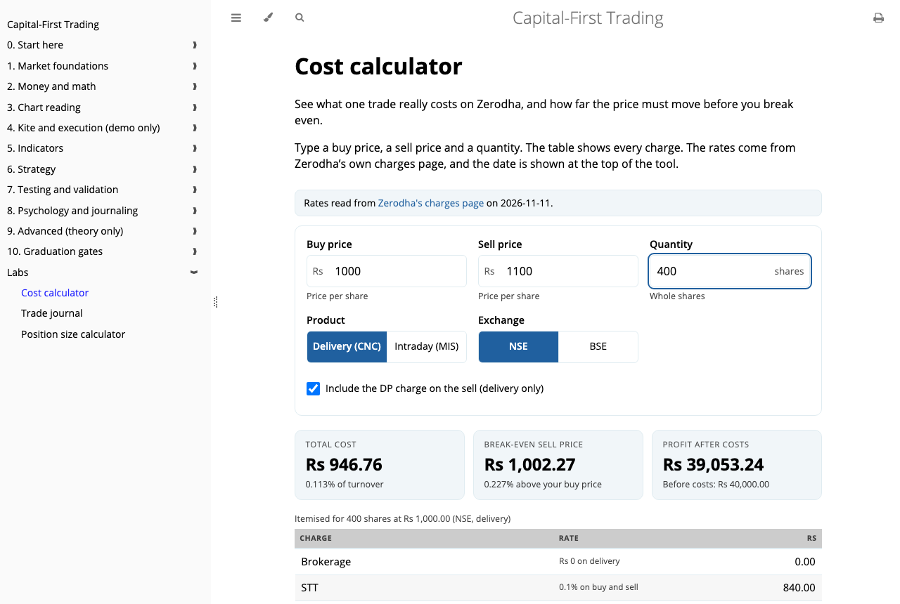
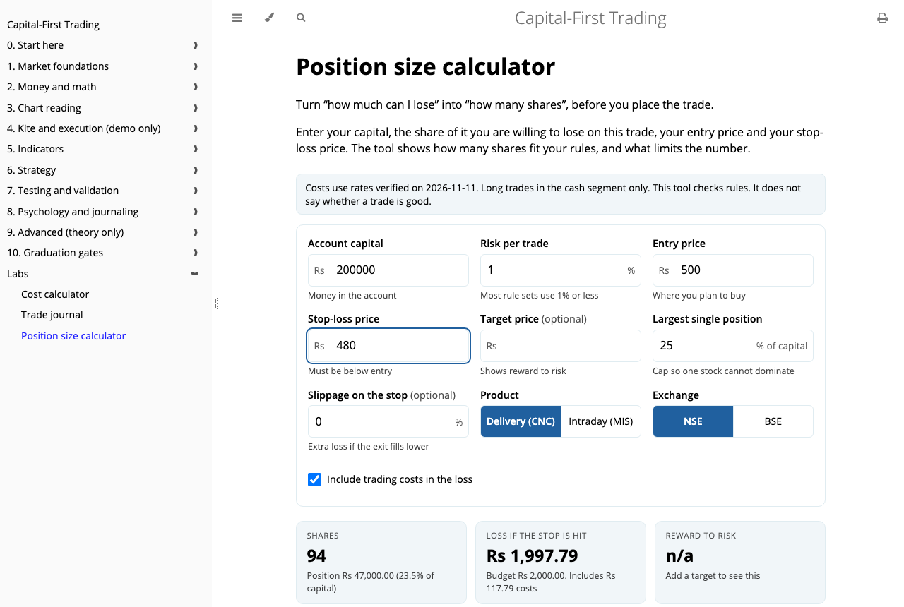
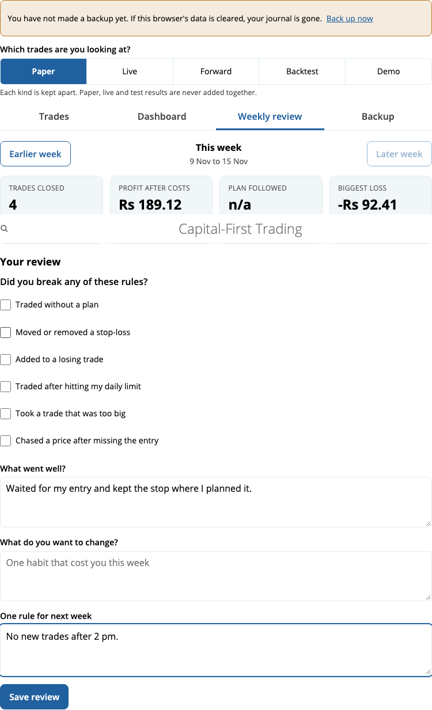
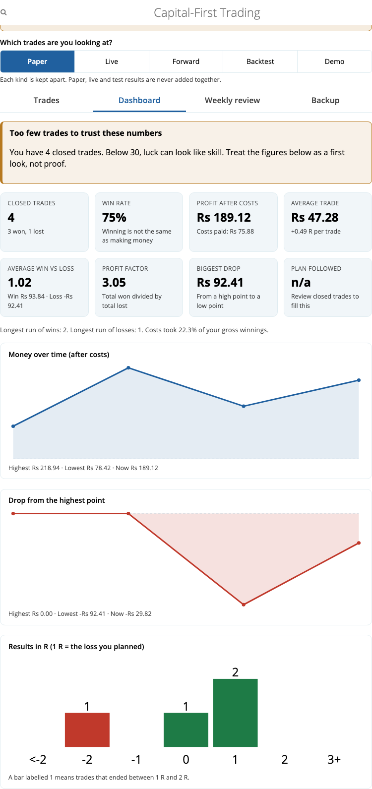
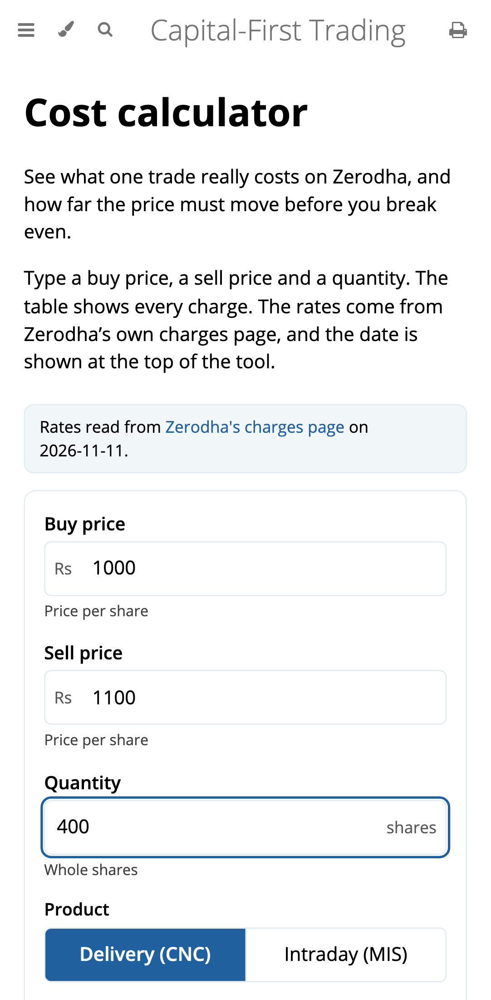

<div align="center">

# Capital-First Trading

**A free, offline study book for the Indian stock market. It teaches you to protect your money before you try to grow it.**

99 chapters · interactive demos · five working tools · no accounts · no server · nothing leaves your device

[](LICENSE)


**[Read it online](https://ranjeet-h.github.io/capital-first-trading/)** ·
[Repository](https://github.com/ranjeet-h/capital-first-trading) ·
[Master plan](PLAN.md) ·
[Tool specs](LABS.md) ·
[Report a problem](https://github.com/ranjeet-h/capital-first-trading/issues)

</div>

<br>

<p align="center">
  
</p>

## Why this exists

Most trading material starts with how to win. This book starts with how not to lose everything.

It is written in plain English, for readers of any age, for people who trade through **Zerodha Kite**. Every chapter ends with a quiz. Most chapters have an interactive demo you can play with. The tools do the real maths, using the real charges, so you see what a trade truly costs before you place it.

> **Education only.** This is a study project, not investment advice. Markets can lose you money. Rules, rates and taxes change, and every fact in the book carries the date it was checked.

## What you get

| | |
|---|---|
| 📚 **99 chapters in 11 tracks** | From "what is a share" to graduation gates that decide when you are ready. Each has a quiz. |
| 🎮 **Interactive demos** | Draw support and resistance, step through candles, click through a view-only copy of Kite, watch a losing streak happen to you. |
| 🧮 **Cost calculator** | Matches Zerodha's own calculator to the paisa. Shows every charge, the break-even price, and the profit after costs. |
| 📏 **Position size calculator** | Give it your capital and the most you will risk. It tells you how many shares, and warns you when a plan is unsafe. |
| 📓 **Trade journal** | Plan before you buy, record buys and sells in parts, review each trade, then read your own numbers. |
| 🧪 **Strategy tester** | Test simple rules on made-up prices with real Zerodha costs, then run experiments that show why backtests lie (peeking, lost shares, many settings, higher costs). |
| 🔭 **Forward test** | A small script you run once a day on your own computer. It logs what a fixed rule would have done on new prices. Bring the log into the journal and compare it with earlier days. It places no orders. |
| 🗓️ **Weekly review** | Look at the week, tick the rules you broke, and write one rule for next week. |
| 📴 **Fully offline** | Install it like an app. No internet needed after the first visit. |
| 🔒 **Private by design** | Your journal lives only in your browser. Backups are files you control, with optional passphrase locking. |

## See it

<table>
  <tr>
    <td width="50%"><br><sub><b>Position size.</b> How many shares can you afford to risk?</sub></td>
    <td width="50%"><br><sub><b>Weekly review.</b> Learn from the week, then set one rule.</sub></td>
  </tr>
  <tr>
    <td><br><sub><b>Dashboard.</b> Win rate, drawdown, and an honest warning when you have too few trades to trust.</sub></td>
    <td align="center"><br><sub><b>Built for phones.</b> Big tap targets, no sideways scrolling.</sub></td>
  </tr>
</table>

## The tracks

| # | Track | Chapters |
|---|---|---|
| 0 | Start here | 3 |
| 1 | Market foundations | 10 |
| 2 | Money and math | 18 |
| 3 | Chart reading | 9 |
| 4 | Kite and execution (demo only) | 10 |
| 5 | Indicators | 10 |
| 6 | Strategy | 7 |
| 7 | Testing and validation | 11 |
| 8 | Psychology and journaling | 7 |
| 9 | Advanced (theory only) | 7 |
| 10 | Graduation gates | 7 |

## What makes it different

- **Capital first.** The first rules you meet are about limits, not profits.
- **Honest numbers.** The journal warns you when fewer than 30 trades make your results meaningless. It never mixes paper, live and test trades.
- **Costs are never hidden.** Charges are checked against Zerodha's official calculator, rounding rules included, with a date shown beside them and a warning when they go stale.
- **Money is exact.** All amounts are whole paise inside the code, so no rounding drift.
- **No tracking, no sign-up, no network calls.** Open it on a plane.
- **Mobile first.** 44 px tap targets, 16 px inputs, no horizontal scroll, enforced by tests.

## Read it online

Open **https://ranjeet-h.github.io/capital-first-trading/**. On a phone, use your browser's "Add to Home Screen" to install it. After the first visit it works with no internet.

## Run it yourself

You need [Node.js](https://nodejs.org) 20+, Python 3, and [mdBook](https://rust-lang.github.io/mdBook/) (`cargo install mdbook`, tested with 0.4.52).

```sh
git clone https://github.com/ranjeet-h/capital-first-trading.git
cd capital-first-trading
npm install

make serve     # live-reloading book at http://localhost:3000
```

Other commands:

```sh
make build     # static site in mdbook/book/, with offline support
make test      # 100 unit tests (Vitest)
make e2e       # 115 browser tests on desktop and phone (Playwright)
make check     # structural checks on every chapter and quiz
make deploy    # build and publish the site to GitHub Pages (gh-pages branch)
```

Use `make serve`, not a double-clicked HTML file. Quizzes load their questions with `fetch`, which browsers block on `file://`.

The first time you run the browser tests, install the browsers with `npx playwright install chromium`.

## How it is built

```
mdbook/src/            the book: chapters, quizzes, lab pages
mdbook/theme/          styles, demos, offline loader
packages/core/         pure TypeScript: costs, sizing, journal, stats, storage, backup
packages/ui/           the three tools as web components (no framework)
data/rates/            Zerodha charge rates with the date they were verified
data/facts/            checked facts, each with source and review window
tests/e2e/             Playwright tests, desktop and phone
tools/                 build and content-check scripts
```

- **Book:** mdBook plus plain JavaScript demos.
- **Tools:** TypeScript web components, bundled with esbuild into one file. The logic is pure functions with unit tests, so every number can be checked by hand.
- **Storage:** IndexedDB in your browser. Backups are JSON, optionally locked with AES-GCM and a passphrase. Importing previews first and never deletes anything.
- **Offline:** a generated service worker caches every page, and a web manifest makes it installable.

## Your data and backups

The journal never leaves your device. Browsers can clear their own storage, so use the **Backup** tab now and then. You can download a file, share it to your phone, or export a spreadsheet. Restoring merges by record, keeps the newer copy, and never deletes what you have.

## Project status

- ✅ All 99 chapters, each with a quiz and at least one demo
- ✅ Cost calculator, position size calculator
- ✅ Trade journal with dashboard, weekly review, backup and restore
- ✅ Offline and installable
- ✅ Optional automatic copy to a folder you pick (Chrome and Edge on a computer)
- ✅ Journal auto-fill from the calculators
- ✅ Import from a Zerodha Console tradebook (cash shares, long trades)
- ✅ Strategy tester on made-up prices, with eight "why backtests lie" experiments (including walk-forward and a kind-of-market view), a chart of any single trade, and your own price files
- ✅ Forward-test script (`tools/forward-test`) and importer. It also writes what the rule would do at the next open. Prices come from files you save yourself; downloading prices is not built in, on purpose

The full roadmap is in [PLAN.md](PLAN.md) and [LABS.md](LABS.md).

## Contributing

Ideas, corrections and bug reports are welcome. Please open an [issue](https://github.com/ranjeet-h/capital-first-trading/issues). If you spot a charge, rate or rule that is out of date, say where you found the new figure so it can be checked against the official source. Before you send a change, run `make test`, `make check` and `make e2e`.

## License

[MIT](LICENSE) © 2026 ranjeet-h. Free to use, copy and change.

<div align="center">
<sub>Not affiliated with Zerodha. "Zerodha" and "Kite" belong to their owners. Nothing here is financial advice.</sub>
</div>
