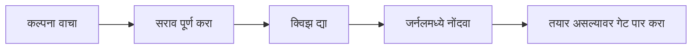
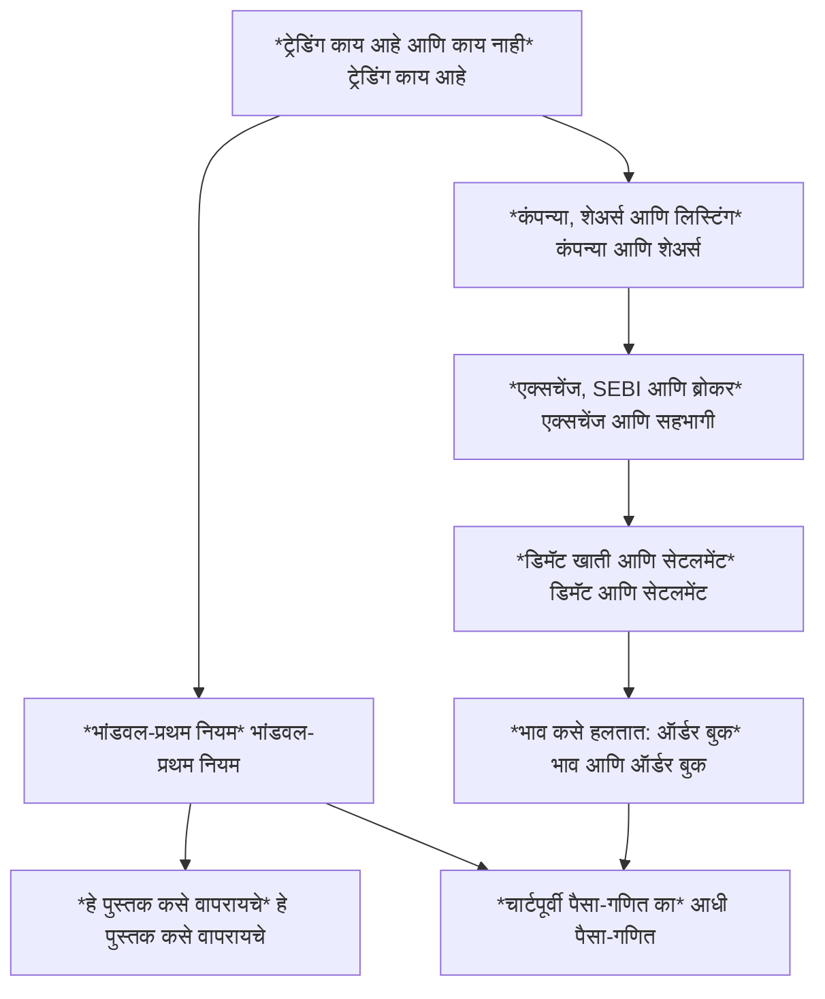

<!-- meta
id: T0.3
title: हे पुस्तक कसे वापरायचे
page_type: Concept
prerequisites: [T0.1, T0.2]
labs: [Lab 3]
estimated_minutes: 15
-->

# हे पुस्तक कसे वापरायचे

## प्रस्तावना

एक शिकणारा एका बैठकीत तीन विभाग पूर्ण करतो. त्याला आत्मविश्वास वाटतो आणि तो त्या संध्याकाळीच "ट्रेडिंग सुरू" करण्याचे ठरवतो. पुस्तकाने असे सांगितले नव्हते. तेच क्षण संथ करण्यासाठी पुस्तकाची रचना केली आहे. प्रत्येक प्रकरण क्विझ, कागदी काम आणि प्रकरण काय सांगत नाही या यादीने संपते. खऱ्या पैशांचा निर्णय वेगळ्या टप्प्यांमागे असतो. ते तुम्ही तुमच्या वेळापत्रकानुसार पार करता.

## कल्पना

**प्रत्येक प्रकरण त्याच अकरा पायऱ्यांनी चालते.** क्रम माहीत असल्यास प्रत्येक भाग कशासाठी आहे ते समजते.

1. प्रस्तावना: रुपयांतील प्रसंग किंवा नेहमीची चूक.
2. कल्पना: मूलभूत गोष्टींपासून समजावलेली कल्पना.
3. चित्र: आकृती किंवा स्थिर कार्ड.
4. सोडवलेले उदाहरण: रुपयांतील आकडे, प्रत्येक पायरी दाखवलेली.
5. परस्परसंवादी डेमो, प्रकरणात असल्यास.
6. मार्गदर्शित सराव, संकेतांसह.
7. स्वतंत्र सराव, उत्तर तुम्ही प्रयत्न करेपर्यंत लपवलेले.
8. क्विझ, प्रत्येक चुकीच्या पर्यायाचे कारण.
9. कागदी काम: जर्नल नोंद, लॅब चालवणे, किंवा Kite डेमो काम.
10. "हे पुस्तक काय सांगत नाही": मर्यादा आणि नेहमीचा गैरवापर.
11. स्रोत, पडताळणीच्या स्थितीसह.

**वाचनाचा क्रम ट्रॅकच्या अवलंबनांनुसार असतो.** अवलंबन म्हणजे एका प्रकरणाला आधी दुसरे प्रकरण लागते. आधी ट्रॅक 0, मग ट्रॅक 1, मग ट्रॅक 2 वाचा. कोणत्याही रणनीती प्रकरणापूर्वी ट्रॅक 2 (पैसा आणि गणित) पूर्ण करा.

**लॅब.** पुस्तकासोबत पाच छोटी साधने येतात: Lab 1 (पोझिशन साइज), Lab 2 (व्यापाराचा खर्च), Lab 3 (तुमचे ट्रेड जर्नल), Lab 4 (जुन्या भावांवर रणनीतीची चाचणी) आणि Lab 5 (कागदावर फॉरवर्ड चाचणी). काही अजून बनत आहेत. ती तयार होईपर्यंत प्रत्येक कागदी काम कागदावर करा.

**जर्नल मोड.** प्रत्येक जर्नल नोंदीचा एक मोड असतो. मोड असे आहेत:

- **शिकण्याची नोंद:** संकल्पना किंवा विचार. व्यापार नाही.
- **paper:** कागदावर ठरवलेला व्यापार, ब्रोकरकडे कधीही पाठवला जात नाही.
- **kite_demo:** Kite डेमो स्क्रीन पाहून केलेले काम. डेमो खोट्या डेटावर चालते आणि ऑर्डर देत नाही.
- **forward:** घडत असताना नोंदवलेला कागदी व्यापार, किंवा फॉरवर्ड चाचणी.
- **backtest:** भूतकाळातील अनुकरण केलेला निकाल.
- **live:** खऱ्या पैशांनी केलेला खरा व्यापार.

गेट पार करण्यापूर्वीच्या नोंदी कधीही live म्हणून चिन्हांकित केल्या जात नाहीत.

**ऑफलाइन वापर.** इन्स्टॉल केल्यानंतर प्रत्येक पान इंटरनेटशिवाय चालते. ॲप होम स्क्रीनवर ठेवण्याची शिफारस आहे.

**बॅकअप.** नियमितपणे बॅकअप फाइल एक्सपोर्ट करा. डिव्हाइसबाहेर एक प्रत ठेवा. डीफॉल्टनुसार ॲप दर 14 दिवसांनी आणि प्रत्येक 10 नवीन व्यापारांनंतर आठवण करते. तुम्ही दोन्ही बदलू शकता.

**गेट तुम्ही शिकलेले तपासतात.** G1 ते G7 तुमचे शिकणे तपासतात. गेट नापास झाल्यास पुन्हा देऊ शकता, वेळेची मर्यादा नाही. गेट पास झाल्याचा अर्थ खऱ्या पैशांनी व्यापार करावा असा नाही. तो निर्णय अजूनही तुमचा आहे, आणि तो वेगळा आहे.

**दबाव नाही.** खरे ट्रेडिंग सुरू करण्यासाठी कोणतीही अंतिम तारीख नाही.

## हे पाहा

बाण डावीकडून उजवीकडे पाहा. प्रत्येक प्रकरण या चक्राची एक फेरी आहे. गेट प्रकरणाचा भाग नाही. ती नंतर द्यायची वेगळी चाचणी आहे.

हा नकाशा आतापर्यंतची ट्रॅक 0 ते ट्रॅक 2 अवलंबने दाखवतो. ट्रॅक 2 *चार्टपूर्वी पैसा-गणित का* नंतरही चालू आहे. प्रत्येक बाण "यापूर्वी वाचले पाहिजे" असे वाचा.

<!-- component: study-loop | caption: वाचन, सराव, क्विझ आणि जर्नल या चक्राभोवती एक फेरी करा, मग एक छोटी अभ्यास बैठक ठरवा. -->

## सोडवलेले उदाहरण

**20 मिनिटांची बैठक:**

| मिनिटे | काम |
|---|---|
| 5 | एक संकल्पना प्रकरण वाचा |
| 2 | एक सराव पूर्ण करा |
| 13 | एक शिकण्याची नोंद करा, मग क्विझ द्या |

**नमुना शिकण्याची नोंद** (मोड: शिकण्याची नोंद):

> ट्रेडिंग भांडवल: Rs 50,000 (काल्पनिक)
> जोखीम बजेट: 1% = Rs 500
> गणित: 50,000 चे 1% = 0.01 x 50,000 = Rs 500.
> आज मी काय शिकलो: जोखीम बजेट आणि ट्रेडिंग भांडवल यातील फरक.

पहिली ओळ ट्रेडिंग भांडवल ठरवते. दुसरी ओळ एका व्यापारासाठीचे जोखीम बजेट ठरवते. जोखीम बजेट म्हणजे एका व्यापारात तुम्ही स्वीकारता तो जास्तीत जास्त तोटा. दोन्ही आकडे काल्पनिक आहेत. बेरीज Rs 50,000 च्या 1% आहे, म्हणजे Rs 500.

## हे करून पाहा

### मार्गदर्शित सराव

**काम:** "मला काय शिकायचे आहे" या शीर्षकाची शिकण्याची नोंद तयार करा. बॅकअप आठवण ठरवा. एक बॅकअप फाइल एक्सपोर्ट करा आणि डिव्हाइसबाहेर एक प्रत ठेवा.

**संकेत:**

1. ॲपच्या जर्नल आणि बॅकअप सेटिंग्ज पाहा. जर्नल साधन अजून बनलेले नाही, म्हणून नक्की जागा ठरलेली नाही.
2. Lab 3 तयार नसल्यास नोंद कागदावर लिहा आणि अभ्यासाच्या साहित्यासोबत ठेवा.
3. डीफॉल्ट बॅकअप आठवण दर 14 दिवसांनी असते.

**उत्तर:** "मला काय शिकायचे आहे" या शीर्षकाची शिकण्याची नोंद आहे. बॅकअप आठवण 14 दिवसांच्या डीफॉल्टवर, किंवा तुम्ही निवडलेल्या वेळेवर ठेवली आहे. एक बॅकअप फाइल एक्सपोर्ट करून डिव्हाइसबाहेर कॉपी केली आहे. जर्नल साधन तयार झाल्यावर ॲपमधील जागा त्यावर अवलंबून असेल.

### स्वतंत्र सराव

**काम:** अवलंबन नकाशा वापरून ट्रॅक 0 ते 2 साठी चार आठवड्यांचे अभ्यास वेळापत्रक ठरवा. कोणतेही संकेत वापरू नका.

तुमचे उत्तर तपासा

एकच बरोबर वेळापत्रक नाही. तुमची योजना बाणांचे पालन करते का ते तपासा. उदाहरण: *भांडवल-प्रथम नियम* आणि *हे पुस्तक कसे वापरायचे* यापूर्वी *ट्रेडिंग काय आहे आणि काय नाही* वाचा. *एक्सचेंज, SEBI आणि ब्रोकर* यापूर्वी *कंपन्या, शेअर्स आणि लिस्टिंग* वाचा. योजनेत फक्त वाचन नाही, तर क्विझ आणि कागदी कामेही आहेत का ते तपासा. तुमच्या योजनेत ट्रेडिंग सुरू करण्याची अंतिम तारीख नसावी. हे पुस्तकही ठरवत नाही.

## क्विझ

<!-- component: quiz-block | src: quiz.json -->

सहा प्रश्न जर्नल मोड, गेट, बॅकअपची वेळ आणि पुस्तकाच्या मर्यादा तपासतात.

## कागदी काम

**मोड:** शिकण्याची नोंद. जर्नल तयार करा. तुमची पहिली शिकण्याची नोंद करा. पहिला बॅकअप एक्सपोर्ट करा. तो बॅकअप डिव्हाइसबाहेर ठेवा.

1. जर्नल उघडा, किंवा ॲप तयार नसल्यास कागदी वही तयार करा.
2. "मला काय शिकायचे आहे" ही शिकण्याची नोंद करा.
3. पहिला बॅकअप एक्सपोर्ट करा आणि डिव्हाइसबाहेर एक प्रत ठेवा.
4. पुढील बॅकअप आठवणीची तारीख लिहा.

## मर्यादा आणि नेहमीच्या चुका

- शिकण्याची नोंद म्हणजे ट्रेडिंग नोंद नाही. शिकण्याच्या नोंदीला व्यापार म्हणून चिन्हांकित करू नका.
- गेट पास करणे म्हणजे तुम्ही काही शिकलात हे दिसते. ते नफ्याचा पुरावा नाही. ते खऱ्या पैशांनी व्यापार करण्याची परवानगी नाही.
- पुस्तक तुमच्यासाठी ऑर्डर देऊ शकत नाही. ते ऑफलाइन चालते आणि ब्रोकरशी जोडलेले नाही.
- गेट पार करण्यापूर्वीच्या नोंदी कधीही live म्हणून चिन्हांकित केल्या जात नाहीत.

## लक्षात ठेवा

- प्रत्येक प्रकरण त्याच अकरा पायऱ्यांनी चालते.
- ट्रॅकची अवलंबने वाचनाचा क्रम ठरवतात. कोणत्याही रणनीती प्रकरणापूर्वी ट्रॅक 2 येतो.
- जर्नल मोड: शिकण्याची नोंद, paper, kite_demo, forward, backtest, live.
- डीफॉल्टनुसार कमीत कमी दर 14 दिवसांनी बॅकअप घ्या, आणि प्रत डिव्हाइसबाहेर ठेवा.
- गेट शिकणे तपासतात, वेळेच्या मर्यादेशिवाय पुन्हा देता येतात, आणि खऱ्या पैशांबद्दल काहीही ठरवत नाहीत.

## स्रोत आणि पडताळणी

**स्रोत (फक्त नावे):**

- Apple WebKit स्टोरेज धोरणाची Documentation.
- MDN स्टोरेज टिकाऊपणाचे पान.
- पुस्तकाची स्वतःची गेट व्याख्या.

**11 नोव्हेंबर 2026 रोजी तपासलेली तथ्ये:**

- Apple चा Safari संघ (WebKit) सांगतो की ते संकेतस्थळ पाहण्यासाठी तुम्ही न गेल्यास सात दिवसांच्या Safari वापरानंतर Safari संकेतस्थळाचा साठवलेला डेटा हटवते. होम स्क्रीनवर ठेवलेल्या वेब ॲपची स्वतःची दिवसांची गणना असते, ती तुम्ही वापरल्यावर पुन्हा सुरू होते, आणि Apple तिचा डेटा हटेल अशी अपेक्षा करत नाही. म्हणूनच नियमित बॅकअप महत्त्वाचे आहेत. (11 नोव्हेंबर 2026 पर्यंत, WebKit ब्लॉग, "Full Third-Party Cookie Blocking and More". ब्राउझरचे नियम बदलतात, म्हणून webkit.org तपासा.)
- ब्राउझर स्वतःच्या डेटाला स्वयंचलित सफाईपासून सुरक्षित ठेवण्याची परवानगी मागू शकतात. याला persistent storage म्हणतात. ब्राउझर आणि आवृत्तींनुसार आधार वेगळा असतो, म्हणून सध्याच्या यादीसाठी MDN चे "StorageManager: persist()" पान पाहा. (11 नोव्हेंबर 2026 पर्यंत, MDN Web Docs.)
- बॅकअप आठवणीसाठी ॲपमधील जागा अजून ठरलेली नाही, कारण जर्नल साधन बनलेले नाही.

<!-- standing-disclaimer -->
