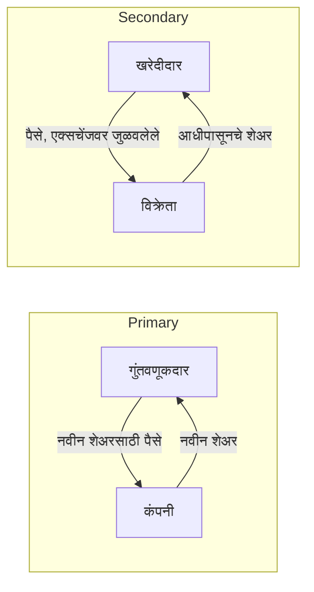

<!-- meta
id: T1.1
title: कंपन्या, शेअर आणि लिस्टिंग
page_type: Concept
prerequisites: [T0.1]
labs: []
estimated_minutes: 25
-->

# कंपन्या, शेअर आणि लिस्टिंग

## प्रस्तावना

एका काल्पनिक ट्रेडरने ऐकले की एक कंपनी "लवकरच लिस्ट होणार" आहे. तो तिच्या पहिल्या सार्वजनिक ऑफरमध्ये शेअर खरेदी करतो. त्याला वाटते की या खरेदीमुळे कंपनीला पैसे मिळतात. एका आठवड्यानंतर तो एक्सचेंजवर दुसऱ्या गुंतवणूकदाराकडून आणखी शेअर घेतो. त्याला वाटते की कंपनीला पुन्हा निधी मिळतो. दोन्ही समजुती दोन वेगळ्या बाजारांची गल्लत करतात. पैसे कुठे जातात, ते हा फरक ठरवतो.

## कल्पना

**शेअर म्हणजे मालकीचा एक भाग.** कंपनीचे ठराविक संख्येने शेअर असतात, आणि ते सर्व समान भाग असतात. प्रत्येक भाग धारकाला, त्याच्याकडील संख्येच्या प्रमाणात, व्यवसायात वाटा देतो.

**मालकीची टक्केवारी** म्हणजे तुमच्याकडील शेअर, एकूण शेअरांनी भागलेले. सूत्र:

Ownership % = (shares held / total shares outstanding) x 100

**धारण केलेल्या शेअरचे मूल्य** म्हणजे शेअरची संख्या गुणिले एका शेअरचा भाव. सूत्र: holding value = shares x price.

**कंपन्या शेअर का विकतात.** कंपनी कर्ज घेण्याऐवजी नवीन भागधारकांकडून पैसे उभे करू शकते. सध्याचे मालकही त्यांच्या हिश्शाचा काही भाग विकू शकतात. ही सर्वसाधारण कारणे आहेत. प्रत्येक कंपनीच्या स्वतःच्या कागदपत्रांत तिची खास कारणे लिहिलेली असतात.

**प्राथमिक बाजार.** कंपनी नवीन शेअर जारी करते. पैसे कंपनीला मिळतात.

**दुय्यम बाजार.** गुंतवणूकदार आधीपासून असलेल्या शेअरची खरेदी-विक्री करतात. पैसे विक्रेत्याला मिळतात, कंपनीला नाही. एक्सचेंजवरील खरेदी-विक्री दुय्यम बाजारात होते.

**IPO (इनिशियल पब्लिक ऑफर).** कंपनीची लोकांना दिलेली पहिली सार्वजनिक शेअर ऑफर. हे प्रकरण किंमत ठरवणे आणि वाटप (शेअर कोणाला मिळतात) एवढेच सर्वसाधारण शब्दांत सांगते. बुक-बिल्डिंग IPO मध्ये कंपनी किमतीचा पट्टा देते, आणि गुंतवणूकदार त्या पट्ट्यात बोली लावतात. खालची आणि वरची मर्यादा असलेला लिलाव असे समजा. ऑफर बंद झाल्यावर शेअरचे वाटप होते. SEBI चा डिसेंबर 2023 पासूनचा नियम असा आहे की ऑफर बंद झाल्यावर 3 कार्यदिवसांच्या आत शेअरचे ट्रेडिंग सुरू झाले पाहिजे (याला T+3 म्हणतात). (11 नोव्हेंबर 2026 नुसार, 9 ऑगस्ट 2023 चे SEBI परिपत्रक. नियम बदलतात, म्हणून SEBI संकेतस्थळ तपासा.)

**IPO आपोआप फायदेशीर नसतो.** लिस्टिंगच्या दिवशीचा भाव म्हणजे शेअरचा एक्सचेंजवरील पहिला व्यवहार ज्या भावात होतो तो. तो इश्यू किमतीच्या वर किंवा खाली असू शकतो. इश्यू किंमत म्हणजे ऑफरसाठी ठरवलेला भाव.

**डायल्युशन (मालकी पातळ होणे).** नवीन शेअर जारी झाले की एकूण शेअरांची संख्या वाढते. मग प्रत्येक सध्याचा शेअर कंपनीचा लहान भाग बनतो. म्हणून सध्याच्या धारकाची टक्केवारी घटते, जोपर्यंत त्याने नवीन शेअरमध्ये काही खरेदी केलेली नसते.

## हे पाहा

कंपनीचा बॉक्स पाहा. तो फक्त प्राथमिक प्रवाहात दिसतो. दुय्यम प्रवाहात पैसे खरेदीदार आणि विक्रेता यांच्यात फिरतात. कंपनीला काहीही मिळत नाही.

<!-- component: share-slices | totalShares: 1000000 | price: 200 | held: 1000 | buyShares: 100 | caption: या प्रकरणातील काल्पनिक कंपनी: 10,00,000 शेअर, भाव Rs 200. 5,00,000 नवीन शेअर जारी करण्यासाठी Play दाबा आणि तुमची टक्केवारी कशी घटते ते पाहा. -->

## सोडवलेले उदाहरण

**काल्पनिक कंपनी:** 10,00,000 शेअर बाजारात आहेत, प्रत्येकाचा भाव Rs 200.

| पायरी | काम | निकाल |
|---|---|---|
| 1. कंपनीचे मूल्य | 10,00,000 x Rs 200 | Rs 20,00,00,000 (Rs 20 कोटी) |
| 2. धारकाची मालकी | 1,000 / 10,00,000 | 0.1% |
| 3. धारकाचे मूल्य | 1,000 x Rs 200 | Rs 2,00,000 |
| 4. दुय्यम व्यवहार, 100 शेअर | 100 x Rs 200 | Rs 20,000 विक्रेत्याला दिले; कंपनीला काहीच मिळत नाही |
| 5. डायल्युशन: कंपनी 5,00,000 नवीन शेअर जारी करते | एकूण होते 10,00,000 + 5,00,000 = 15,00,000; धारकाचे 1,000 / 15,00,000 | 0.0667% |

**तपासणी, पायरी 5:** 1,000 / 15,00,000 = 1 / 1,500 = 0.000667, म्हणजे 0.0667%.

धारकाची मालकी 0.1% वरून 0.0667% झाली, कारण शेअरची संख्या वाढली. धारकाकडे अजूनही 1,000 शेअर आहेत. त्याचे मूल्य घटते की नाही, हे नवीन इश्यूनंतरच्या भावावर अवलंबून असते. वरील गणित ते ठरवत नाही.

## हे करून पाहा

### मार्गदर्शित सराव

**काम:** एका धारकाकडे एका कंपनीचे 250 शेअर आहेत. कंपनीचे एकूण शेअर 20,00,000 आहेत. शेअरचा भाव Rs 150 आहे. धारकाची मालकीची टक्केवारी आणि धारण केलेल्या शेअरचे मूल्य काढा.

**संकेत:**

1. धारकाच्या शेअरला एकूण शेअरने भागून अपूर्णांक काढा.
2. अपूर्णांकाला 100 ने गुणा, म्हणजे टक्केवारी मिळेल.
3. शेअरच्या संख्येला भावाने गुणा, म्हणजे मूल्य मिळेल.

**उत्तर:** मालकी = 250 / 20,00,000 = 0.000125, म्हणजे 0.0125%. मूल्य = 250 x Rs 150 = Rs 37,500.

### स्वतंत्र सराव

**काम:** या प्रकरणातील उदाहरणातील कंपनी 10,00,000 नवीन शेअर जारी करते. धारकाची नवीन मालकीची टक्केवारी काढा. धारकाचे मूल्य आपोआप का कमी होत नाही, ते स्पष्ट करा. कोणतेही संकेत वापरू नका.

तुमचे उत्तर तपासा

नवीन एकूण = 10,00,000 + 10,00,000 = 20,00,000 शेअर. धारकाची मालकी = 1,000 / 20,00,000 = 0.005%.

धारकाचे मूल्य म्हणजे शेअर x भाव. धारकाकडे अजूनही 1,000 शेअर आहेत. भाव Rs 200 च राहिला, तर धारण केलेले शेअर अजूनही Rs 2,00,000 किमतीचे असतील. भाव व्यापार ठरवतो. नवीन पैशांमुळे कंपनीच्या शक्यता बदलू शकतात, त्यामुळे भाव कोणत्याही दिशेने हलू शकतो. टक्केवारी नक्की घटते. मूल्य आपोआप घटत नाही.

## क्विझ

<!-- component: quiz-block | src: quiz.json -->

पाच प्रश्न मालकीची बेरीज, प्रत्येक बाजारातील पैशांचा प्रवाह, आणि IPO व डायल्युशनबद्दलची विधाने तपासतात.

## कागदी काम

**पद्धत:** शिकण्याची नोंद. ती जर्नलमध्ये किंवा कागदावर लिहा. कोणतीही खरेदी करू नका.

1. भूतकाळातील कोणत्याही IPO चा सार्वजनिक ऑफर दस्तऐवज शोधा. तो एक्सचेंज किंवा SEBI संकेतस्थळावर मिळेल.
2. "objects of the issue" (ऑफरच्या उद्देशाचा विभाग) नावाचा विभाग शोधा. त्यात पैसे कशासाठी आहेत ते लिहिलेले असते.
3. कंपनीने पैसे कशासाठी वापरणार असे सांगितले, ते स्वतःच्या शब्दांत लिहा.
4. स्रोत, तुम्ही तो पाहिल्याची तारीख आणि कंपनीचे नाव नोंदवा. काहीही खरेदी करू नका.

## मर्यादा आणि नेहमीच्या चुका

- हे प्रकरण कोणता IPO खरेदी करावा हे सांगत नाही. IPO ला भांडवल-प्रथम नियमांतून सूट मिळत नाही.
- IPO विषयीची हवा, आणि शेअर मिळाल्याचा उत्साह, अनेकदा घाईच्या खरेदीकडे नेतो.
- लिस्टिंगच्या दिवशीचा भाव इश्यू किमतीच्या वर किंवा खाली असू शकतो. हे प्रकरण दोन्हीपैकी काहीही भाकीत करत नाही.
- टक्केवारी आणि मूल्याची गणिते एका क्षणाचे चित्र आहेत. भाव हलतो, म्हणून मूल्यही हलते.

## लक्षात ठेवा

- शेअर म्हणजे मालकीचा भाग. मालकी % = धारण शेअर / एकूण शेअर, गुणिले 100.
- प्राथमिक बाजार: पैसे कंपनीला. दुय्यम बाजार: पैसे विक्रेत्याला.
- IPO म्हणजे कंपनीची पहिली सार्वजनिक ऑफर. तो आपोआप फायदेशीर नसतो.
- डायल्युशन: नवीन शेअरमुळे प्रत्येक सध्याच्या धारकाची टक्केवारी घटते, जोपर्यंत तो इश्यूमध्ये खरेदी करत नाही.
- 10,00,000 पैकी 1,000 शेअर असतील तर मालकी 0.1%. 5,00,000 नवीन शेअरनंतर ती 0.0667%.

## स्रोत आणि पडताळणी

**स्रोत (फक्त नावे):**

- SEBI ICDR नियम.
- IPO वरील SEBI गुंतवणूकदार शिक्षण पाने.
- NSE आणि BSE ची IPO शिक्षण पाने.

**11 नोव्हेंबर 2026 रोजी तपासलेली तथ्ये:**

- IPO बंद झाल्यावर 3 कार्यदिवसांत लिस्टिंग होण्याचा वेळ 9 ऑगस्ट 2023 च्या SEBI परिपत्रकातून आला आहे. 1 डिसेंबर 2023 रोजी किंवा नंतर उघडणाऱ्या ऑफरसाठी तो बंधनकारक झाला.
- IPO ची तपशीलवार पायरी, किमतीच्या पट्ट्याच्या मर्यादा आणि वाटपाचे नियम SEBI च्या ICDR नियमांत आहेत. कोणत्याही IPO साठी अर्ज करण्यापूर्वी ते SEBI संकेतस्थळावर वाचा.
- सध्याचे IPO आकडे या प्रकरणाच्या कक्षेबाहेर आहेत.

<!-- standing-disclaimer -->
