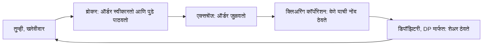

<!-- meta
id: T1.2
title: एक्सचेंज, SEBI आणि ब्रोकर
page_type: Concept
prerequisites: [T1.1]
labs: []
estimated_minutes: 25
-->

# एक्सचेंज, SEBI आणि ब्रोकर

## प्रस्तावना

एका काल्पनिक नवशिक्याला वाटते की त्याचा ब्रोकरच एक्सचेंज आहे. त्याला वाटते की त्याची ऑर्डर ब्रोकरच्या ऑफिसमध्ये जुळवली जाते. एखादा व्यापार बिघडल्यावर त्याला सांगता येत नाही की कोणाला विचारायचे आणि कोणत्या क्रमाने. कोणती संस्था कोणते काम करते हे माहीत असल्यास गोंधळाची स्थिती स्टेप्सच्या यादीत बदलते.

## कल्पना

तुमची ऑर्डर आणि तुमच्या नावावरचे शेअर यांच्या मध्ये अनेक संस्था असतात. प्रत्येक संस्थेचे एक काम असते. हे प्रकरण प्रत्येक भूमिका एकदाच स्पष्ट करते. या भूमिका वेगळ्या ठेवा.

**SEBI** हा सिक्युरिटीज नियामक आहे. ब्रोकर, एक्सचेंज आणि सूचीबद्ध कंपन्यांसाठी ते नियम बनवते. ते शेअरचे भाव ठरवत नाही.

**एक्सचेंज (NSE आणि BSE)** ती बाजारपेठ चालवतात जिथे ऑर्डर जुळवल्या जातात. भारतातील हे दोन मुख्य शेअर एक्सचेंज आहेत. SEBI आपल्या वेबसाइटवर मान्यताप्राप्त एक्सचेंजची अधिकृत यादी ठेवते. खरेदीची ऑर्डर आणि विक्रीची ऑर्डर तिथे जुळवली जाते. एक्सचेंज तुमचे पैसे स्वतःकडे ठेवत नाही.

**क्लिअरिंग कॉर्पोरेशन** व्यापारानंतर काम करते. व्यापारामुळे दोन्ही बाजूंनी कोणाचे किती देणे आहे याची नोंद ती ठेवते. सेटलमेंट कशी खात्रीशीर होते, त्याचा तो भाग आहे. सेटलमेंट म्हणजे शेअर आणि पैसे यांचे अंतिम हस्तांतरण. बाजारातील एका विश्वासू मध्यस्थाचा विचार करा, जो दोन्ही बाजूंना वचन देतो की दुसरी बाजू पैसे देईल किंवा शेअर देईल. NSE चे क्लिअरिंग कॉर्पोरेशन NSE Clearing Limited या नावाने ओळखले जाते. BSE चे नाव Indian Clearing Corporation Limited (ICCL) आहे.

**डिपॉझिटरी** शेअर इलेक्ट्रॉनिक स्वरूपात ठेवतात. भारतात दोन डिपॉझिटरी आहेत: NSDL आणि CDSL. त्या शेअरसाठी बँकेसारखे काम करतात. कोणाकडे काय आहे याची नोंद त्या ठेवतात. तुमचे शेअर कागदी प्रमाणपत्राच्या स्वरूपात कपाटात नसतात. ते डिपॉझिटरीमध्ये तुमच्या नावावर नोंदलेले असतात.

**ब्रोकर (ट्रेडिंग सदस्य)** तुमच्या ऑर्डर स्वीकारतो, तुम्हाला ट्रेडिंग प्लॅटफॉर्म देतो आणि तुमच्या ऑर्डर एक्सचेंजकडे पाठवतो. रोजच्या व्यवहारात ज्या फर्मशी तुमचा संबंध येतो ती ब्रोकर फर्म असते. ती एक्सचेंज नाही. तिथे तुमचे शेअर ठेवलेले नसतात.

**डिपॉझिटरी पार्टिसिपंट (DP)** ही फर्म डिपॉझिटरीच्या वतीने तुमचे डिमॅट खाते सांभाळते. डिपॉझिटरी होल्डिंगची नोंद ठेवते. खाते DP सांभाळते. ही दोन वेगळी कामे आहेत, जरी एकाच फर्मने दोन्ही केली तरी.

**बँका** व्यापार आणि सेटलमेंटसाठी वापरले जाणारे पैसे ठेवतात. तुमचे ट्रेडिंग खाते एका बँक खात्याशी जोडलेले असते.

**तक्रारीचा मार्ग** म्हणजे तक्रारींचा क्रम. आधी ब्रोकरकडे जा. मग एक्सचेंजकडे जा. मग SEBI चे तक्रार पोर्टल SCORES (scores.sebi.gov.in) वर जा. SEBI च्या गुंतवणूकदार पानावर सांगितले आहे की ज्या फर्मविरुद्ध तक्रार आहे तिच्याकडे आधी जा. समाधान न झाल्यासच SCORES वापरा. जुनी SCORES साइट (scores.gov.in) 28 Mar 2024 रोजी बंद झाली, म्हणून नवीन साइट वापरा. SEBI चे हेल्पलाइन क्रमांक 1800-266-7575 आणि 1800-22-7575 आहेत. (11 Nov 2026 पर्यंत, SEBI गुंतवणूकदार साइटनुसार. नवीनतम पायऱ्यांसाठी ती तपासा.)

**एक व्यावहारिक तपासणी.** कोणत्याही ब्रोकरकडे खाते उघडण्यापूर्वी त्याची नोंदणी अधिकृत यादीत तपासा. SEBI च्या गुंतवणूकदार साइटवर "Check Registration Status of Market Intermediary" नावाचे साधन आहे. SEBI आपल्या वेबसाइटवर मान्यताप्राप्त मध्यस्थांची यादीही ठेवते. (11 Nov 2026 पर्यंत, SEBI गुंतवणूकदार साइटनुसार.)

## हे पाहा

बाणांच्या मागे जा. ऑर्डर तुमच्याकडून ब्रोकरकडे, मग एक्सचेंजकडे, मग क्लिअरिंगकडे जाते. शेअर डिपॉझिटरीमार्फत तुमच्याकडे परत येतात. ब्रोकर आणि एक्सचेंज हे दोन वेगळे चौकोन आहेत हे लक्षात घ्या.

## सोडवलेले उदाहरण

**काल्पनिक:** Rs 250 दराने 20 शेअर खरेदी करा.

| पायरी | काम | निकाल |
|---|---|---|
| 1. व्यापाराचे मूल्य | 20 x Rs 250 | Rs 5,000 |

आता ऑर्डरचा मागोवा घ्या. प्रत्येक पायरीवर पैसे कोणाकडे आहेत ते लक्षात घ्या.

| पायरी | संस्था | काय घडते | या पायरीवर पैसे कोणाकडे असतात |
|---|---|---|---|
| 1 | तुम्ही | Rs 250 दराने 20 शेअरची खरेदी ऑर्डर देता | तुमचे जोडलेले पैसे, Rs 5,000 लागतील |
| 2 | ब्रोकर | ऑर्डर स्वीकारतो आणि एक्सचेंजकडे पाठवतो | ब्रोकरच्या प्रक्रियेतून पैसे जातात |
| 3 | एक्सचेंज | ऑर्डर एका विक्रेत्याशी जुळवतो | एक्सचेंज तुमचे पैसे ठेवत नाही |
| 4 | क्लिअरिंग कॉर्पोरेशन | व्यापारामुळे येणाऱ्या देण्याची नोंद ठेवते | क्लिअरिंग यंत्रणा पैसे हलवते |
| 5 | डिपॉझिटरी, DP मार्फत | सेटलमेंटनंतर 20 शेअर तुमच्या डिमॅट खात्यात जमा होतात | सेटलमेंट शेअर आणि पैसे हलवते, व्यापारानंतर एका कामकाजाच्या दिवसानंतर (T+1, पहा *डिमॅट खाते आणि सेटलमेंट*) |

मुख्य मुद्दा: कोणतीही पायरी एक्सचेंजला तुमचे पैसे ठेवायला सांगत नाही.

## हे करून पाहा

**परस्परसंवादी डेमो (संकल्पनात्मक मोड).**

<!-- component: order-flow-sim | mode: conceptual | side: buy | quantity: 20 | price: 250 | steps: trader, broker, exchange, clearing, depository | caption: Rs 250 दराने 20 शेअरची एक खरेदी ऑर्डर प्रत्येक संस्थेतून कशी जाते ते पाहा, आणि प्रत्येक पायरीवर कोण काय करते ते सांगा. -->

### मार्गदर्शित सराव

**कार्य:** Rs 250 दराने 20 शेअरच्या विक्रीसाठी आकृतीतील संस्थांना नावे द्या.

**इशारे:**

1. स्वतःपासून सुरुवात करा.
2. ऑर्डरचा मागोवा घ्या: तुम्ही, ब्रोकर, एक्सचेंज.
3. मग शेअरचा मागोवा घ्या: क्लिअरिंग, मग डिपॉझिटरी.

**उत्तर:** तुम्ही Rs 250 दराने 20 शेअरची विक्री ऑर्डर देता. व्यापाराचे मूल्य Rs 5,000 आहे. ब्रोकर ऑर्डर स्वीकारतो आणि एक्सचेंजकडे पाठवतो. एक्सचेंज ती एका खरेदीदाराशी जुळवतो. क्लिअरिंग कॉर्पोरेशन देण्याची नोंद ठेवते. डिपॉझिटरी, DP मार्फत, सेटलमेंट झाल्यावर तुमच्या डिमॅट खात्यातून शेअर बाहेर काढते. ते व्यापारानंतर एका कामकाजाच्या दिवसानंतर होते (पहा *डिमॅट खाते आणि सेटलमेंट*).

### स्वतंत्र सराव

**कार्य:** एका मित्राला तीन वाक्यांत समजावून सांगा, की एक्सचेंज ही अशी जागा का नाही जिथे तुम्ही खाते उघडता. कोणतेही इशारे वापरू नका.

तुमचे उत्तर तपासा

एक उत्तर असे असू शकते: "एक्सचेंज ही बाजारपेठ आहे जिथे ऑर्डर जुळवल्या जातात. तुम्ही ब्रोकरकडे खाते उघडता. ब्रोकर तुमच्या ऑर्डर स्वीकारतो आणि त्या एक्सचेंजकडे पाठवतो. तुमचे शेअर डिपॉझिटरीमध्ये, DP मार्फत, नोंदलेले असतात, एक्सचेंजमध्ये नाहीत."

तुमच्या तीन वाक्यांनी जुळवणी (एक्सचेंज), प्रवेश (ब्रोकर) आणि ठेवणे (डिपॉझिटरी) यांत फरक केला आहे का ते तपासा.

## क्विझ

<!-- component: quiz-block | src: quiz.json -->

सहा प्रश्न ब्रोकर आणि एक्सचेंजमधील फरक, क्लिअरिंगची भूमिका, तक्रारीचा क्रम आणि शेअर कोण ठेवते हे तपासतात.

## कागदी काम

**मोड:** शिकण्याची नोंद. ती तुमच्या जर्नलमध्ये किंवा कागदावर लिहा.

1. या प्रकरणातील प्रत्येक संस्था यादी करा: SEBI, NSE, BSE, क्लिअरिंग कॉर्पोरेशन, NSDL, CDSL, ब्रोकर, DP आणि बँक.
2. प्रत्येकाची भूमिका तुमच्या स्वतःच्या शब्दांत लिहा, प्रत्येकी एका ओळीत.
3. अधिकृत पानाची लिंक जोडा जे त्या संस्थेचे वर्णन करते.
4. त्या भूमिकेवर अवलंबून राहण्यापूर्वी SEBI, NSE आणि BSE च्या पानांवर तपासा.

## मर्यादा आणि नेहमीच्या चुका

- हे पुस्तक कोणत्याही ब्रोकरची शिफारस करत नाही. Zerodha फक्त ब्रोकरचे उदाहरण म्हणून दिले आहे, शिफारस म्हणून नाही.
- नोंदणीची तपासणी तुमची जबाबदारी आहे. खाते उघडण्यापूर्वी अधिकृत यादी तपासा.
- ब्रोकर किंवा सल्लागार असल्याचा दावा करणाऱ्या कोणालाही तुम्ही पडताळणी करेपर्यंत पैसे पाठवू नका.
- येथील भूमिका सर्वसाधारण आहेत. प्रत्येक फर्मची नेमकी रचना तिच्या स्वतःच्या कागदपत्रांत असते.

## लक्षात ठेवा

- SEBI नियमन करते. ते भाव ठरवत नाही.
- एक्सचेंज ऑर्डर जुळवते. ते तुमचे पैसे ठेवत नाही.
- ब्रोकर तुमच्या ऑर्डर स्वीकारतो. तो एक्सचेंज नाही.
- डिपॉझिटरी शेअर इलेक्ट्रॉनिक स्वरूपात ठेवते, DP मार्फत.
- तक्रारीचा क्रम: ब्रोकर, मग एक्सचेंज, मग SEBI.

## स्रोत आणि पडताळणी

**स्रोत (फक्त नावे):**

- SEBI ची वेबसाइट: SEBI विषयी, मध्यस्थ, गुंतवणूकदार तक्रार.
- NSE ची वेबसाइट: क्लिअरिंग आणि सदस्यत्वाची पाने.
- BSE ची वेबसाइट.
- NSDL आणि CDSL ची वेबसाइट.
- खात्यांवरील Zerodha सपोर्ट पाने, ब्रोकरचे उदाहरण म्हणून, शिफारस म्हणून नाही.

**तथ्ये 11 Nov 2026 रोजी तपासली:**

- क्लिअरिंग कॉर्पोरेशन NSE Clearing Limited आणि Indian Clearing Corporation Limited आहेत. डिपॉझिटरी NSDL आणि CDSL आहेत.
- तक्रारीचा क्रम आणि नवीन SCORES पत्ता SEBI च्या गुंतवणूकदार पानांवरून घेतले आहेत.
- नोंदणी तपासणी साधन SEBI च्या गुंतवणूकदार सहाय्य पानावरून घेतले आहे.
- मान्यताप्राप्त एक्सचेंजची पूर्ण यादी SEBI ठेवते. हे प्रकरण ती यादी कॉपी करत नाही, म्हणून SEBI ची साइट तपासा.

<!-- standing-disclaimer -->
