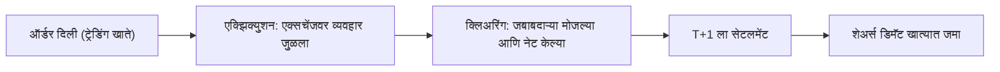

<!-- meta
id: T1.3
title: डिमॅट खाती आणि सेटलमेंट
page_type: Concept
prerequisites: [T1.2]
labs: []
estimated_minutes: 25
-->

# डिमॅट खाती आणि सेटलमेंट

## प्रस्तावना

एक काल्पनिक नवशिक्या सकाळी Rs 250 दराने 20 शेअर्स खरेदी करतो. ऑर्डर पूर्ण झालेली तो पाहतो. शेअर्स आधीच डिमॅट खात्यात आले आहेत आणि त्याच दुपारी विकता येतील, असे त्याला वाटते. पण ऑर्डर पूर्ण होणे आणि होल्डिंग दिसणे यामध्ये क्लिअरिंग आणि सेटलमेंटचे टप्पे असतात. पैसे आणि शेअर्स एकाच क्षणी हलत नाहीत.

## कल्पना

**तीन खाती यात सहभागी असतात.** प्रत्येकात वेगळी गोष्ट असते.

- **ट्रेडिंग खाते:** जिथे ऑर्डर दिल्या जातात आणि पैशांचा हिशोब ठेवला जातो.
- **डिमॅट खाते:** जिथे शेअर्स इलेक्ट्रॉनिक स्वरूपात ठेवले जातात.
- **जोडलेले बँक खाते:** जिथून पैसे ट्रेडिंग खात्यात येतात आणि बाहेर जातात.

**एक व्यापार तीन टप्प्यांतून जातो.**

1. **एक्झिक्युशन:** एक्सचेंजवर ऑर्डर जुळते. तेव्हा व्यापार होतो.
2. **क्लिअरिंग:** दोन्ही बाजूंच्या जबाबदाऱ्या मोजल्या जातात. अनेक व्यवहार एकत्र केले जातात.
3. **सेटलमेंट:** शेअर्स आणि पैसे प्रत्यक्षात हस्तांतरित होतात.

**नेटिंग** म्हणजे एका सेटलमेंट चक्रातील अनेक व्यवहार प्रत्येक शेअरसाठी आणि प्रत्येक रोख रकमेसाठी एका निव्वळ आकड्यात एकत्र करणे. पैसे किंवा शेअर्स हलण्यापूर्वी खरेदी आणि विक्री एकमेकांना भरून काढतात.

**T+1** म्हणजे व्यवहाराच्या तारखेनंतर एक कामाचा दिवस गेल्यावर सेटलमेंट होते. SEBI चे सर्व सूचिबद्ध शेअर्ससाठीचे T+1 चक्र 27 जानेवारी 2023 पासून लागू आहे. (11 नोव्हेंबर 2026 पर्यंत, SEBI परिपत्रक 7 सप्टेंबर 2021 आणि SEBI चे मास्टर परिपत्रक. नियम बदलतात, म्हणून SEBI संकेतस्थळ तपासा.) "T" म्हणजे व्यवहाराचा दिवस. "+1" म्हणजे एक कामाचा दिवस नंतर, एक कॅलेंडर दिवस नव्हे.

**शेअर्स सेटलमेंटनंतरच तुमच्या डिमॅट खात्यात येतात.** तुम्ही सोमवारी खरेदी केली, तर मंगळवारच्या सेटलमेंटनंतर ते जमा होतात. काही ब्रोकर ते येण्यापूर्वीच मंगळवारी विकू देतात. याला BTST म्हणतात, म्हणजे आज खरेदी करा आणि उद्या विका. यात **शॉर्ट डिलिव्हरी** नावाची जोखीम असते. विकलेले शेअर्स वेळेत आले नाहीत, तर एक्सचेंज ऑक्शन घेऊ शकते, आणि दंड मूल्याच्या 20% पर्यंत असू शकतो. ज्या शेअर्सची रक्कम अजून खात्यात आलेली नाही, त्यांच्या विक्रीचे पैसे त्याच दिवशी वापरता येत नाहीत. (11 नोव्हेंबर 2026 पर्यंत, BTST वरील Zerodha सहाय्य पाने. ब्रोकरचे नियम वेगळे असतात आणि बदलतात, म्हणून तुमच्या ब्रोकरकडे तपासा.)

**होल्डिंग आणि पोझिशन वेगळे आहेत.** डिलिव्हरी होल्डिंग म्हणजे सेटल झालेले शेअर्स, जे तुमच्या डिमॅट खात्यात पडून असतात. इंट्राडे पोझिशन म्हणजे जी त्याच दिवशी उघडून बंद केली जाते. ती डिलिव्हरी होल्डिंग नसते. इंट्राडे पोझिशनबद्दल *ऑर्डर बुक* मध्ये माहिती आहे.

**वेळ लगेच होत नाही.** एक्झिक्युशन, क्लिअरिंग आणि सेटलमेंट वेगवेगळ्या वेळी होतात. सेटलमेंटनंतर होल्डिंग दिसते. ऑर्डर पूर्ण झाल्याच्या क्षणी ते दिसत नाही.

## हे पाहा

डावीकडून उजवीकडे बाण पाहा. एक्झिक्युशन आणि सेटलमेंटमधील गॅपमुळे ऑर्डर पूर्ण झाल्या क्षणी होल्डिंग दिसत नाही.

<!-- component: settlement-timeline | qty: 20 | price: 250 | startDay: 0 | settleDays: 1 | caption: Rs 250 दराने 20 शेअर्सची एक काल्पनिक सोमवारची खरेदी. ती पाहण्यासाठी Play दाबा, आणि काल्पनिक सुट्टी जोडण्यासाठी एखाद्या दिवसावर टॅप करा. -->

## सोडवलेले उदाहरण

**नेटिंगचे उदाहरण, फक्त संकल्पना.** एका ब्रोकरकडे प्रत्येकी Rs 5,000 चे तीन खरेदी व्यवहार आहेत. त्याचा Rs 2,000 चा एक विक्री व्यवहार देखील आहे. हे चारही एकाच सेटलमेंट चक्रात आहेत.

| पायरी | काम | निकाल |
|---|---|---|
| 1. एकूण खरेदी | 3 x 5,000 | Rs 15,000 |
| 2. विक्रीची रक्कम | 1 x 2,000 | Rs 2,000 |
| 3. निव्वळ देय | 15,000 - 2,000 | Rs 13,000 |

**तपासणी:** 13,000 + 2,000 = 15,000, जी एकूण खरेदीइतकी आहे. हे उदाहरण कल्पना सांगण्यासाठी गोल आकड्यांत मांडले आहे. प्रत्यक्ष सेटलमेंटमध्ये NSE च्या FAQ नुसार नेटिंग प्रत्येक ग्राहकासाठी, प्रत्येक शेअरसाठी केले जाते. ते trade-for-trade विभागातील शेअर्सना किंवा ऑक्शन व्यवहारांना लागू होत नाही, जिथे प्रत्येक व्यवहार पूर्ण रकमेने सेटल होतो. (11 नोव्हेंबर 2026 पर्यंत, NSE च्या दुय्यम बाजारावरील (Secondary Market) Basic FAQs. नियम बदलतात, म्हणून NSE संकेतस्थळ तपासा.)

**वेळापत्रकाचे उदाहरण.** एका काल्पनिक सोमवारी झालेली खरेदी, मंगळवार कामाचा दिवस असल्यास मंगळवारी सेटल होते. पुढचा दिवस सुट्टी असेल तर सेटलमेंट पुढच्या कामाच्या दिवसावर जाते. NSE दरवर्षी आपली सुट्ट्यांची यादी प्रकाशित करते. *ट्रेडिंग सत्रे, वेळा आणि सुट्ट्या* पाहा.

## हे करून पाहा

### मार्गदर्शित सराव

**काम:** Rs 250 दराने 20 शेअर्स खरेदीचा, म्हणजे Rs 5,000 च्या व्यवहार मूल्याचा, मागोवा घेण्यासाठी खालील तक्त्यातील रिकाम्या जागा भरा.

| टप्पा | कोणते खाते किंवा संस्था | कोणता दिवस | रिकामी जागा |
|---|---|---|---|
| ऑर्डर दिली | ______ | व्यवहाराचा दिवस | ______ |
| व्यवहार जुळला | ______ | व्यवहाराचा दिवस | ______ |
| जबाबदारी नोंदवली | ______ | व्यवहाराचा दिवस | ______ |
| सेटलमेंट | ______ | पुढचा कामाचा दिवस, T+1 | ______ |
| शेअर्स पोहोचतात | ______ | सेटलमेंटनंतर | ______ |

**संकेत:**

1. ऑर्डर आणि पैसे कोणते खाते ठेवते? शेअर्स कोणते खाते ठेवते?
2. व्यवहार कोणती संस्था जुळवते, आणि जबाबदारी कोणती संस्था नोंदवते?
3. व्यवहाराचा दिवस कोणता, आणि सेटलमेंटचा दिवस कोणता?

**उत्तर:** ऑर्डर दिली: ट्रेडिंग खाते, व्यवहाराच्या दिवशी. व्यवहार जुळला: एक्सचेंज. जबाबदारी नोंदवली: क्लिअरिंग कॉर्पोरेशन. सेटलमेंट: पुढच्या कामाच्या दिवशी, T+1 ला. Rs 5,000 जोडलेल्या बँक खात्यातून जातात. शेअर्स डेपॉझिटरी आणि DP मार्फत डिमॅट खात्यात जमा होतात. शेअर्स सेटलमेंटनंतर डिमॅट खात्यात येतात, ऑर्डर पूर्ण झाल्या क्षणी नव्हे.

### स्वतंत्र सराव

**काम:** एक व्यवहार शुक्रवारी, सार्वजनिक सुट्टीच्या आधी केला आहे. त्याची सेटलमेंट तारीख शोधण्यासाठी कोणते स्रोत लागतील ते लिहा. कॅलेंडर न पाहता तारीख काढू नका. कोणतेही संकेत वापरू नका.

तुमचे उत्तर तपासा

लागणारे स्रोत:

- सध्याचा T+1 नियम आणि त्याची लागू होण्याची तारीख. ते वरील नोंदींत आहेत.
- त्या वर्षाची एक्सचेंजची सुट्ट्यांची यादी, जी NSE संकेतस्थळावर प्रकाशित होते.
- व्यवहाराची तारीख, आणि व्यवहार व संभाव्य सेटलमेंट तारखेमधील आठवड्याचे शेवटचे दिवस.

हे तीन मिळाल्यावरच कामाचे दिवस मोजता येतात. सुट्ट्या दरवर्षी ठरतात, त्यामुळे तारीख स्मरणातून ठरवता येत नाही.

## क्विझ

<!-- component: quiz-block | src: quiz.json -->

सहा प्रश्न होल्डिंगची वेळ, T+1 चा अर्थ, नेटिंगची गणिते आणि प्रत्येक खात्यात काय असते हे तपासतात.

## कागदी काम

**पद्धत:** Kite डेमो. Kite डेमोमध्ये होल्डिंग आणि निधी कुठे दिसतात ते शोधा, आणि त्यांची लेबले स्वतःच्या शब्दांत लिहा.

1. Kite डेमो उघडा. होल्डिंग आणि निधी दाखवणारी लेबले लक्षात घ्या.
2. प्रत्येक लेबल तुमच्या स्वतःच्या शब्दांत जर्नलमध्ये किंवा कागदावर लिहा.
3. मांडणीला "सध्याच्या मांडणीसाठी तुमचे स्वतःचे Kite तपासा" असे लेबल लावा.
4. Kite डेमो शिकण्यासाठी डमी डेटा वापरतो. Zerodha कडे पेपर-ट्रेडिंग खाते नाही. (11 नोव्हेंबर 2026 पर्यंत, Zerodha सहाय्य पाने. त्यात बदल असल्यास तपासा.)

## मर्यादा आणि नेहमीच्या चुका

- शिकण्याच्या सरावात सेटलमेंटची जोखीम कमी असते. लाइव्ह व्यापारांसाठी ती खरी आहे. त्याच दिवशी विक्री करता येईल असे गृहीत धरू नका. आधी तुमच्या ब्रोकरचा सध्याचा नियम तपासा.
- येथील तारखा आणि नेटिंगचे नियम संकल्पना समजावतात. खरे नियम एक्सचेंज आणि SEBI च्या दस्तऐवजांत आहेत.
- डिमॅट खात्यातील होल्डिंग म्हणजे खात्यातील रोख रक्कम नव्हे. पैसे बँकेत आणि ट्रेडिंग खात्यात असतात.
- Kite डेमोची मांडणी बदलू शकते. तुमच्या स्वतःच्या Kite मधील सध्याची मांडणी तपासा.

## लक्षात ठेवा

- ट्रेडिंग खाते ऑर्डर आणि निधी ठेवते. डिमॅट खाते शेअर्स ठेवते. बँक खाते जोडलेले असते.
- व्यवहार एक्झिक्युट, क्लिअर आणि मग सेटल होतो. सेटलमेंटनंतर होल्डिंग दिसते.
- नेटिंग अनेक व्यवहारांना प्रत्येक शेअर आणि प्रत्येक रोख रकमेसाठी एका निव्वळ आकड्यात आणते. उदाहरणात, 15,000 खरेदी वजा 2,000 विक्री म्हणजे निव्वळ Rs 13,000 देय.
- T+1 म्हणजे व्यवहाराच्या तारखेनंतर एक कामाचा दिवस.
- शेअर्स सेटलमेंटनंतरच डिमॅट खात्यात येतात. ते येण्यापूर्वी विकणे (BTST) शॉर्ट-डिलिव्हरीचा धोका घेऊन येते.

## स्रोत आणि पडताळणी

**स्रोत (फक्त नावे):**

- क्लिअरिंग आणि सेटलमेंट चक्रावरील SEBI परिपत्रके.
- NSE ची क्लिअरिंग आणि सेटलमेंट पाने.
- NSDL आणि CDSL ची संकेतस्थळे.
- डिमॅट खात्यांवरील Zerodha सहाय्य पाने.

**11 नोव्हेंबर 2026 रोजी तपासलेली तथ्ये:**

- 27 जानेवारी 2023 पासून सर्व सूचिबद्ध शेअर्सना T+1 लागू आहे. सेटलमेंटवरील SEBI चे मास्टर परिपत्रक दैनंदिन वेळापत्रक ठरवते (pay-in सकाळी 11:00 पर्यंत, निधी pay-out दुपारी 1:30 पर्यंत, शेअर्स pay-out दुपारी 3:30 पर्यंत). 28 मार्च 2024 पासून SEBI ने काही निवडक शेअर्ससाठी ऐच्छिक, त्याच दिवशीच्या (T+0) सेटलमेंटची चाचणी सुरू केली. हे प्रकरण ती शिकवत नाही.
- सेटलमेंटची तारीख सुट्टीवर पडल्यास ती पुढच्या कामाच्या दिवशी जाते. 2026 ची सुट्ट्यांची यादी *ट्रेडिंग सत्रे, वेळा आणि सुट्ट्या* मध्ये आहे.
- BTST, शॉर्ट डिलिव्हरी आणि ऑक्शन दंड Zerodha च्या BTST वरील सहाय्य पानावरून घेतले आहेत.
- नेटिंगचे नियम NSE च्या दुय्यम बाजारावरील (Secondary Market) Basic FAQs मधून घेतले आहेत.
- डिमॅट खात्याचे शुल्क या प्रकरणात दिलेले नाही. *ट्रेडवरील खर्च* आणि Zerodha च्या शुल्क पानावर पाहा.
- Kite डेमो आणि पेपर-ट्रेडिंग खात्याचा अभाव Zerodha च्या सहाय्य संकेतस्थळावरून घेतले आहेत.

<!-- standing-disclaimer -->
