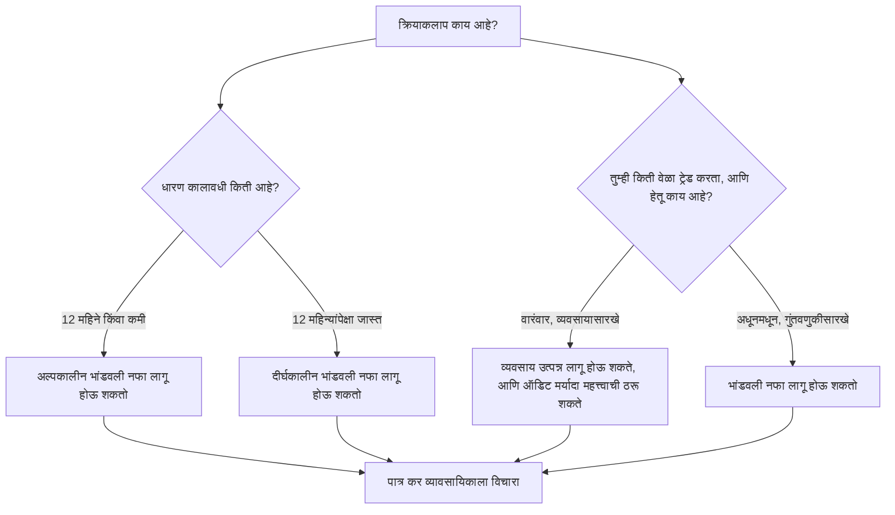

<!-- meta
id: T2.3
title: ट्रेडिंग नफ्यावरील कर
page_type: Concept
prerequisites: [T2.2, T1.9]
labs: []
estimated_minutes: 20
-->

# ट्रेडिंग नफ्यावरील कर

## प्रस्तावना

एक ट्रेडर वर्षभरात एकूण Rs 10,000 नफा कमावतो. त्याला ट्रेडिंग खर्च Rs 300 लागतो. उरलेले Rs 9,700 त्याचा नफा आहे, असे तो मानतो. काही महिन्यांनी कर नोटीस येते. ती त्याच्या नियोजनात नसलेल्या रकमेची असते. चूक अंकगणितात नव्हती. चूक ही होती की कर म्हणजे ट्रेडिंग उलाढालीची फक्त टक्केवारी, असे त्याने गृहीत धरले. व्यापाराचे वर्गीकरण कसे होते, हे ट्रेडरने तपासले नव्हते. हे प्रकरण आधी कल्पना समजावते. मग अधिकृत स्रोत सांगतात त्याप्रमाणे मुख्य नियम यादी करते.

## कल्पना

कर हा ट्रेडिंग खर्चापेक्षा वेगळा थर आहे. *ट्रेडवरील खर्च* प्रत्येक व्यापारावर ब्रोकर, एक्सचेंज आणि सरकारला दिला जातो. कर मात्र वर्षभराच्या निव्वळ नफ्यावर ठरतो. नियम क्रियाकलापाच्या प्रकारावर अवलंबून असतात.

तीन कल्पना महत्त्वाच्या आहेत:

- **वर्गीकरण.** तोच शेअर वेगवेगळ्या प्रकारे कराला पात्र ठरू शकतो. तुम्ही तो गुंतवणूक म्हणून धरता, व्यवसाय म्हणून ट्रेड करता, की इतर काही करता, यावर ते अवलंबून असते. वर्गीकरण तथ्यांवर ठरते. ती तथ्ये म्हणजे तुम्ही किती काळ धरता, किती वेळा ट्रेड करता आणि तुमचा हेतू काय आहे. डिलिव्हरी न घेता पूर्ण होणारा व्यापार (उदाहरणार्थ, एकाच दिवशी खरेदी आणि विक्री) कायदा सट्टा व्यवहार मानतो. असा व्यवहार व्यवसाय म्हणून केला, तर तो वेगळा "सट्टा व्यवसाय" ठरतो.
- **धारण कालावधी.** सूचिबद्ध शेअर्ससाठी, बारा महिने किंवा त्याहून कमी काळ धरलेला नफा अल्पकालीन असतो. बारा महिन्यांपेक्षा जास्त काळ धरलेला नफा दीर्घकालीन असतो. दोन्हींचे दर वेगळे आहेत.
- **तोटा समायोजन (loss set-off).** काही तोटे काही नफ्यांना रद्द करू शकतात. काही तोटे पुढच्या वर्षांत नेता येतात. खाली कोणता तोटा, कोणत्या नफ्याविरुद्ध, आणि किती काळासाठी, ते नियम दिले आहेत.

### सर्व मुख्य नियम एकाच ठिकाणी

हे नियम सूचिबद्ध शेअर्सना लागू होतात, जे एक्सचेंजवर खरेदी-विक्री होतात आणि ज्यावर STT भरला जातो. ते 2026-27 करवर्षापासून लागू होतात, जेव्हा नवा Income-tax Act, 2025 1 एप्रिल 2026 रोजी लागू झाला. तुमची स्थिती वेगळी असू शकते. कोणते नियम तुम्हाला लागू होतात, हे पात्र कर सल्लागाराने तपासावे.

| विषय | अधिकृत स्रोत काय सांगतात |
|---|---|
| सूचिबद्ध शेअर्सवरील अल्पकालीन नफा (12 महिने किंवा कमी धरलेला) | 20% दराने कर लागू |
| सूचिबद्ध शेअर्सवरील दीर्घकालीन नफा (12 महिन्यांपेक्षा जास्त धरलेला) | एका वर्षातील दीर्घकालीन नफ्याचे पहिले Rs 1,25,000 करमुक्त आहेत. त्यावरील भाग 12.5% दराने करपात्र आहे, इंडेक्सेशनशिवाय |
| STT अट | हे खास दर फक्त तेव्हा लागू होतात जेव्हा STT भरला गेला होता. दीर्घकालीन शेअर नफ्यासाठी, काही अपवाद वगळता, शेअर खरेदी आणि विक्री दोन्ही वेळी STT भरलेला असावा लागतो |
| भांडवली तोटा समायोजन | अल्पकालीन तोटा कोणत्याही भांडवली नफ्याविरुद्ध वजा करता येतो. दीर्घकालीन तोटा फक्त दीर्घकालीन नफ्याविरुद्धच वजा करता येतो |
| भांडवली तोटा पुढे नेणे | न वापरलेला भांडवली तोटा 8 वर्षांपर्यंत पुढे नेता येतो. तो फक्त भांडवली नफ्याविरुद्धच वापरता येतो |
| सट्टा नसलेले व्यवसाय उत्पन्न | तोटा त्याच वर्षी इतर उत्पन्न प्रकारांविरुद्ध वजा करता येतो (पगार वगळून). न वापरलेला तोटा 8 वर्षांपर्यंत पुढे नेता येतो, आणि तो फक्त व्यवसाय उत्पन्नाविरुद्धच वापरता येतो |
| सट्टा व्यवसाय (उदाहरणार्थ, डिलिव्हरीशिवाय इंट्राडे व्यापार) | तोटा फक्त दुसऱ्या सट्टा व्यवसायातील नफ्याविरुद्धच वजा करता येतो. न वापरलेला तोटा 4 वर्षांपर्यंत पुढे नेता येतो |
| कर ऑडिट | ज्या व्यक्तीला व्यवसाय उत्पन्न आहे, तिने उलाढाल Rs 1 कोटींपेक्षा जास्त असल्यास खात्यांचे ऑडिट करून घ्यावे लागते. रोख पावत्या आणि रोख देयके प्रत्येकी एकूण रकमेच्या 5% किंवा त्याहून कमी असतील, तर मर्यादा Rs 10 कोटी आहे |
| ITR फॉर्म (व्यक्ती) | फक्त भांडवली नफा असलेला परतावा ITR-2 मध्ये दाखवला जातो. व्यवसाय उत्पन्न, ट्रेडिंग व्यवसाय म्हणून केलेले ट्रेडिंग धरून, ITR-3 मध्ये दाखवले जाते |
| लाभांश | लाभांश तुमच्या उत्पन्नात जोडला जातो आणि "इतर स्रोतांकडून उत्पन्न" म्हणून करपात्र होतो. कंपनी पैसे देण्यापूर्वी कर कापू शकते. ते मिळवण्यासाठी उधार घेतलेल्या पैशावरील व्याज वजा करता येते, फक्त लाभांशाच्या 20% पर्यंत |
| कर पद्धत | नवी कर पद्धत ही डीफॉल्ट आहे. व्यवसाय उत्पन्न असलेल्या व्यक्तीला जुनी पद्धत हवी असल्यास, ती परतावा भरण्याच्या शेवटच्या तारखेपर्यंत निवडावी लागते. ही निवड परत बदलता येते, पण फक्त एकदाच |

(11 नोव्हेंबर 2026 पर्यंत. स्रोत: आयकर विभागाने प्रकाशित केलेला Income-tax Act, 2025, आणि तोटा समायोजन व ITR फॉर्मवरील आयकर विभागाची e-filing मदत पाने. दर आणि मर्यादा दरवर्षीच्या अर्थसंकल्पानुसार बदलतात, म्हणून incometax.gov.in दरवर्षी तपासा.)

जुन्या Income-tax Act, 1961 अंतर्गत 31 मार्च 2026 पर्यंतच्या उत्पन्नासाठीही हेच नियम लागू होते. कलमांचे क्रमांक बदलले, पण वरील दर बदलले नाहीत. आधीच्या वर्षांचे तोटे नव्या कायद्यातही पुढे नेले जातात, जसे जुन्या कायद्यात नेले जात होते.

खर्चही महत्त्वाचे आहेत. भांडवली नफा काढताना STT ला वजावट म्हणून परवानगी नाही. व्यवसाय उत्पन्नासाठी, व्यवसायाच्या ओघात केलेल्या व्यापारांवर भरलेला STT व्यवसाय खर्च म्हणून दाखवता येतो. ब्रोकरेजसारखे इतर खर्च उत्पन्नाच्या प्रकारावर अवलंबून असतात. कोणते खर्च लागू होतात, ते व्यावसायिकाला विचारा.

**पुस्तक काय करते आणि काय करत नाही.** हे पुस्तक तुमचा कर काढत नाही. तुमचा कर तुमच्या स्वतःच्या तथ्यांवर, इतर उत्पन्नावर आणि वर्षावर अवलंबून असतो. खालील सराव गणितात फक्त बीजगणित दाखवण्यासाठी बनवलेला दर वापरला आहे.

**सूत्र, आधी शब्दांत.** निव्वळ निकाल = एकूण नफा - ट्रेडिंग खर्च - कर. कर = दर x करपात्र आधार. करपात्र आधार वर्गीकरणावर अवलंबून असतो. त्यातून खर्च वजा करता येतो का, हे उत्पन्नाच्या प्रकारावर अवलंबून असते, जसे वरील नोंदी दाखवतात.

चिन्हांमध्ये, G म्हणजे एकूण नफा, C म्हणजे ट्रेडिंग खर्च, B म्हणजे करपात्र आधार, आणि t म्हणजे कर दर. सराव गणितात t ही बनवलेली संख्या आहे.

- जर खर्च वजा करता येत असेल, तर B = G - C.
- कर = t x B.
- निव्वळ = G - C - t x B.

t ही जागा धरणारी चिन्ह आहे. खालील सरावात तिला फक्त बीजगणित दाखवण्यासाठी बनवलेली किंमत दिली आहे. खरे दर वरील तक्त्यात आहेत.

**वर्गीकरणाबद्दलचे प्रश्न.** कराच्या आकड्याला अर्थ येण्यापूर्वी तुम्हाला उत्तरे हवीत. उदाहरणार्थ: मी हे किती काळ धरले? वर्षभरात मी किती व्यापार केले? मी गुंतवणूक करत होतो, की ट्रेडिंग व्यवसाय म्हणून चालवत होतो? पात्र कर व्यावसायिकाने हे प्रश्न तुमच्याबरोबर सोडवावेत. तुमची उत्तरे जर्नलमध्ये लिहिल्याने मदत होते. जर्नल हीच ती नोंद बनते, जी तुम्हाला लागेल.

## हे पाहा

खालील निर्णय-वृक्ष वर्गीकरण ठरवणाऱ्या प्रश्नांचे प्रकार दाखवतो. तो निकाल देत नाही. प्रत्येक शाखा व्यावसायिकासाठी एका प्रश्नावर संपते.

वरून खाली निर्णय-वृक्ष वाचा. शाखा दाखवतात की व्यावसायिकाकडे कोणती तथ्ये न्यावी लागतील. दर वरील तक्त्यात आहेत.

<!-- component: tax-calc | trades: 6000,3000,1000 | costs: 300 | rate: 20 | caption: डमी कर दर वापरून सराव गणित. हा खरा दर नाही. अधिकृत स्रोत तपासा किंवा कर व्यावसायिकाला विचारा. -->

## सोडवलेले उदाहरण

**काल्पनिक, सांकेतिक.** एकूण नफा Rs 10,000 आहे. ट्रेडिंग खर्च Rs 300 आहे. या सराव गणितासाठी, खर्च करपात्र आधारातून वजा करता येतो असे गृहीत धरा. प्रत्यक्षात हे उत्पन्नाच्या प्रकारावर अवलंबून असते, जसे वर नमूद केले आहे.

| पायरी | सूत्र | मूल्य |
|---|---|---|
| एकूण नफा | G | Rs 10,000 |
| ट्रेडिंग खर्च | C | Rs 300 |
| करपात्र आधार | B = G - C | 10,000 - 300 = Rs 9,700 |
| कर | t x B | t x 9,700 |
| निव्वळ निकाल | G - C - t x B | 10,000 - 300 - t x 9,700 = 9,700 - 9,700t |

**डमी उदाहरण, फक्त बीजगणितासाठी (बनवलेली गोल संख्या, तुमचा कर नाही).** जर t 20% असता, तर कर 0.20 x 9,700 = Rs 1,940 झाला असता. निव्वळ 9,700 - 1,940 = Rs 7,760 झाला असता. येथील 20% फक्त बीजगणित बरोबर चालते हे दाखवते. ते कोणाच्याही खऱ्या कराचे गणित नाही. त्याला कराचा आकडा म्हणून वापरू नका.

## हे करून पाहा

### मार्गदर्शित सराव

**काम.** एका बनवलेल्या वर्षात एकूण नफा Rs 4,000 आणि ट्रेडिंग खर्च Rs 200 आहे. जागा धरणारा दर t वापरून निव्वळ सूत्र लिहा. t हे चिन्हच ठेवा. त्यात संख्या टाकू नका.

संकेत:

1. आधी करपात्र आधार शोधा. तो एकूण नफा वजा खर्च असतो.
2. कर म्हणजे t गुणिले करपात्र आधार.
3. निव्वळ म्हणजे एकूण नफा वजा खर्च वजा कर.

**उत्तर:** करपात्र आधार = 4,000 - 200 = 3,800. कर = t x 3,800. निव्वळ = 4,000 - 200 - t x 3,800 = 3,800 - 3,800t, म्हणजे 3,800 x (1 - t).

<!-- component: tax-calc | trades: 4000 | costs: 200 | rate: 20 | caption: मार्गदर्शित सराव: एकूण नफा Rs 4,000 आणि खर्च Rs 200. कागदावर दर चिन्हाच्या रूपात ठेवा. स्लायडर कल्पना दाखवण्यासाठी फक्त डमी दर वापरतो. -->

### स्वतंत्र सराव

**काम.** तुमच्या पहिल्या ट्रेडिंग वर्षापूर्वी पात्र कर व्यावसायिकाकडे नेण्यासाठी पाच प्रश्नांची यादी करा.

तुमचे उत्तर तपासा

एकच बरोबर यादी नाही. चांगल्या प्रश्नांची ही उदाहरणे आहेत:

1. माझा धारण कालावधी माझ्या नफ्यावरील कर नियम कसा बदलतो?
2. ट्रेडिंग क्रियाकलाप किती पातळीवर व्यवसाय मानला जातो, आणि त्यामुळे माझे कर नियम बदलतात का?
3. माझे कोणते तोटे कोणते नफे रद्द करू शकतात? कोणते पुढे नेता येतील, आणि किती काळासाठी?
4. माझे ट्रेडिंग खर्च माझा करपात्र आधार कमी करतात का, आणि कोणते खर्च?
5. मला कर ऑडिटची अट पूर्ण करावी लागते का, आणि कोणत्या उलाढालीवर?

## क्विझ

<!-- component: quiz-block | src: quiz.json -->

क्विझ मुख्य कल्पना तपासतो. कर म्हणजे उलाढालीची सपाट टक्केवारी नाही. धारण कालावधी आणि वर्गीकरण महत्त्वाचे आहेत. तोटा समायोजनाचे स्वतःचे नियम आहेत.

## कागदी काम

**पद्धत:** शिकण्याची नोंद. ती तुमच्या जर्नलमध्ये लिहा.

1. तुम्ही नोंदवलेल्या प्रत्येक व्यापारासाठी एक वर्गीकरण नोंद स्तंभ जोडा, ज्यात तीन नोंदी असतील: धारण कालावधी, हेतू, आणि तुम्ही किती वेळा ट्रेड करता.
2. कोणताही कर आकडा काढू नका. हा स्तंभ पुढच्या वापरासाठी नोंद आहे, आणि व्यावसायिक तो वापरू शकतो.
3. नोंदींवर "शिकण्याची नोंद" असा शिक्का लावा, लाइव्ह नोंद नव्हे.

## मर्यादा आणि नेहमीच्या चुका

- तुम्ही किती कर भराल हे ते सांगत नाही. ते अधिकृत स्रोत सांगतात तसे मुख्य नियम यादी करते. तुमची स्थिती वेगळी असू शकते.
- हा कर सल्ला नाही. हे पुस्तक कर सल्ला देत नाही. पात्र व्यावसायिकाशी बोला.
- नफा आणि तोटा प्रत्येक क्रियाकलापात नेहमी सारखे हाताळले जात नाहीत. हे फरकच सल्ला घेण्याचे कारण आहेत.
- कोणत्याही योजनेसाठी कराचे बिल लहान आहे की मोठे, हे ते दाखवत नाही. नियमांनुसार, तोट्याच्या वर्षात कराचे बिल अपेक्षेपेक्षा मोठे असू शकते.

## लक्षात ठेवा

- कर ट्रेडिंग खर्चापेक्षा वेगळा आहे. तो क्रियाकलापावर अवलंबून असलेल्या नियमांनुसार निव्वळ नफ्यावर लागू होतो.
- वर्गीकरण, धारण कालावधी आणि तोटा समायोजन बहुतेक कर नियम ठरवतात. सूचिबद्ध शेअर्ससाठी सीमारेषा 12 महिने आहे. अल्पकालीन नफ्यावर 20% कर लागतो. वर्षाला Rs 1,25,000 वरील दीर्घकालीन नफ्यावर 12.5% कर लागतो.
- सूत्र असे आहे: निव्वळ = एकूण नफा - खर्च - कर, आणि कर = दर x करपात्र आधार.
- सुरुवातीपासूनच प्रत्येक व्यापाराची वर्गीकरण नोंद ठेवा.
- हे प्रश्न पात्र कर व्यावसायिकाकडे न्या.

## स्रोत आणि पडताळणी

- Income-tax Act, 2025 (Act 30 of 2025), आयकर विभागाने प्रकाशित केलेला (incometaxindia.gov.in). त्यात सूचिबद्ध शेअर्सवरील दर, Rs 1,25,000 सूट, तोटा समायोजन आणि पुढे नेणे, सट्टा व्यवसाय, कर ऑडिट मर्यादा आणि नवी कर पद्धत आहे. 11 नोव्हेंबर 2026 रोजी वाचले.
- आयकर विभागाची e-filing मदत पाने (incometax.gov.in), तोट्याचे समायोजन आणि पुढे नेणे, आणि व्यवसाय उत्पन्नासाठीच्या ITR फॉर्मवर. 11 नोव्हेंबर 2026 रोजी वाचले.
- जुन्या Income-tax Act, 1961 अंतर्गत 23 जुलै 2024 रोजी किंवा नंतरच्या हस्तांतरणांसाठीही हेच दर आणि धारण कालावधी लागू होते.
- Zerodha Varsity कर विभाग, फक्त संदर्भासाठी (फक्त दुवा, मजकूर कॉपी केलेला नाही).

<!-- facts-needed: classification rules for trading income; short-term and long-term capital gains rates and holding-period thresholds; business and speculative income treatment; loss set-off and carry-forward rules; tax audit turnover thresholds; tax regime choice and changes; dividend taxation. -->

<!-- standing-disclaimer -->
