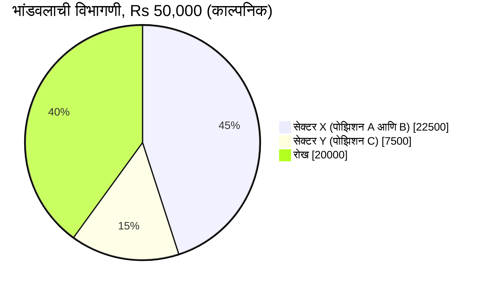

<!-- meta
id: T2.14
title: पोर्टफोलिओ एक्सपोजर आणि एकाग्रता
page_type: Math/Calculator
prerequisites: [T2.5, T2.11, T1.8]
labs: [Lab 3, Lab 1]
estimated_minutes: 25
-->

# पोर्टफोलिओ एक्सपोजर आणि एकाग्रता

## प्रस्तावना

काल्पनिक: एक ट्रेडर पाच शेअर्स धरून बसला आहे आणि म्हणतो, "माझी गुंतवणूक विविध आहे." त्यातील पाचपैकी तीन शेअर्स एकाच सेक्टरमधले आहेत. त्या सेक्टरमध्ये एक वाईट आठवडा आला, तर ते तिन्ही एकाच दिशेने, एकाच दिवशी हलतात. खात्याला पाच वेगळे डाव वाटतात. प्रत्यक्षात ते एकाच मोठ्या डावासारखे वागले.

## कल्पना

चार संज्ञा लक्षात ठेवा:

- **एक्सपोजर** म्हणजे तुमच्या पोझिशन्सचे रुपयांतील मूल्य. ते अनेकदा भांडवलाची टक्केवारी म्हणून लिहिले जाते. एक्सपोजर म्हणजे जोखीम नव्हे. पोझिशन मोठी असू शकते, आणि तरीही तिचा नियोजित तोटा छोटा असू शकतो.
- **ओपन जोखीम** म्हणजे प्रत्येक स्टॉप त्याच्या स्टॉप भावावर पूर्ण झाला तर होणारा नियोजित तोटा.
  - ओपन जोखीम = प्रत्येक पोझिशनसाठी (एंट्री - स्टॉप) x शेअर्स, यांची बेरीज.
  - हा नियोजित तोटा आहे, कमाल तोटा नव्हे. गॅप आणि सर्किट (एक्सचेंजने ठरवलेल्या दैनिक भाव मर्यादा) यांमुळे प्रत्यक्ष तोटा मोठा होऊ शकतो (*स्लिपेज, गॅप आणि नियोजित विरुद्ध प्रत्यक्ष जोखीम*).
- **एकाग्रता** म्हणजे तुमचे भांडवल एका शेअरमध्ये, एका सेक्टरमध्ये किंवा एका थीममध्ये किती आहे.
- **सहसंबंध** म्हणजे एकत्र हलण्याकडे कल असलेल्या पोझिशन्स. एकाच सेक्टरमधील शेअर्स अनेकदा एकत्र हलतात. एकत्र हलणारे पाच शेअर्स हे पाच वेगळ्या डावांपेक्षा एका डावाच्या जवळ असतात.

इतर मुद्दे:

- **रोख** = भांडवल - गुंतवलेले मूल्य. गुंतवलेले मूल्य म्हणजे सर्व पोझिशन्सच्या मूल्यांची बेरीज.
- **विविधीकरण** एका कंपनीमुळे किंवा एका घटनेमुळे येणारी जोखीम कमी करते. ते संपूर्ण बाजारावर येणारी जोखीम काढून टाकत नाही.
- **मर्यादा.** तुम्ही प्रत्येक पोझिशनसाठी, प्रत्येक सेक्टरसाठी आणि एकूण ओपन जोखमीसाठी कमाल मर्यादा ठरवता. Lab 1 मध्ये सुरुवातीचे मूल्य म्हणून प्रति पोझिशन 25% ची मर्यादा वापरली आहे. सेक्टरच्या मर्यादा तुम्ही ठरवता.
- **तोट्यातील पोझिशनमध्ये भर घालणे**, सरासरी खर्च कमी करण्यासाठी, अपयशी ठरत असलेल्या कल्पनेतील एकाग्रता वाढवते. याला **सरासरी कमी करणे** म्हणतात. या पुस्तकाचे भांडवल-प्रथम नियम ते करण्यास मनाई करतात (*पोझिशन साइजिंग टप्प्याटप्प्याने*). भर घालण्यापूर्वी मर्यादा तपासा.
- **सेक्टर लेबल्स** तुमच्या डेटामधून येतात. त्यांचा स्रोत NSE सेक्टोरल निर्देशांकाच्या व्याख्यांशी तपासा. NSE Indices प्रत्येक कंपनीला चार स्तरांत ठेवते: मॅक्रो-इकॉनॉमिक सेक्टर, सेक्टर, इंडस्ट्री आणि बेसिक इंडस्ट्री. इतर डेटा पुरवठादार वेगळी लेबल्स वापरू शकतात, त्यामुळे दोन यादींत एकच कंपनी वेगळ्या गटात दिसू शकते. (11 नोव्हेंबर 2026, NSE Indices चे इंडस्ट्री वर्गीकरण असे होते. नियम बदलतात, त्यामुळे NSE साइट तपासा.)

## हे पाहा

सोडवलेल्या उदाहरणाचा पाय चार्ट, रुपयांतील मूल्यांसह (काल्पनिक):

चार्ट दाखवतो की सेक्टर X हा भांडवलाचा सर्वात मोठा तुकडा आहे. सेक्टर X भांडवलाच्या 45% आहे, आणि रोख 40% आहे. सोडवलेल्या उदाहरणातील तक्त्यात ओपन जोखीम आणि सेक्टर मर्यादा देखील दिसतात. पाय चार्ट त्या दाखवू शकत नाही.

<!-- component: exposure-meter | capital: 50000 | caption: सोडवलेल्या उदाहरणातील तीन पोझिशन्स, Rs 50,000 खात्यात. Add position D (पोझिशन D जोडा) दाबून पाहा की कोणती मर्यादा मोडते. मर्यादा केवळ उदाहरणासाठी आहेत. -->

## सोडवलेले उदाहरण

**काल्पनिक.** भांडवल Rs 50,000. धरलेल्या पोझिशन्स:

| पोझिशन | सेक्टर | मूल्य | भांडवलाचा वाटा | स्टॉपवर नियोजित तोटा |
|---|---|---|---|---|
| A | X | 10,000 | 20% | 500 |
| B | X | 12,500 | 25% | 500 |
| C | Y | 7,500 | 15% | 300 |

1. **गुंतवलेले मूल्य:** 10,000 + 12,500 + 7,500 = Rs 30,000. भांडवलाच्या तुलनेत वाटा: 30,000 / 50,000 = 60%.
2. **रोख:** 50,000 - 30,000 = Rs 20,000, जे 40% आहे.
3. **ओपन जोखीम:** 500 + 500 + 300 = Rs 1,300. भांडवलाच्या तुलनेत वाटा: 1,300 / 50,000 = 2.6%.
4. **सेक्टर X:** 10,000 + 12,500 = Rs 22,500. भांडवलाच्या तुलनेत वाटा: 22,500 / 50,000 = 45%. हे उदाहरणातील सेक्टर मर्यादा 50% च्या आत आहे.

**नवीन पोझिशन जोडणे.** पोझिशन D ही सेक्टर X मधील Rs 6,000 ची आहे, तिचा नियोजित तोटा Rs 300.

5. सेक्टर X होतो 22,500 + 6,000 = Rs 28,500. भांडवलाच्या तुलनेत वाटा: 28,500 / 50,000 = 57%.
6. ओपन जोखीम होते 1,300 + 300 = Rs 1,600. भांडवलाच्या तुलनेत वाटा: 1,600 / 50,000 = 3.2%.
7. उदाहरणातील सेक्टर मर्यादा भांडवलाच्या 50% आहे. D च्या आधी सेक्टर X 45% वर आहे, जे मर्यादेत आहे. D नंतर तो 57% होतो, जो 50% च्या वर आहे, म्हणून मर्यादा मोडली आहे. **नवीन पोझिशन नाकारली जाते.** सेक्टर मर्यादा हाच नियम आहे ज्यामुळे नकार होतो.

## हे करून पाहा

प्रत्येक सराव आधी हाताने सोडवा. मग तुमचे उत्तर तपासण्यासाठी डेमो वापरा. *हे पाहा* खालील डेमो सोडवलेल्या उदाहरणातील तीन पोझिशन्सवर उघडतो, म्हणून तो मार्गदर्शित सरावाला योग्य आहे. स्वतंत्र सरावाचा स्वतःचा डेमो त्याखाली आहे.

### मार्गदर्शित सराव

**काम.** सोडवलेल्या उदाहरणातील होल्डिंग्ज वापरून गुंतवलेली टक्केवारी, ओपन जोखमीची टक्केवारी आणि सेक्टर Y चा वाटा काढा.

संकेत:

1. आधी पोझिशन मूल्यांची बेरीज करा, मग ती भांडवलाने भागा.
2. नियोजित तोट्यांची बेरीज करा, मग ती भांडवलाने भागा.
3. सेक्टर Y मध्ये फक्त एकच पोझिशन आहे.

**उत्तर:** गुंतवलेले 30,000 / 50,000 = 60%. ओपन जोखीम 1,300 / 50,000 = 2.6%. सेक्टर Y 7,500 / 50,000 = 15%.

### स्वतंत्र सराव

**काम.** चार पोझिशन्स, प्रत्येक भांडवलाच्या 25% इतकी, आणि प्रत्येकाचा नियोजित तोटा भांडवलाच्या 1% इतका. एकूण ओपन जोखीम आणि गुंतवलेली टक्केवारी काढा. मग स्पष्ट करा की चारही एकाच सेक्टरमध्ये असतील तर ही एकाग्रतेची समस्या का आहे.

तुमचे उत्तर तपासा

प्रत्येक पोझिशन भांडवलाच्या 25% आहे, म्हणून गुंतवलेले = 4 x 25% = 100%. रोख = 0.

प्रत्येक नियोजित तोटा भांडवलाच्या 1% आहे, म्हणून ओपन जोखीम = 4 x 1% = 4%.

चारही एकाच सेक्टरमध्ये असतील, तर एका सेक्टरच्या हालचालीने चारही स्टॉप एकाच वेळी गाठले जाऊ शकतात. चार पोझिशन्स चार वेगळ्या डावांपेक्षा त्या सेक्टरवरील एका मोठ्या डावाच्या जवळ असतात. त्यामुळे सेक्टरचा वाटा (भांडवलाच्या 100%) ही एकाग्रतेची समस्या आहे.

<!-- component: exposure-meter | capital: 50000 | caption: स्वतंत्र सरावाची तपासणी: Four equal positions (चार समान पोझिशन्स) दाबा, एक सेक्टर निवडा, आणि ओपन जोखीम व सेक्टरचा वाटा वाचा. -->

## क्विझ

<!-- component: quiz-block | src: quiz.json -->

सहा प्रश्न ओपन जोखीम, सेक्टरचा वाटा, एक्सपोजर आणि जोखीम यातील फरक, सहसंबंध आणि सेक्टर बेरजेतील चूक शोधणे यांवर आहेत.

## कागदी काम

**पद्धत:** शिकण्याची नोंद (किंवा कागदी काम). कोणतीही ऑर्डर दिली जात नाही.

1. तुमच्या जर्नलमध्ये एक साप्ताहिक पोर्टफोलिओ स्नॅपशॉट लिहा. फक्त बनावट होल्डिंग्ज वापरा.
2. प्रत्येक पोझिशनसाठी मूल्य, सेक्टर, भांडवलाचा वाटा आणि स्टॉपवरील नियोजित तोटा लिहा.
3. एकूण बेरीज करा: गुंतवलेले, रोख, ओपन जोखीम आणि प्रत्येक सेक्टरचा वाटा.
4. प्रत्येक बेरीज तुमच्या मर्यादांशी तपासा. कोणतीही मर्यादा मोडली आहे का, यावर एक ओळ लिहा.

जर्नल अॅप तयार नसेल, तर कागद वापरा.

## मर्यादा आणि सामान्य चुका

- एक्सपोजर आणि ओपन जोखीम हे अंदाज नाहीत. ओपन जोखीम गृहीत धरते की प्रत्येक स्टॉप त्याच्या स्टॉप भावावर पूर्ण होतो. गॅप आणि सर्किट ती गृहीतके मोडू शकतात (*स्लिपेज, गॅप आणि नियोजित विरुद्ध प्रत्यक्ष जोखीम*).
- सेक्टर लेबल्स डेटा स्रोतावर अवलंबून असतात. वापरण्यापूर्वी स्रोत तपासा.
- विविधीकरण बाजारव्यापी जोखीम काढून टाकत नाही. व्यापक घसरण प्रत्येक सेक्टरवर परिणाम करू शकते.
- 50% सेक्टर मर्यादा ही उदाहरणासाठी आहे. प्रत्येक मर्यादा तुम्ही ठरवता.
- तोट्यातील पोझिशनमध्ये सरासरी खर्च कमी करण्यासाठी भर घालणे एकाग्रता वाढवते. तो उपाय नाही.

## लक्षात ठेवा

- एक्सपोजर म्हणजे मूल्य. ओपन जोखीम म्हणजे नियोजित तोटा. त्या वेगळ्या संख्या आहेत.
- ओपन जोखीम = सर्व पोझिशन्समधील (एंट्री - स्टॉप) x शेअर्स यांची बेरीज.
- एकाच सेक्टरमधील पोझिशन्स अनेकदा एकत्र हलतात. त्यांना एक मोठा डाव म्हणून मोजा.
- पोझिशन जोडताना प्रत्येक वेळी सेक्टरची बेरीज अद्ययावत करा.
- पोझिशन जोडण्यापूर्वी प्रत्येक मर्यादा तपासा, नंतर नव्हे.

## स्रोत आणि पडताळणी

स्रोत (फक्त नावे):

- NSE सेक्टोरल निर्देशांक कार्यपद्धतीची कागदपत्रे.

NSE Indices चे चार स्तरांचे इंडस्ट्री वर्गीकरण 11 नोव्हेंबर 2026 रोजी NSE Indices साइटवरून वाचले गेले.

<!-- standing-disclaimer -->
