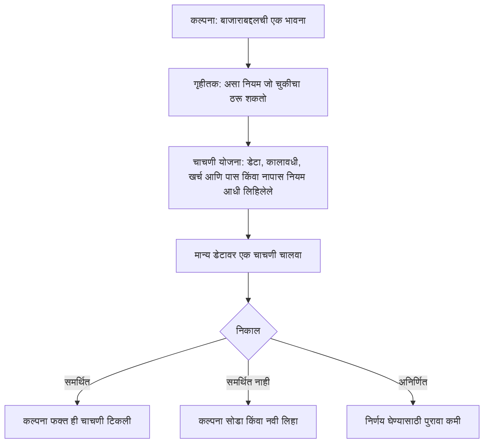

<!-- meta
id: T7.1
title: कल्पनेपासून गृहीतक आणि चाचणी योजनेपर्यंत
page_type: Concept
prerequisites: [T6.2, T6.4]
labs: []
estimated_minutes: 15
-->

# कल्पनेपासून गृहीतक आणि चाचणी योजनेपर्यंत

## प्रस्तावना

समजा तुमच्या मनात कल्पना आहे: जे शेअर्स नवा उच्चांक गाठतात, ते वर जात राहतात. तुम्ही ही कल्पना जुन्या भावांवर तपासता. तीन वेगवेगळे स्टॉप पातळी वापरता आणि सर्वाधिक नफा दाखवणारी पातळी ठेवता. नफा चांगला दिसतो. पण स्टॉप तुम्ही निकाल पाहिल्यानंतर निवडला. त्या निवडीमुळे चाचणी अन्याय्य होते. निकाल तुम्हाला फार थोडे सांगू शकतो. हे प्रकरण दाखवते की कल्पना अशी कशी लिहायची, की चाचणी तिची खरी तपासणी करू शकेल.

## कल्पना

**कल्पना** म्हणजे बाजाराबद्दलची एक भावना. "अलीकडे भाव मजबूत वाटतात" ही कल्पना आहे. भावना जशी आहे तशी कोणी तपासू शकत नाही. कोणताही निकाल तिला चुकीचे ठरवणार नाही.

**गृहीतक** म्हणजे असा नियम, जो चुकीचा ठरू शकतो. त्याला स्पष्ट एंट्री, स्पष्ट एक्झिट आणि स्पष्ट साइज असतो. प्रत्येक भाग एक संख्या किंवा साधी अट असतो. मग चाचणी दाखवू शकते की नियम अपयशी ठरला. ट्रेडिंग एज म्हणजे खरा, पुन्हा मिळणारा फायदा असलेला नियम (*ट्रेडिंग एज म्हणजे काय*). गृहीतक हे तपासण्याचे साधन आहे की एज खरंच आहे का.

**चुकीचे ठरवता येणे** म्हणजे कोणता निकाल तुम्हाला कल्पना सोडायला लावेल, हे सांगता येणे. "खर्च वजा केल्यानंतर सरासरी निकाल शून्यापेक्षा वर नसेल, तर मी कल्पना सोडीन" अशी योजना चुकीचे ठरवता येण्यासारखी आहे. कोणताही निकाल तिला चुकीचे ठरवू शकत नसेल, तर कल्पना चाचणीसाठी तयार नाही.

**पास किंवा नापास होण्याचा नियम आधी ठरवा, मग डेटा पाहा.** निकाल पाहिल्यानंतर नियम बदलणे ही स्वतःची फसवणूक करण्याची सर्वात सामान्य पद्धत आहे. मग चाचणी भूतकाळाला बसवलेली तडजोड बनते. ती कल्पनेची तपासणी राहत नाही.

**चाचणी योजना** म्हणजे चाचणीपूर्वी लिहिलेली ही माहिती:

- **विश्व:** ज्या शेअर्सची चाचणी घ्यायची ते शेअर्स.
- **डेटा स्रोत:** भाव कुठून येतात. त्याच्या अटी वाचा.
- **कालावधी:** चाचणी ज्या तारखांचा समावेश करते त्या तारखा.
- **विभागणी:** डेटा कसा विभागला आहे. एक भाग नियम बनवण्यासाठी. दुसरा भाग शेवटच्या तपासणीसाठी राखून ठेवलेला (*नमुन्याबाहेरील आणि वॉक-फॉरवर्ड चाचणी*).
- **एंट्री, स्टॉप आणि एक्झिट:** कधी व्यापार उघडायचा, कधी तोटा कापायचा आणि कधी बाहेर पडायचे, हे ठरवणारे नियम.
- **साइजिंग:** प्रत्येक व्यापारात किती शेअर्स वापरायचे (*पोझिशन साइजिंग, टप्प्याटप्प्याने*).
- **खर्च:** चाचणीत धरलेले शुल्क आणि स्लिपेज (*एका व्यापारावरील खर्च*).
- **मेट्रिक्स:** तुम्ही वाचणारे आकडे, जसे की अपेक्षित परतावा (*अपेक्षित परतावा आणि नफा घटक*).
- **पास किंवा नापास नियम:** कोणता निकाल परिणाम ठरवतो, तो नियम.
- **आजमावलेल्या आवृत्त्यांची संख्या:** प्रत्येक आवृत्ती, जी तुम्ही आजमावली, त्या सोडून दिलेल्यांसह.

चाचणीचे तीन संभाव्य निकाल असतात:

- **समर्थित:** या नियमांखाली कल्पना ही चाचणी पार झाली.
- **समर्थित नाही:** या नियमांखाली कल्पना अपयशी ठरली. ती सोडा किंवा नवी कल्पना लिहा. नियम बदलून ती वाचवू नका.
- **अनिर्णित:** चाचणीने निर्णय दिला नाही. उदाहरणार्थ, व्यापार फार कमी झाले, त्यामुळे काही सांगता येत नाही.

पास झालेली चाचणी हा कमकुवत पुरावा आहे. याचा अर्थ कल्पना एक चाचणी टिकली. यावरून कल्पना काम करते, हे सिद्ध होत नाही.

## हे पाहा

वरपासून खालपर्यंत बाण अनुसरा. चाचणी योजना चाचणी चालवण्याआधी असली पाहिजे. तीनही निकालांपैकी प्रत्येक वेगळ्या पुढच्या पायरीकडे नेतो. या आकृतीत कोणतीही पेटी व्यापार म्हणत नाही.

<!-- component: hypothesis-builder | caption: सैल कल्पनेचे चाचणी करता येणारे नियम बनवा, आधी पास नियम लॉक करा, मग निकालावरून काय सांगता येते ते पाहा. -->

## सोडवलेले उदाहरण

**काल्पनिक.** कल्पना आहे: जे शेअर्स नवा उच्चांक गाठतात, ते वर जात राहतात. या कल्पनेवरून लिहिलेले एक चाचणी करता येणारे गृहीतक येथे आहे.

| भाग | नियम |
|---|---|
| एंट्री | मागील 55 दिवसांतील सर्वाधिक भावापेक्षा दिवसाचा बंद वर गेल्यावर, पुढच्या दिवसाच्या ओपनिंग भावाला खरेदी करा. |
| स्टॉप | एंट्री भावाच्या 2.5 पट ATR(14) खाली. ATR म्हणजे सरासरी खरा रेंज, म्हणजे एका दिवसात भाव साधारणपणे किती हलतो याचे मोजमाप. 14 म्हणजे वापरलेल्या दिवसांची संख्या. |
| एक्झिट | स्टॉप 3 पट ATR वर ट्रेल करा. ट्रेलिंग स्टॉप भाव वाढल्यावर वर सरकतो. तो खाली सरकत नाही. |
| साइज | प्रति व्यापार Rs 50,000 च्या 1% = Rs 500 जोखीम. |
| खर्च | लॅब 2 मधील खर्च सेटिंग्जमधील खर्च. |
| पास नियम | नमुना राखून ठेवलेल्या कालावधीत खर्च वजा केल्यानंतर अपेक्षित परतावा शून्यापेक्षा वर असला पाहिजे. अपेक्षित परतावा म्हणजे प्रति व्यापार सरासरी निकाल. राखून ठेवलेला कालावधी म्हणजे अंतिम तपासणीसाठी बाजूला ठेवलेला डेटाचा भाग. |

आता एका निकालानंतर पास नियम बदला. समजा पहिल्या चाचणीत प्रति व्यापार अपेक्षित परतावा Rs 20 वजा आला. तुम्ही पास नियम "प्रति व्यापार वजा Rs 50 पेक्षा वर" असा बदलता. आता कल्पना पास होते. पण नवा नियम वेगळी, न तपासलेली कल्पना आहे. पहिल्या चाचणीने आधीच ती समर्थित नाही, असे सांगितले होते.

## हे करून पाहा

### मार्गदर्शित सराव

**काम.** प्रत्येक अस्पष्ट कल्पनेचे गृहीतक बनवा. प्रत्येकासाठी एंट्रीची अट, एक्झिट आणि "काम करते" हे ठरवणारी एक संख्या लिहा.

1. मजबूत शेअर्स विकत घ्या.
2. बाजार कमजोर वाटतो तेव्हा विक्री करा.
3. स्वस्त वाटणारे शेअर्स विकत घ्या.

संकेत:

1. एंट्रीची अट मोजता येईल अशा पद्धतीने लिहा. "मजबूत" किंवा "स्वस्त" सारख्या शब्दांना संख्या लागते.
2. एक्झिट अशी अट म्हणून लिहा, जी तुम्ही भावाच्या चार्टवर तपासू शकता.
3. "काम करते" हे ठरवणारी एक संख्या निवडा. उदाहरणार्थ, खर्च वजा केल्यानंतर अपेक्षित परतावा शून्यापेक्षा वर.

**उत्तर:**

1. एंट्री: मागील 20 दिवसांतील सर्वाधिक बंद भावापेक्षा बंद वर गेल्यावर, पुढच्या दिवसाच्या ओपनला खरेदी करा. एक्झिट: मागील 10 दिवसांतील सर्वात कमी बंद भावापेक्षा बंद खाली गेल्यावर, पुढच्या दिवसाच्या ओपनला विक्री करा. काम करते: राखून ठेवलेल्या कालावधीत खर्चानंतर अपेक्षित परतावा शून्यापेक्षा वर.
2. "कमजोर वाटतो" ही कल्पना तुमच्याकडे आधीच असलेल्या शेअर्सच्या एक्झिटसाठी आहे. एक्झिट: निवडलेला बाजार निर्देशांक 50 दिवसांच्या सरासरी बंद भावाच्या खाली बंद झाल्यावर, पुढच्या दिवसाच्या ओपनला विक्री करा. काम करते: राखून ठेवलेल्या कालावधीत प्रति व्यापार खर्चानंतरचा सरासरी निकाल शून्यापेक्षा वर.
3. एंट्री: बंद भाव 60 दिवसांच्या सरासरी बंद भावापेक्षा किमान 10% खाली गेल्यावर, पुढच्या दिवसाच्या ओपनला खरेदी करा. एक्झिट: बंद भाव 60 दिवसांच्या सरासरीपर्यंत परत आल्यावर किंवा 20 ट्रेडिंग दिवसांनंतर, जे आधी येईल तेव्हा, पुढच्या दिवसाच्या ओपनला विक्री करा. काम करते: राखून ठेवलेल्या कालावधीत खर्चानंतर अपेक्षित परतावा शून्यापेक्षा वर.

प्रत्येकाला सोप्या उदाहरणासारखा स्टॉप आणि साइज जोडा.

### स्वतंत्र सराव

**काम.** तुमच्या स्वतःच्या निवडीच्या ब्रेकआउट कल्पनेसाठी पूर्ण चाचणी योजना लिहा. *कल्पना* या भागात दिलेले प्रत्येक क्षेत्र समाविष्ट करा.

तुमचे उत्तर तपासा

एक नमुना योजना. सर्व आकडे या सरावासाठी ठरवलेली उदाहरणे आहेत.

- **विश्व:** 30 सूचीबद्ध शेअर्स, सुरुवातीपूर्वी लिखित नियमाने निवडलेले.
- **डेटा स्रोत:** एक नावाजलेला मोफत स्रोत, ज्याच्या अटी तुम्ही वाचल्या आहेत. अनेक मोफत स्रोत फक्त वैयक्तिक वापरास परवानगी देतात. *ऐतिहासिक डेटा* पाहा.
- **कालावधी:** 2016 ते 2022.
- **विभागणी:** 2016 ते 2019 नियम बनवण्यासाठी. 2020 ते 2022 अंतिम तपासणीसाठी राखून ठेवलेले. 2020 ते 2022 च्या डेटावरून काहीही निवडलेले नाही.
- **एंट्री:** मागील 20 दिवसांतील सर्वाधिक बंद भावापेक्षा बंद वर गेल्यावर, पुढच्या दिवसाच्या ओपनला खरेदी करा.
- **स्टॉप:** एंट्री भावाच्या 2 पट ATR(14) खाली.
- **एक्झिट:** स्टॉप, किंवा मागील 10 दिवसांतील सर्वात कमी बंद भावापेक्षा बंद खाली गेल्यावर पुढच्या दिवसाचा ओपन, जे आधी येईल ते.
- **साइजिंग:** Rs 50,000 च्या चाचणी भांडवलाच्या 1% जोखीम, म्हणजे प्रति व्यापार Rs 500. *पोझिशन साइजिंग, टप्प्याटप्प्याने* मधील मर्यादा लागू.
- **खर्च:** लॅब 2 मधील खर्च सेटिंग्ज. स्लिपेज फक्त तुम्ही ठरवले असेल तरच जोडा.
- **मेट्रिक्स:** खर्चानंतर अपेक्षित परतावा, प्रॉफिट फॅक्टर, आणि चाचणी खात्यातील शिखरापासूनची सर्वात मोठी घसरण (*ड्रॉडाउन आणि रिकव्हरीचे गणित*).
- **पास किंवा नापास नियम:** राखून ठेवलेल्या कालावधीत किमान 30 व्यापारांसह, खर्चानंतर अपेक्षित परतावा शून्यापेक्षा वर. 30 ही उदाहरणाची संख्या आहे, चाचणीआधी ठरवलेली.
- **आजमावलेल्या आवृत्त्यांची संख्या:** 1, ही योजना. तुम्ही आजमावलेली कोणतीही इतर आवृत्ती नोंदवली जाते.

सर्व आकडे काल्पनिक आहेत.

## क्विझ

<!-- component: quiz-block | src: quiz.json -->

क्विझ चुकीचे ठरवता येणारे नियम, निकालानंतर ठरवलेले पास नियम, पास झालेली चाचणी काय दाखवते आणि सहकाऱ्याच्या चार्टला कसे उत्तर द्यायचे, हे तपासते.

## कागदी काम

**मोड:** कागदी काम (पेपर). हे तुमच्या जर्नलमध्ये लिहा. जर्नल तयार नसेल, तर कागदावर लिहा.

1. *कल्पना* या भागातील साच्यात एक गृहीतक लिहा.
2. प्रत्येक भाग लिहा: एंट्री, स्टॉप, एक्झिट आणि साइज.
3. *कल्पना* यादीतील प्रत्येक क्षेत्र भरा.
4. पास किंवा नापास नियम लिहा आणि त्यावर तारीख घाला. कोणत्याही चाचणीनंतर तो बदलू नका.

## मर्यादा आणि नेहमीच्या चुका

- चाचणी योजना कल्पना काम करेल, हे दाखवत नाही. ती फक्त दाखवते की कल्पना कशी तपासली गेली.
- चाचणी योजना म्हणजे ट्रेडिंग योजना नव्हे. या प्रकरणात खऱ्या पैशाचा वापर करण्याची परवानगी नाही.
- नियम लिहिल्याने ती प्रणाली होत नाही. प्रणालीला चाचणी झालेले नियम, खर्च, साइजिंग आणि कालांतराने निकालांची नोंद लागते.
- निकाल पाहिल्यानंतर पास नियम बदलणे ही सर्वात सामान्य चूक आहे. असा कोणताही बदल नवी कल्पना मानून तिची नवी चाचणी करा (*ओव्हरफिटिंग आणि तुम्ही किती गोष्टी आजमावल्या*).

## लक्षात ठेवा

- गृहीतक म्हणजे असा नियम, जो चुकीचा ठरू शकतो.
- कोणताही निकाल पाहण्याआधी पास किंवा नापास नियम लिहा.
- पास झालेली चाचणी कमकुवत पुरावा आहे, सिद्धता नाही.
- बदललेला नियम ही नवी, न तपासलेली कल्पना आहे.
- चाचणी योजना म्हणजे ट्रेडिंग योजना नव्हे.

## स्रोत आणि पडताळणी

- Robert Pardo, *The Evaluation and Optimization of Trading Strategies*, 2nd edition (Wiley, 2008), ट्रेडिंग कल्पना कशी तपासायची याबद्दल.

<!-- standing-disclaimer -->
