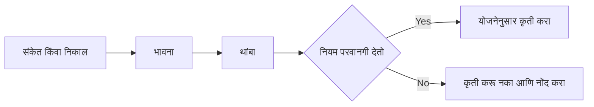

<!-- meta
id: T8.1
title: भीती, लोभ आणि तोट्यावरील मेंदू
page_type: Concept
prerequisites: [T0.1, T2.1]
labs: [Lab 3]
estimated_minutes: 20
-->

# भीती, लोभ आणि तोट्यावरील मेंदू

## प्रस्तावना

एक ट्रेडर एका दिवसात Rs 2,000 चा तोटा करतो. हे काल्पनिक उदाहरण आहे. त्याच्या योजनेत सांगितले आहे की तोटा झाल्यावर थांबा. पण त्याला तो पैसा लगेच परत मिळवण्याची तीव्र ओढ वाटते. तो एक असा व्यापार करतो, जो योजनेत नव्हता. सर्वात जास्त दुखावणारा तोटा तोच असतो, जो त्याने स्वतः निवडलेला असतो. हे प्रकरण सांगते की या भावना का येतात, आणि पैसे जाण्याआधी त्या कशा ओळखायच्या.

## कल्पना

भीती आणि लोभ आयुष्याच्या अनेक भागांत उपयोगी असतात. बाजारात त्या अनेकदा चुकीच्या दिशेने ढकलतात. भाव अनेक कारणांनी हलतात, आणि एकटा ट्रेडर त्यातील बहुतेक कारणे पाहू शकत नाही. एका ठिकाणी उपयोगी असलेली भावना दुसऱ्या ठिकाणी दिशाभूल करू शकते.

तोटा झाल्यावर तणावाची प्रतिक्रिया येते. त्या वेळी कृती करण्याची ओढ येते, कारण त्यामुळे ती भावना थांबते. भावना थांबवण्यासाठी कृती करणे हे योजनेचे पालन करण्यापेक्षा वेगळे आहे. अनेक लोकांना तितक्याच रकमेच्या नफ्यापेक्षा तोटा जास्त जाणवतो. म्हणूनच तोच Rs 500 गमावणे जास्त वाईट वाटू शकते.

प्रत्येक तोटा R मध्ये मोजा. एक R म्हणजे एका व्यापारातील तुमची नियोजित जोखीम. 1R चा तोटा म्हणजे एका थांबवलेल्या व्यापाराचा नियोजित खर्च. यामुळे तोटा तुमच्या पद्धतीचा ठरलेला खर्च बनतो. हे वैयक्तिक अपयश नाही.

भावना निर्णयाच्या ठिकाणी दिसतात. अशी चार ठिकाणे आहेत:

- तोट्यानंतर.
- विजयानंतर.
- भाव तुमच्याशिवाय हलतो तेव्हा.
- तुमची योजना "व्यापार नाही" म्हणते तेव्हा.

प्रत्येक ठिकाणी भावना लिहिलेल्या नियमावर मात करू शकते. भावनेला नाव दिल्यास तुम्ही थांबू शकता. या थांब्यामुळे नियमाला निर्णय घेण्याची संधी मिळते.

हे पुस्तक कोणाचेही निदान करत नाही. व्यापारामुळे तुम्हाला खरा त्रास होत असेल, तर *ट्रेडिंग पूर्णपणे कधी थांबवायचे* हे प्रकरण पाहा.

## हे पाहा

बाणांच्या मागे संकेत किंवा निकालापासून जा. कोणत्याही कृतीआधीचा थांबा लक्षात घ्या. पुढे काय होते ते नियमाची तपासणी ठरवते, भावना नाही.

<!-- component: fear-greed-curve | capital: 50000 | caption: काल्पनिक एक दिवस, ज्यात सहा क्षण आहेत. भावनेला नाव द्या, कृती निवडा, आणि नियम पाळणाऱ्या दिवसाशी तुलना करा. -->

## सोडवलेले उदाहरण

**काल्पनिक.** भांडवल Rs 50,000. एक R म्हणजे Rs 500, जो भांडवलाचा 1 टक्का आहे. दिवसाचा शेवट Rs 2,000 च्या तोट्याने होतो.

| मोजमाप | गणना | निकाल |
|---|---|---|
| R मधील तोटा | 2,000 / 500 | 4R |
| भांडवलातील तोट्याचा शेअर | 2,000 / 50,000 | 4% |

तोटा तेवढाच मोठा असतो, मग तो चार नियोजित थांब्यांमुळे आलेला असो किंवा एका नियोजित नसलेल्या व्यापारामुळे. दुसरी स्थिती नियम मोडण्याची आहे. तुमच्या जर्नलमध्ये ती नियम मोडणारी नोंद म्हणून लिहिली जाते.

## हे करून पाहा

### मार्गदर्शित सराव

**काम.** खालील पाच वाक्यांपैकी प्रत्येक "भावना", "नियम" किंवा "निकाल" असे वर्गीकृत करा.

1. "भाव Rs 240 पर्यंत पडला आणि माझा स्टॉप लागला."
2. "मला आत्ताच Rs 2,000 परत मिळवायचे आहेत."
3. "व्यापारात Rs 500 चा तोटा झाला, जो 1R आहे."
4. "योजना म्हणते की दोन तोट्यांनंतर नवीन व्यापार नाही."
5. "मला वाटते की आत्ताच कृती केलीच पाहिजे, नाहीतर हालचाल चुकेल."

संकेत:

1. नियम म्हणजे एखादी अट जुळल्यावर काय करायचे ते सांगणे.
2. भावना म्हणजे पुढे तुम्हाला काय करायचे आहे, त्याबद्दल.
3. निकाल म्हणजे जे आधीच घडले आहे ते.

**उत्तर:**

1. निकाल.
2. भावना.
3. निकाल.
4. नियम.
5. भावना.

### स्वतंत्र सराव

**काम.** तुम्हाला वापरायचे असलेले पाच भावना-टॅग लिहा. प्रत्येकासाठी एक वाक्य लिहा, ते कधी येते ते सांगणारे. तुमच्या जर्नलमध्ये टॅगची यादी असेल, तर ती वापरा.

तुमचे उत्तर तपासा

एक नमुना यादी:

- **शांत.** योजना पाळली जाते आणि व्यापाराची गरज नसते तेव्हा हे येते.
- **भीती.** स्टॉप जवळ असतो आणि लवकर बाहेर पडावे असे वाटते तेव्हा हे येते.
- **लोभ.** विजयानंतर, जेव्हा आकार वाढवावासा वाटतो तेव्हा हे येते.
- **निराशा.** तोट्यानंतर, जेव्हा लगेच कृती करायची असते तेव्हा हे येते.
- **दिलासा.** व्यापार योजनेनुसार संपतो तेव्हा हे येते.

## क्विझ

<!-- component: quiz-block | src: quiz.json -->

क्विझ तोट्याचे R मध्ये मोजमाप आणि निर्णयाची ठिकाणे तपासते. तसेच तोट्यानंतर तो परत मिळवण्याची इच्छा, आणि शांत ट्रेडरलाही तपासणी का लागते, हे तपासते.

## कागदी काम

**मोड:** शिकण्याची नोंद.

1. पाच शिकण्याच्या नोंदी सत्रांपैकी प्रत्येकापूर्वी एक भावना-टॅग लिहा. याला emotion_before म्हणा.
2. सत्र संपल्यावर एक भावना-टॅग लिहा. याला emotion_after म्हणा.
3. कोणताही क्षण नोंदवा, जेव्हा एखादी भावना तुम्हाला नियमाबाहेर कृती करायला ढकलते.
4. पाच सत्रांनंतर, तुम्हाला दिसणाऱ्या पॅटर्नबद्दल एक वाक्य लिहा.

तुमच्या जर्नलमध्ये नोंद करा (जर्नल अॅप तयार होईपर्यंत कागदावर). जर जर्नलमधील भावनांची फील्ड तयार नसतील, तर स्वतंत्र सरावातील पाच टॅग वापरा.

## मर्यादा आणि नेहमीच्या चुका

- हे प्रकरण तुमचा नियम तोट्यानंतर काय असावा, हे सांगत नाही. ते तुमची लिखित योजना सांगते (*भांडवल-प्रथम नियम*).
- भावनेला नाव दिल्याने ती थांबत नाही. थांबा आणि नियमाची तपासणी तुमच्या भांडवलाचे संरक्षण करतात.
- हे पुस्तक कोणाचेही निदान करत नाही आणि थेरपी देत नाही. व्यापारामुळे खरा त्रास होत असेल, तर विश्वासू व्यक्तीशी किंवा पात्र व्यावसायिकाशी बोला. *ट्रेडिंग पूर्णपणे कधी थांबवायचे* हे प्रकरण पाहा.
- भावना-टॅग हा शिकण्यासाठीची नोंद आहे. ट्रेडर म्हणून तुम्ही किती चांगले किंवा वाईट आहात, त्याचा तो गुण नाही.
- तोट्यानंतर भावना येणे सामान्य आहे. त्या व्यापार करण्याचे कारण नाहीत.

## लक्षात ठेवा

- भावना हे संकेत आहेत, आज्ञा नाहीत.
- प्रत्येक तोटा R मध्ये आणि भांडवलातील वाटा म्हणून नोंदवा.
- निर्णयाची चार ठिकाणे: तोट्यानंतर, विजयानंतर, भाव तुमच्याशिवाय हलतो तेव्हा, आणि योजना "व्यापार नाही" म्हणते तेव्हा.
- कोणत्याही कृतीआधी थांबा आणि नियम तपासा.
- तोटा भरून काढण्यासाठी व्यापार करणे हा नियम मोडणे आहे. त्याची नोंद करा.

## स्रोत आणि पडताळणी

- Daniel Kahneman, *Thinking, Fast and Slow* (Farrar, Straus and Giroux, 2011, first edition).
- लॅब 3 मधील जर्नलची भावना-फील्ड.

<!-- standing-disclaimer -->
