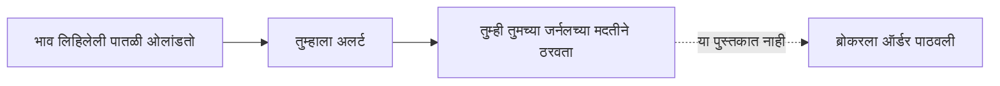

<!-- meta
id: T9.5
title: अल्गो ट्रेडिंग आणि हे पुस्तक ऑटोमेशन का करत नाही
page_type: Concept
prerequisites: [T4.4, T7.10, T9.4]
labs: []
estimated_minutes: 25
-->

# अल्गो ट्रेडिंग आणि हे पुस्तक ऑटोमेशन का करत नाही

## प्रस्तावना

एक वाचक विचार करतो, "जर एखादी स्क्रिप्ट माझ्यासाठी भाव पाहू शकते, तर ती झोपेत असतानाही माझे ऑर्डर देऊ शकते. मग माझ्याकडून कधीच चूक होणार नाही." हे प्रकरण सांगते की ही कल्पना धोकादायक का आहे. तसेच हे पुस्तक ऑर्डर ऑटोमेट का करत नाही, हेही सांगते.

## कल्पना

**अल्गो ट्रेडिंग** म्हणजे एखाद्या प्रोग्रामने चालवलेले ट्रेडिंगचे नियम. एक नियम असे म्हणू शकतो, "भाव मी लिहिलेली पातळी ओलांडला, तर काहीतरी कर." ते काहीतरी दोन अतिशय वेगळ्या गोष्टींपैकी एक असू शकते.

- **अलर्ट** तुम्हाला सांगतो की एखादी पातळी ओलांडली गेली. तो काहीही लावत नाही.
- **ऑर्डर** ब्रोकरला खरेदी किंवा विक्रीची सूचना पाठवतो. ऑर्डर पाठवणे हे वेगळे पाऊल आहे, आणि त्यावर नियमन आहे.

**ट्रेडिंग API** म्हणजे सॉफ्टवेअरने ब्रोकरशी बोलण्याचा मार्ग. योजना वेगवेगळ्या असतात. काही योजनांमध्ये तुम्हाला लागणारा बाजार डेटा नसू शकतो.

Zerodha चे Kite Connect हे एक उदाहरण आहे. त्याची Personal योजना मोफत आहे. ती ऑर्डर, GTT ऑर्डर, अलर्ट, मार्जिन तपासणी आणि पोर्टफोलिओ साधने देते, पण लाइव्ह डेटा आणि ऐतिहासिक डेटा देत नाही. सशुल्क Connect योजनेसाठी प्रत्येक ॲपसाठी महिना Rs 500 लागतात, आणि त्यात लाइव्ह डेटा आणि ऐतिहासिक कँडल्स मिळतात. Zerodha सांगते की ऐतिहासिक डेटा एकटा विकत घेता येत नाही, आणि Kite Connect साठी टेस्ट सँडबॉक्स नाही. (11 Nov 2026 नुसार, Kite API शुल्क आणि FAQ वरील Zerodha सपोर्ट पाने. योजना आणि किमती बदलतात, म्हणून support.zerodha.com तपासा.)

**SEBI रिटेल अल्गो फ्रेमवर्क** ब्रोकरसाठी आणि रिटेल वापरासाठी अल्गोरिदमचे नियम ठरवते. त्यात Algo-ID नावाने अल्गोरिदम ओळखण्याची पद्धत आहे. अधिकृत कागदपत्रे काय सांगतात ते येथे आहे.

- SEBI चे 4 February 2025 चे परिपत्रक, रिटेल गुंतवणूकदारांचा अल्गो ट्रेडिंगमधील सुरक्षित सहभाग, यावर आहे. त्यात ब्रोकर जबाबदार असतो. ब्रोकर प्रिन्सिपल असतो, आणि अल्गो पुरवठादार त्याचा एजंट असतो.
- API द्वारे पाठवलेल्या प्रत्येक ऑर्डरवर एक्सचेंजने दिलेला ओळखकर्ता असतो. याला Algo-ID म्हणतात.
- ब्रोकरने API उघडे ठेवू शकत नाहीत. ग्राहकाला त्या ग्राहकाशी जोडलेली API की आणि ब्रोकरने मंजूर केलेला स्थिर इंटरनेट पत्ता लागतो. लॉगिनसाठी OAuth आणि दोन-टप्प्यांची तपासणी लागते.
- 5 May 2025 च्या एक्सचेंज परिपत्रकाने सुरुवातीला प्रति सेकंद 10 ऑर्डरची मर्यादा ठेवली आहे. ही मर्यादेपर्यंत ग्राहकाच्या स्वतःच्या अल्गोला ब्रोकरमार्फत अतिरिक्त नोंदणीची गरज नाही. जो ग्राहक त्यापेक्षा जास्त वेगाने जाऊ इच्छितो, त्याने अल्गोची नोंदणी करून एक्सचेंजकडून Algo-ID घ्यावा. मर्यादेपेक्षा जास्त ऑर्डर नाकारल्या जातात.
- अल्गो पुरवठादारांची नोंदणी एक्सचेंजकडे असली पाहिजे. जो पुरवठादार तयार "ब्लॅक बॉक्स" अल्गो विकतो, त्याने रिसर्च ॲनालिस्ट म्हणूनही नोंदणी करावी.
- 30 September 2025 च्या नंतरच्या SEBI परिपत्रकाने 1 October 2025 पासून टप्प्याटप्प्याने सुरुवात ठरवली, ज्यात ब्रोकरचे टप्पे 3 January 2026 पर्यंत आहेत.
- Zerodha सांगते की 1 April 2026 पासून API द्वारे ऑर्डर देण्यासाठी स्थिर (स्टॅटिक) इंटरनेट पत्ता लागतो. तो आठवड्यातून एकदा बदलता येतो, आणि कुटुंबातील सदस्य एक पत्ता सामायिक करू शकतात.

(11 Nov 2026 नुसार, 4 Feb 2025 व 30 Sep 2025 चे SEBI परिपत्रक, 5 May 2025 चे NSE परिपत्रक आणि Zerodha सपोर्ट पाने. नियम बदलतात, म्हणून SEBI आणि NSE साइट तपासा.)

ऑटोमेशनमुळे जोखीम संपत नाही. ते एकच चूक झटपट अनेक वेळा करू शकते. एक बग तुम्हाला नको असलेल्या ऑर्डर पाठवू शकतो. खर्च आणि डेटाच्या मर्यादाही वाढतात.

हे पुस्तक ऑफलाइन आहे. त्यात ब्रोकरला कॉल नाहीत, लॉगिन तपशील साठवलेले नाहीत आणि ऑर्डर लावण्याची सोय नाही.

## हे पाहा

आकृती डावीकडून उजवीकडे वाचा. पहिली दोन पायऱ्या म्हणजे अलर्ट आणि तुमचा स्वतःचा निर्णय. शेवटची पायरी, म्हणजे ऑर्डर पाठवणे, या पुस्तकाचा भाग नाही.

<!-- component: algo-pipeline | mode: alert | caption: लिहिलेल्या नियमापासून एका कल्पनेचा अलर्टपर्यंतचा प्रवास पाहा. एक व्यक्ती तपासते. ऑर्डर पाठवणे या पुस्तकाचा भाग नाही. -->

## सोडवलेले उदाहरण

**काल्पनिक, आकडे नाहीत.** दोन स्क्रिप्ट एकच लिहिलेली भाव पातळी पाहतात.

| | स्क्रिप्ट A | स्क्रिप्ट B |
|---|---|---|
| पातळी ओलांडल्यावर ती काय करते | तुम्हाला संदेश पाठवते | ब्रोकरला ऑर्डर पाठवते |
| ऑर्डर लावते | नाही | होय |
| लागू होणारी कर्तव्ये | तुमच्या स्वतःच्या तपासण्या | वरील भागातील प्रमाणे ब्रोकर आणि नियामक कर्तव्ये |

स्क्रिप्टची लांबी हा फरक नाही. ऑर्डरची पायरी हा फरक आहे. त्या पायरीसोबत अनुपालन आणि जोखमीची कर्तव्ये येतात, जी अलर्टला लागत नाहीत.

## हे करून पाहा

### मार्गदर्शित सराव

**काम.** वर्णन केलेल्या पाच स्क्रिप्ट वर्गीकृत करा. प्रत्येकासाठी एक लेबल निवडा: फक्त अलर्ट, ऑर्डर लावते, किंवा आधी अनुपालन तपासणी हवी.

1. एखाद्या शेअरचा भाव Rs 300 ओलांडतो तेव्हा तुम्हाला संदेश पाठवते. ते काहीही लावत नाही.
2. भाव Rs 300 ओलांडतो तेव्हा ब्रोकरमार्फत 10 शेअर विकत घेते.
3. दररोज ठरलेल्या वेळी ब्रोकरला विक्रीची ऑर्डर पाठवते.
4. तुम्हाला ऑनलाइन सापडलेली एक स्क्रिप्ट. ती ऑर्डर लावते की नाही ते तुम्ही सांगू शकत नाही.
5. चार्ट दाखवते आणि तुमचा नियम पूर्ण झाला की संदेश पाठवते. तिचा कोणत्याही ब्रोकरशी संबंध नाही.

संकेत:

1. विचारा, कोणतीही ऑर्डर तुमच्या मशीनमधून ब्रोकरकडे जाते का.
2. फक्त संदेश पाठवणारी स्क्रिप्ट म्हणजे अलर्ट.
3. शंका असेल तर "आधी अनुपालन तपासणी हवी" निवडा.

**उत्तर:** 1 फक्त अलर्ट आहे. 2 ऑर्डर लावते. 3 ऑर्डर लावते. 4 आधी अनुपालन तपासणी हवी. 5 फक्त अलर्ट आहे.

### स्वतंत्र सराव

**काम.** कोणत्याही ट्रेडिंग API चा विचार करण्याआधी अधिकृत स्रोतांवरून उत्तरे मिळवायचे तीन प्रश्न लिहा. तुमच्या प्रश्नांत तारीख किंवा खर्च लिहू नका.

तुमचे उत्तर तपासा

चांगल्या प्रश्नांची उदाहरणे:

- ऑर्डर पाठवणाऱ्या स्क्रिप्टला कोणते नियम लागू होतात, आणि ते कोणी पाळायचे आहेत?
- Algo-ID साठी काय लागते, आणि तो केव्हा लागतो? (अधिकृत परिपत्रके याचे उत्तर देतात. ती स्वतः वाचा, सारांशावर अवलंबून राहू नका.)
- माझ्या गरजेचा डेटा कोणत्या ब्रोकर योजनांमध्ये आहे, आणि प्रत्येक योजनेत काय आहे?

चांगला प्रश्न तपासायचा स्रोत नाव देतो. तो उत्तर गृहीत धरत नाही.

## क्विझ

<!-- component: quiz-block | src: quiz.json -->

क्विझ अलर्ट विरुद्ध ऑर्डर, मोफत API, ऑटोमेशनची जोखीम, एक परिस्थिती आणि एक चूक शोधणे तपासते.

## कागदी काम

**मोड:** शिकण्याची नोंद. या प्रकरणात सराव नाही. फक्त विचार करायचा आहे.

1. तुमच्या शिकण्याच्या नोंदीत तीन पडताळणी प्रश्न लिहा.
2. अलर्ट आणि ऑर्डर यातील फरक एका वाक्यात लिहा.
3. ऑटोमेशनमुळे जोखीम का संपत नाही, ते एका वाक्यात लिहा.
4. ही वाक्ये तुमच्या जर्नलमध्ये सेव्ह करा, किंवा जर्नल ॲप तयार होईपर्यंत कागदावर लिहा.

## मर्यादा आणि नेहमीच्या चुका

- SEBI, NSE आणि BSE ची परिपत्रके आणि त्यांच्या तारखा बदलतात. कृती करण्याआधी स्रोतावर तपासा.
- Kite Connect योजनांमधील सुविधा आणि शुल्क बदलतात. Zerodha सपोर्ट पाने तपासा.
- हे प्रकरण कोणत्याही API साठी कोड किंवा सेटअपच्या पायऱ्या देत नाही.
- अलर्ट स्क्रिप्टलाही तुमच्या स्वतःच्या तपासण्या लागतात. तीही चुकू शकते.
- ऑटोमेशन भांडवलाचे नियम बदलत नाही. *जोखीम मर्यादा* पाहा.

## लक्षात ठेवा

- अलर्ट तुम्हाला सांगतो की काहीतरी घडले. ऑर्डर ब्रोकरला सूचना पाठवते.
- ऑर्डर पाठवणे हे वेगळे, नियमन असलेले पाऊल आहे.
- मोफत API म्हणजे कोणतेही नियम लागू होत नाहीत, असे नाही.
- ऑटोमेशन चूक अधिक वेगाने पुन्हा करू शकते.
- हे पुस्तक ऑर्डर ऑटोमेट करत नाही, आणि त्यात ब्रोकरला कॉल नाहीत.

## स्रोत आणि पडताळणी

- SEBI चे 4 February 2025 चे परिपत्रक, रिटेल गुंतवणूकदारांचा अल्गो ट्रेडिंगमधील सुरक्षित सहभाग
- SEBI चे 30 September 2025 चे परिपत्रक, टप्प्याटप्प्याने सुरुवात (ग्लाइड पाथ)
- NSE चे 5 May 2025 चे परिपत्रक, रिटेल अल्गो ट्रेडिंगसाठी अंमलबजावणी मानके
- Kite API शुल्क, स्थिर IP आणि Kite Connect FAQ वरील Zerodha सपोर्ट पाने

<!-- standing-disclaimer -->
