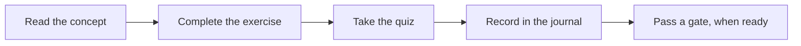
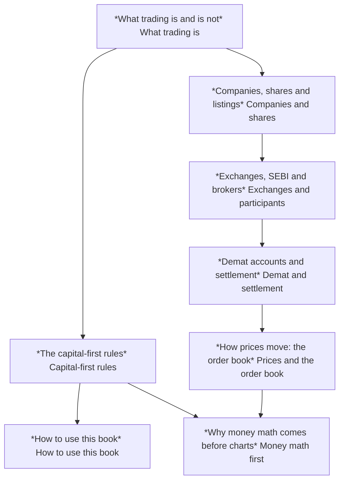

<!-- meta
id: T0.3
title: How to use this book
page_type: Concept
prerequisites: [T0.1, T0.2]
labs: [Lab 3]
estimated_minutes: 15
-->

# How to use this book

## Hook

A learner finishes three sections in one sitting. The learner feels confident and decides to "start trading" that evening. The book did not ask for that. Its structure is built to slow that moment down. Each chapter ends with a quiz, a paper task and a list of what the chapter does not tell you. The real-money decision sits behind separate gates. You pass those on your own schedule.

## The idea

**Every chapter follows the same eleven steps.** Knowing the order tells you what each part is for.

1. Hook: a rupee scenario or a common mistake.
2. Concept: the idea, explained from the basics.
3. Visual: a diagram or a static card.
4. Worked example: rupee figures, with every step shown.
5. Interactive demo, where the chapter has one.
6. Guided exercise, with hints.
7. Independent exercise, with the answer hidden until you try.
8. Quiz, with a reason for each wrong option.
9. Paper task: a journal entry, a lab run, or a Kite demo task.
10. "What this does NOT tell you": the limits and common misuse.
11. Sources, with verification status.

**Reading order follows the track dependencies.** A dependency means one chapter needs another one first. Read Track 0 first, then Track 1, then Track 2. Finish Track 2 (money and math) before any strategy chapter.

**Labs.** The book comes with five small tools: Lab 1 (position size), Lab 2 (trade costs), Lab 3 (your trade journal), Lab 4 (testing a strategy on past prices) and Lab 5 (a forward test on paper). Some are still being built. Until they are ready, do each paper task on paper.

**Journal modes.** Every journal entry has one mode. The modes are:

- **learning note:** a reflection or a note on a concept. Not a trade.
- **paper:** a planned trade on paper, never sent to a broker.
- **kite_demo:** a task done in the Kite demo, which uses dummy data.
- **forward:** a paper trade, or a forward test, recorded as it happens.
- **backtest:** a simulated result from the past.
- **live:** a real trade with real money.

Entries made before the gates are passed are never marked live.

**Offline use.** After installation, every page works without internet. Adding the app to your home screen is recommended.

**Backups.** Export a backup file regularly. Keep a copy outside the device. By default, the app reminds you every 14 days, and after every 10 new trades. You can change both.

**Gates test what you have learned.** Gates G1 to G7 check your learning. If you fail a gate, you can take it again, with no timer. Passing a gate does not mean you should trade real money. That decision is still yours, and it is separate.

**No pressure.** There is no deadline to start real trading.

## See it

Follow the arrows from left to right. Each chapter is one pass through this loop. A gate is not part of a chapter. It is a separate check you take later.

This map shows the Track 0 to Track 2 dependencies covered so far. Track 2 goes on past *Why money math comes before charts*. Read each arrow as "must be read before".

## Worked example

**A 20-minute session:**

| Minutes | Activity |
|---|---|
| 5 | Read a concept chapter |
| 2 | Complete one exercise |
| 13 | Record one learning note, then take the quiz |

**Sample learning note** (mode: learning note):

> Trading capital: Rs 50,000 (hypothetical)
> Risk budget: 1% = Rs 500
> Working: 1% of 50,000 = 0.01 x 50,000 = Rs 500.
> What I learned today: the difference between a risk budget and a trading capital figure.

The first line sets the trading capital. The second line sets the risk budget for one trade. The risk budget is the most you accept losing on one trade. Both figures are hypothetical. The sum is 1% of Rs 50,000, which is Rs 500.

## Try it

### Guided exercise

**Task:** Create a learning-note entry titled "What I expect to learn". Set the backup reminder. Export one backup file and store a copy outside the device.

**Hints:**

1. The menu location is to be confirmed in the Lab 3 build.
2. If Lab 3 is not ready, write the note on paper and keep it with your study materials.
3. The default backup reminder is every 14 days.

**Answer:** The learning note titled "What I expect to learn" exists. The backup reminder is set to the default of 14 days, or to a time you chose. One backup file is exported and copied outside the device. The menu location is [VERIFY: menu location, to be confirmed in the Lab 3 build].

### Independent exercise

**Task:** Plan a four-week study schedule for Tracks 0 to 2, using the dependency map. Use no hints.

Check your answer

There is no single correct schedule. Check that your plan follows the arrows. For example, read *What trading is and is not* before *The capital-first rules* and *How to use this book*. Read *Companies, shares and listings* before *Exchanges, SEBI and brokers*. Check that the plan includes quizzes and paper tasks, not only reading. Your plan should set no deadline to start trading. This book sets none either.

## Quiz

<!-- component: quiz-block | src: quiz.json -->

Six questions check the journal modes, the gates, the backup timing and the limits of the book.

## Paper task

**Mode:** learning note. Set up the journal. Record your first learning note. Export your first backup. Store that backup outside the device.

1. Open the journal, or prepare a paper notebook if the app is not ready.
2. Record the learning note "What I expect to learn".
3. Export the first backup and store a copy outside the device.
4. Note the date of your next backup reminder.

## Limits and common mistakes

- A learning record is not a trading record. Do not label a learning note as a trade.
- Passing a gate shows you learned something. It is not proof of profit. It is not permission to trade real money.
- The book cannot place orders for you. It works offline and has no broker connection.
- Entries before the gates are passed are never marked live.

## Remember

- Every chapter follows the same eleven steps.
- Track dependencies set the reading order. Track 2 comes before any strategy chapter.
- Journal modes: learning note, paper, kite_demo, forward, backtest, live.
- Back up at least every 14 days by default, and keep a copy outside the device.
- Gates test learning, can be retaken with no timer, and do not decide anything about real money.

## Sources and verification

**Sources (names only):**

- Apple WebKit storage policy documentation.
- MDN storage persistence page.
- The book's own gate definitions.

**Facts to verify:**

- Whether iOS Safari deletes stored data for sites not added to the Home Screen. [VERIFY: Apple WebKit documentation]
- Which browsers support asking for persistent storage. [VERIFY: MDN storage persistence page]
- Lab 3 menu location for the backup reminder. [VERIFY: confirm in the Lab 3 build]

<!-- facts-needed: Apple WebKit storage eviction for sites not added to Home Screen; MDN storage persistence support; Lab 3 backup menu location -->

<!-- standing-disclaimer -->
