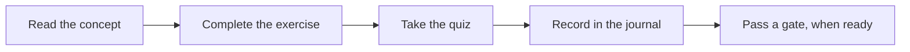
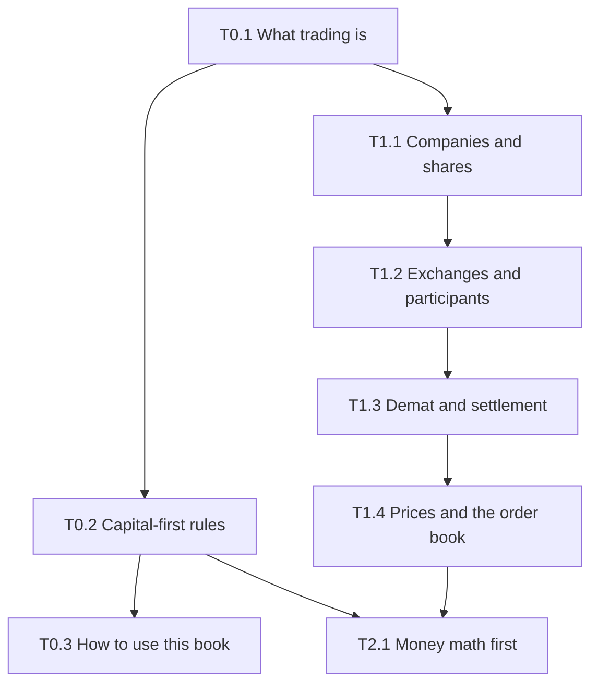

# How to use this book

## Hook

A learner finishes three sections in one sitting, feels confident, and decides to "start trading" that evening. Nothing in the book asked for that. The book's structure is built to slow that moment down: each chapter ends with a quiz, a paper task and a list of what the chapter does not tell you, and the real-money decision sits behind separate gates that you pass on your own schedule.

## The idea

**Every chapter follows the same eleven steps.** Knowing the order tells you what each part is for.

1. Hook: a rupee scenario or a common mistake.
2. Concept: the idea from first principles.
3. Visual: a diagram or a static card.
4. Worked example: rupee figures, every step shown.
5. Interactive demo, where one is specified.
6. Guided exercise, with hints.
7. Independent exercise, with the answer hidden until you try.
8. Quiz, with a reason for each wrong option.
9. Paper task: a journal entry, a lab run, or a Kite demo task.
10. "What this does NOT tell you": the limits and common misuse.
11. Sources, with verification status.

**Reading order follows the track dependencies.** Track 2 (money and math) must be finished before any strategy chapter. Track 0 comes first, then Track 1, then Track 2.

**The labs are built in order.** Lab 3 is the trade journal. It is built first, so that every later lesson can be recorded from day one. Labs 2 and 1 (costs and position size) follow, then Labs 4 and 5 later. Until the journal app exists, the paper task can be done on paper.

**Journal modes.** Every journal entry has one mode:

- **learning note:** a reflection or a concept note. Not a trade.
- **paper:** a planned trade on paper, never sent to a broker.
- **kite_demo:** a task done in the Kite demo, which uses dummy data.
- **forward:** a paper or forward-test trade recorded as it happens.
- **backtest:** a simulated past result.
- **live:** a real trade with real money.

Entries made before the gates are passed are never marked live.

**Offline use.** After installation, every page works without a network. Installing to the home screen is recommended.

**Backups.** Export a versioned file regularly and keep a copy outside the device. By default the app reminds you every 14 days, and after every 10 new trades. Both can be changed.

**Gates test educational competence.** Gates G1 to G7 check what you have learned. A failed gate can be retaken, with no timer. Passing a gate does not mean you should trade real money. That decision remains your separate decision.

**No pressure.** There is no deadline to start real trading.

## See it

Follow the arrows from left to right. Each chapter is one pass through this loop. The gate is not part of a chapter; it is a separate check you take later.

This map shows the Tracks 0 to 2 dependencies that are covered so far. Track 2 continues beyond T2.1. Read the arrows as "must be read before".

## Worked example

**A 20-minute session:**

| Minutes | Activity |
|---|---|
| 5 | Read a concept chapter |
| 2 | Complete one exercise |
| 13 | Record one learning note, then take the quiz |

**Sample learning note** (mode: learning note):

> Trading capital: Rs 50,000 (hypothetical)
> Risk budget: 1% = Rs 500
> Working: 1% of 50,000 = 0.01 x 50,000 = Rs 500.
> What I learned today: the difference between a risk budget and a trading capital figure.

The first line sets the trading capital. The second sets the risk budget for one trade. Both are hypothetical here. The arithmetic is 1% of Rs 50,000, which is Rs 500.

## Try it

No interactive demo is specified for this chapter. <!-- OPEN: spec gives a static flow diagram and dependency map, with no interactive demo; none placed. -->

### Guided exercise

**Task:** Create a learning-note entry titled "What I expect to learn". Set the backup reminder. Export one backup file and store a copy outside the device.

**Hints:**

1. The menu location is to be confirmed in the Lab 3 build.
2. Until Lab 3 exists, write the note on paper and keep it with your study materials.
3. The backup reminder default is 14 days.

**Answer:** The learning note titled "What I expect to learn" exists. The backup reminder is set to the default of 14 days, or to a value you chose. One backup file is exported and copied outside the device. The menu location is [VERIFY: menu location, to be confirmed in the Lab 3 build].

### Independent exercise

**Task:** Plan a four-week study schedule for Tracks 0 to 2, using the dependency map. Use no hints.

Check your answer

There is no single correct schedule. Check that your plan respects the arrows: T0.1 before T0.2 and T0.3, T1.1 before T1.2, and so on. Check that the plan allows for quizzes and paper tasks, not only reading. The schedule sets no deadline to start trading, and the book sets none.

## Quiz

<!-- component: quiz-block | src: quiz.json -->

Six questions check the journal modes, the gates, the backup timing and the limits of the book.

## Paper task

**Mode:** learning note. Set up the journal, record your first learning note, export your first backup, and store that backup outside the device.

1. Open the journal, or prepare a paper notebook until the journal app is ready.
2. Record the learning note "What I expect to learn".
3. Export the first backup and store a copy outside the device.
4. Note the date of your next backup reminder.

## What this does NOT tell you

- A learning record is not a trading record. Do not label a learning note as a trade.
- Passing a gate is educational competence. It is not proof of profit, and it is not permission to trade real money.
- The book cannot place orders for you. It works offline and has no broker connection.
- Entries before the gates are passed are never marked live.

## Remember

- Every chapter follows the same eleven steps.
- Track dependencies set the reading order; Track 2 comes before any strategy chapter.
- Journal modes: learning note, paper, kite_demo, forward, backtest, live.
- Back up at least every 14 days by default, and keep a copy outside the device.
- Gates test learning, can be retaken with no timer, and do not decide anything about real money.

## Sources and verification

**Sources (names only):**

- Apple WebKit storage policy documentation.
- MDN storage persistence page.
- The book's own gate definitions (project plan, section 6).

**Facts to verify:**

- iOS Safari storage eviction for sites not added to the Home Screen. [VERIFY: Apple WebKit documentation]
- Browser support for persistent storage requests. [VERIFY: MDN storage persistence page]
- Lab 3 menu location for the backup reminder. [VERIFY: confirm in the Lab 3 build]

Last content review: not yet done

<!-- facts-needed: Apple WebKit storage eviction for sites not added to Home Screen; MDN storage persistence support; Lab 3 backup menu location -->

<!-- standing-disclaimer -->
