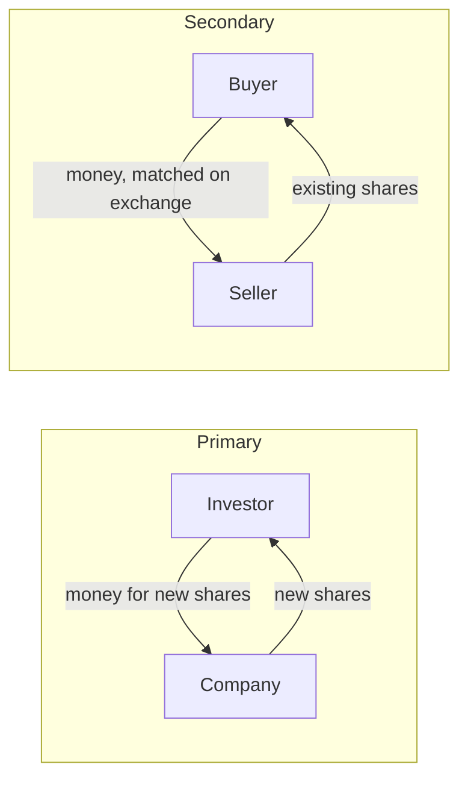

<!-- meta
id: T1.1
title: Companies, shares and listings
page_type: Concept
prerequisites: [T0.1]
labs: []
estimated_minutes: 25
-->

# Companies, shares and listings

## Hook

A hypothetical trader hears that a company is "about to list." They buy shares at its first public offer. They think the company gets the money from that purchase. A week later, they buy more on the exchange from another investor. They believe the company is funded again. Both beliefs mix up two different markets. The difference decides where the money goes.

## The idea

**A share is a unit of ownership.** A company has a fixed number of shares, and they are all equal parts. Each part gives its holder a share of the business, in proportion to the number held.

**Ownership percentage** is the shares you hold, divided by the total number of shares. In symbols:

Ownership % = (shares held / total shares outstanding) x 100

**Value of a holding** is the number of shares times the price of one share. In symbols: holding value = shares x price.

**Why companies sell shares.** A company can raise money from new shareholders instead of borrowing it. Existing owners can also sell part of their stake. These are general reasons. Each company's own filings give its specific reasons.

**Primary market.** The company issues new shares. The money goes to the company.

**Secondary market.** Investors trade shares that already exist. The money goes to the seller, not to the company. Buying and selling on the exchange takes place in the secondary market.

**IPO (initial public offer).** A company's first public offer of shares to the public. This chapter explains pricing and allotment (who gets the shares) only in general terms [VERIFY: SEBI ICDR regulations; book-building method].

**An IPO is not automatically profitable.** The listing-day price is the first price at which the shares trade on the exchange. It can be above or below the issue price, which is the price set for the offer.

**Dilution.** When new shares are issued, the total number of shares rises. Each existing share is then a smaller part of the company. So an existing holder's percentage falls, unless they buy some of the new shares.

## See it

Look at the company box. It appears only in the primary flow. In the secondary flow, money passes between buyer and seller. The company receives nothing.

## Worked example

**Hypothetical company:** 10,00,000 shares outstanding, trading at Rs 200 each.

| Step | Working | Result |
|---|---|---|
| 1. Company value | 10,00,000 x Rs 200 | Rs 20,00,00,000 (Rs 20 crore) |
| 2. Holder's ownership | 1,000 / 10,00,000 | 0.1% |
| 3. Holder's value | 1,000 x Rs 200 | Rs 2,00,000 |
| 4. Secondary trade, 100 shares | 100 x Rs 200 | Rs 20,000 paid to the seller; the company receives nothing |
| 5. Dilution: company issues 5,00,000 new shares | Total becomes 10,00,000 + 5,00,000 = 15,00,000; holder's 1,000 / 15,00,000 | 0.0667% |

**Check on step 5:** 1,000 / 15,00,000 = 1 / 1,500 = 0.000667, which is 0.0667%.

The holder's ownership fell from 0.1% to 0.0667%, because the share count rose. The holder still has 1,000 shares. Whether their value falls depends on the price after the new issue. The arithmetic above does not decide that.

## Try it

### Guided exercise

**Task:** A holder owns 250 shares in a company with 20,00,000 shares in total. The share price is Rs 150. Work out the holder's ownership percentage and the value of the holding.

**Hints:**

1. Divide the holder's shares by the total shares to get the fraction.
2. Multiply the fraction by 100 to get the percentage.
3. Multiply the shares by the price to get the value.

**Answer:** Ownership = 250 / 20,00,000 = 0.000125, which is 0.0125%. Value = 250 x Rs 150 = Rs 37,500.

### Independent exercise

**Task:** The company in the worked example issues 10,00,000 new shares. Work out the holder's new ownership percentage. Explain why the holder's value is not automatically lower. Use no hints.

Check your answer

New total = 10,00,000 + 10,00,000 = 20,00,000 shares. Holder's ownership = 1,000 / 20,00,000 = 0.005%.

The holder's value is shares x price. The holder still has 1,000 shares. If the price stayed at Rs 200, the holding would still be worth Rs 2,00,000. Trading sets the price. The new money may change the company's prospects, so the price could move either way. The percentage falls for certain. The value does not fall automatically.

## Quiz

<!-- component: quiz-block | src: quiz.json -->

Five questions check ownership sums, the money flow in each market, and the claims about IPOs and dilution.

## Paper task

**Mode:** learning note. Write it in your journal, or on paper. No purchase.

1. Find the public offer document for any past IPO. You can find it on the exchange or SEBI website.
2. Find the section called "objects of the issue." It says what the money is for.
3. Write, in your own words, what the company said it would use the money for.
4. Record the source, the date you accessed it, and the company name. Do not buy anything.

## Limits and common mistakes

- This chapter does not tell you whether any IPO is worth buying. An IPO does not get an exemption from the capital-first rules.
- Hype about an IPO, and excitement about getting shares, often lead to rash buying.
- The listing-day price can be above or below the issue price. This chapter does not predict either.
- The percentage and value sums are a snapshot. The price moves, so the value moves too.

## Remember

- A share is a unit of ownership. Ownership % = shares held / total shares, times 100.
- Primary market: money goes to the company. Secondary market: money goes to the seller.
- An IPO is a company's first public offer. It is not automatically profitable.
- Dilution: new shares lower each existing holder's percentage, unless they buy into the issue.
- For 1,000 of 10,00,000 shares, ownership is 0.1%. After 5,00,000 new shares, it is 0.0667%.

## Sources and verification

**Sources (names only):**

- SEBI ICDR regulations.
- SEBI investor education pages on IPOs.
- NSE and BSE IPO education pages.

**Facts to verify:**

- IPO process, timelines, book-building and allotment rules. [VERIFY: SEBI ICDR regulations]
- Any current IPO figures are out of scope for this chapter.

<!-- facts-needed: SEBI ICDR regulations (IPO process, timelines, book-building, allotment) -->

<!-- standing-disclaimer -->
