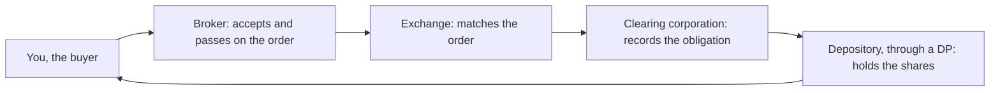

<!-- meta
id: T1.2
title: Exchanges, SEBI and brokers
page_type: Concept
prerequisites: [T1.1]
labs: []
estimated_minutes: 25
-->

# Exchanges, SEBI and brokers

## Hook

A hypothetical beginner believes their broker is the exchange. They think their order is matched inside the broker's office. When a trade goes wrong, they cannot say who to ask, or in what order. Knowing which institution does which job turns a confusing situation into a list of steps.

## The idea

Many institutions sit between your order and the shares in your name. Each one has one job. This chapter defines each role once. Keep the roles separate in your mind.

**SEBI** is the securities regulator. It makes the rules for brokers, exchanges and listed companies. It does not set stock prices.

**Exchanges (NSE and BSE)** run the marketplace where orders are matched [VERIFY: current recognition status and roles]. A buy order is matched with a sell order there. The exchange does not hold your money.

**The clearing corporation** works after a trade. It records what each side owes because of the trade. It is part of how settlement is guaranteed. Settlement is the final transfer of shares and money [VERIFY: clearing corporation names and role].

**Depositories** hold shares electronically [VERIFY: NSDL and CDSL roles]. Your shares are recorded in your name at a depository, not in a paper certificate kept in a drawer.

**The broker (trading member)** accepts your orders, gives you the trading platform, and passes your orders to the exchange. The broker is the firm you deal with day to day. It is not the exchange. It is not where your shares are held.

**The depository participant (DP)** is the firm that keeps your demat account for you, on the depository's behalf [VERIFY]. The depository records the holding. The DP keeps the account. These are two different roles, even when one firm does both.

**Banks** hold the funds used for trading and settlement. Your trading account is linked to a bank account.

**The grievance route** is the order for complaints. Start with the broker. Then go to the exchange. Then go to SEBI's complaint portal [VERIFY: SCORES process].

**One practical check.** Before you open an account with any broker, check its registration on the official lists [VERIFY: SEBI or exchange list of registered brokers].

## See it

Follow the arrows. The order goes from you to the broker, then to the exchange, then to clearing. The shares come back to you through the depository. Notice that the broker and the exchange are two separate boxes.

## Worked example

**Hypothetical:** buy 20 shares at Rs 250.

| Step | Working | Result |
|---|---|---|
| 1. Trade value | 20 x Rs 250 | Rs 5,000 |

Now follow the order. Note who holds the money at each step.

| Step | Institution | What happens | Who holds the money at this step |
|---|---|---|---|
| 1 | You | Place the buy order for 20 shares at Rs 250 | Your linked funds, Rs 5,000 needed |
| 2 | Broker | Accepts the order and passes it to the exchange | Moved through the broker's process |
| 3 | Exchange | Matches the order with a seller | The exchange does not hold your money |
| 4 | Clearing corporation | Records the obligation from the trade | The clearing system moves funds [VERIFY: clearing names and role] |
| 5 | Depository, through the DP | After settlement, the 20 shares are credited to your demat account | Settlement moves the shares and the money [VERIFY: T+1 timing, see *Demat accounts and settlement*] |

The main point: no step asks the exchange to hold your money.

## Try it

**Interactive demo (conceptual mode).**

<!-- component: order-flow-sim | mode: conceptual | side: buy | quantity: 20 | price: 250 | steps: trader, broker, exchange, clearing, depository | caption: Follow one buy order of 20 shares at Rs 250 through each institution, and say who does what at each step. -->

### Guided exercise

**Task:** Label the institutions on a diagram for a sale of 20 shares at Rs 250.

**Hints:**

1. Start with yourself.
2. Follow the order: you, broker, exchange.
3. Then follow the shares: clearing, then the depository.

**Answer:** You place the sell order for 20 shares at Rs 250. The trade value is Rs 5,000. The broker accepts the order and passes it to the exchange. The exchange matches it with a buyer. The clearing corporation records the obligation. The depository, through the DP, moves the shares out of your demat account when the trade settles [VERIFY: settlement timing, see *Demat accounts and settlement*].

### Independent exercise

**Task:** Explain to a friend, in three sentences, why the exchange is not the place where you open an account. Use no hints.

Check your answer

One answer: "The exchange is the marketplace where orders are matched. You open an account with a broker, who takes your orders and passes them to the exchange. Your shares are recorded at a depository, through a DP, not at the exchange itself."

Check that your three sentences separate matching (exchange), access (broker) and holding (depository).

## Quiz

<!-- component: quiz-block | src: quiz.json -->

Six questions check the broker-exchange difference, the clearing role, the grievance order, and who holds shares.

## Paper task

**Mode:** learning note. Write it in your journal, or on paper.

1. List each institution in this chapter: SEBI, NSE, BSE, the clearing corporation, NSDL, CDSL, the broker, the DP and the bank.
2. Write its role in your own words, one line each.
3. Add a link to the official page that describes it.
4. Check each role against the SEBI, NSE and BSE pages before you rely on it.

## Limits and common mistakes

- It does not recommend any broker. Zerodha appears as a broker example only, not as a recommendation.
- Registration checks are your responsibility. Check the official list before you open an account.
- Never send money to anyone who claims to be a broker or adviser until you have verified them.
- The roles described here are general. Each firm's exact structure is in its own documents.

## Remember

- SEBI regulates. It does not set prices.
- The exchange matches orders. It does not hold your money.
- The broker takes your orders. It is not the exchange.
- The depository holds shares electronically, through a DP.
- The grievance route is broker, then exchange, then SEBI.

## Sources and verification

**Sources (names only):**

- SEBI website: about SEBI, intermediaries, investor grievance.
- NSE website: clearing and membership pages.
- BSE website.
- NSDL and CDSL websites.
- Zerodha support pages on accounts, as a broker example and not as a recommendation.

**Facts to verify:**

- Clearing corporation names and roles. [VERIFY: NSE clearing page; NSDL; CDSL]
- The SCORES complaint process. [VERIFY: SEBI SCORES page]
- The current list of recognised exchanges. [VERIFY: SEBI]
- The check on broker registration. [VERIFY: SEBI or exchange list of registered brokers]

<!-- facts-needed: clearing corporation names and roles (NSE clearing page); NSDL and CDSL roles; SCORES complaint process; recognised exchanges list; broker registration list -->

<!-- standing-disclaimer -->
