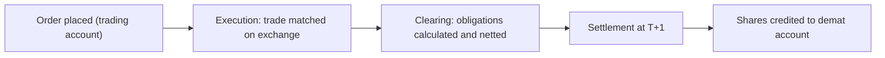

<!-- meta
id: T1.3
title: Demat accounts and settlement
page_type: Concept
prerequisites: [T1.2]
labs: []
estimated_minutes: 25
-->

# Demat accounts and settlement

## Hook

A hypothetical beginner buys 20 shares at Rs 250 in the morning. They see the order filled. They assume the shares are already in the demat account, and ready to sell the same afternoon. But between the fill and the holding there are clearing and settlement steps. The cash and the shares do not move at the same moment.

## The idea

**Three accounts are involved.** Each holds something different.

- **Trading account:** where orders are placed and funds are tracked.
- **Demat account:** where shares are held electronically.
- **Linked bank account:** where money moves in and out of the trading account.

**A trade moves through three stages.**

1. **Execution:** the order matches at the exchange. This is when the trade happens.
2. **Clearing:** each side's obligations are worked out. Many trades are combined.
3. **Settlement:** the shares and the money actually change hands.

**Netting** combines many trades in one settlement cycle into one net figure for each share and for each cash amount. Buys and sells offset each other before money or shares move.

**T+1** means settlement happens one working day after the trade date. SEBI's T+1 cycle for all listed shares has been in force since 27 Jan 2023. (As of 11 Nov 2026, SEBI circular of 7 Sep 2021 and SEBI's master circular. Rules change, so check the SEBI site.) "T" is the trade day. "+1" means one working day later, not one calendar day.

**Shares reach your demat account only after settlement.** If you buy on Monday, they are credited after settlement on Tuesday. Some brokers let you sell them on Tuesday before they arrive. This is called BTST, buy today and sell tomorrow. It carries a risk called short delivery. If the shares you sold do not arrive in time, the exchange can run an auction, and the penalty can be up to 20% of the value. Money from selling shares that have not yet reached your account also cannot be used the same day. (As of 11 Nov 2026, Zerodha support page on BTST. Broker rules differ and change, so check with your broker.)

**Holding and position are different.** A delivery holding is settled shares sitting in your demat account. An intraday position is one you open and close on the same day. It is not a delivery holding. Intraday positions are covered in *Order book*.

**The timeline is not instant.** Execution, clearing and settlement happen at different times. The holding appears after settlement. It does not appear at the moment of the fill.

## See it

Follow the arrows from left to right. The gap between execution and settlement is why a holding does not appear the moment an order fills.

<!-- component: settlement-timeline | qty: 20 | price: 250 | startDay: 0 | settleDays: 1 | caption: A buy of 20 shares at Rs 250 on a made-up Monday. Press Play to follow it, then tap a day to add a made-up holiday. -->

## Worked example

**Netting illustration, concept only.** A broker has three buy trades of Rs 5,000 each. It also has one sell trade of Rs 2,000. All four are in the same settlement cycle.

| Step | Working | Result |
|---|---|---|
| 1. Total buys | 3 x 5,000 | Rs 15,000 |
| 2. Sell proceeds | 1 x 2,000 | Rs 2,000 |
| 3. Net payable | 15,000 - 2,000 | Rs 13,000 |

**Check:** 13,000 + 2,000 = 15,000, which equals the total buys. The example is a round-number picture of the idea. In real settlement, NSE's FAQ says netting is done for each client in each share. It does not apply to stocks in the trade-for-trade segment or to auction trades, where each trade is settled in full. (As of 11 Nov 2026, NSE Basic FAQs on the Secondary Market. Rules change, so check the NSE site.)

**Timeline example.** A buy executed on a hypothetical Monday settles on Tuesday, if Tuesday is a working day. If the next day is a holiday, the settlement moves to the next working day. NSE publishes its holiday list each year. See *Trading sessions, timings and holidays*.

## Try it

### Guided exercise

**Task:** Fill in the blanks in the trace for a buy of 20 shares at Rs 250, a trade value of Rs 5,000.

| Stage | Which account or institution | Which day | Blank to fill |
|---|---|---|---|
| Order placed | ______ | Trade day | ______ |
| Trade matched | ______ | Trade day | ______ |
| Obligation recorded | ______ | Trade day | ______ |
| Settlement | ______ | Next working day, T+1 | ______ |
| Shares arrive | ______ | After settlement | ______ |

**Hints:**

1. Which account holds the order and the funds? Which holds the shares?
2. Which institution matches the trade, and which records the obligation?
3. Which day is the trade day, and which is the settlement day?

**Answer:** Order placed: trading account, on the trade day. Trade matched: the exchange. Obligation recorded: the clearing corporation. Settlement: on the next working day, T+1. The Rs 5,000 leaves the linked bank account. The shares are credited to the demat account through the depository and the DP. Shares arrive in the demat account after settlement, not at the moment of the fill.

### Independent exercise

**Task:** A trade is done on a Friday, before a public holiday. List the sources you would need to find its settlement date. Do not work out the date without the calendar. Use no hints.

Check your answer

Sources needed:

- The current T+1 rule and its effective date. These are in the notes above.
- The exchange's holiday list for the year, which NSE publishes on its site.
- The trade date, and the weekend days between the trade and the candidate settlement date.

You can count working days only after you have these three. You cannot fix the date from memory, because holidays are set each year.

## Quiz

<!-- component: quiz-block | src: quiz.json -->

Six questions check the holding timing, the meaning of T+1, the netting arithmetic, and what each account holds.

## Paper task

**Mode:** kite_demo. Find where holdings and funds appear in the Kite demo, and note the labels in your own words.

1. Open the Kite demo. Note the labels that show holdings and funds.
2. Write each label in your own words, in your journal or on paper.
3. Label the layout "check your own Kite for the current layout".
4. The Kite demo uses dummy data for interface practice. Zerodha does not provide a paper-trading account. (As of 11 Nov 2026, Zerodha support page. Check it for any change.)

## Limits and common mistakes

- Settlement risk is low in a learning exercise. It is real for live trades. Do not assume you can sell on the same day. Check your broker's current rule first.
- The dates and netting rules here explain a concept. The real rules are in the exchange and SEBI documents.
- A holding in your demat account is not the same as cash in your account. The money is in the bank and the trading account.
- The Kite demo's layout may change. Check your own Kite for the current layout.

## Remember

- Trading account holds orders and funds. Demat account holds shares. The bank account is linked.
- A trade is executed, then cleared, then settled. The holding appears after settlement.
- Netting reduces many trades to one net figure for each share and each cash amount. In the example, 15,000 of buys minus 2,000 of sells is a net Rs 13,000 payable.
- T+1 means one working day after the trade date.
- Shares arrive in your demat account after settlement. Selling them before they arrive (BTST) carries a short-delivery risk.

## Sources and verification

**Sources (names only):**

- SEBI circulars on the settlement cycle.
- NSE clearing and settlement pages.
- NSDL and CDSL websites.
- Zerodha support pages on demat accounts.

**Facts checked on 11 Nov 2026:**

- T+1 has applied to all listed shares since 27 Jan 2023. SEBI's master circular on settlement sets the daily schedule (pay-in by 11:00 am, funds pay-out by 1:30 pm, shares pay-out by 3:30 pm). SEBI also began an optional same-day (T+0) settlement trial for a small set of shares on 28 Mar 2024. This chapter does not teach it.
- Settlement falls on the next working day when the usual day is a holiday. The 2026 holiday list is in *Trading sessions, timings and holidays*.
- BTST, short delivery and the auction penalty come from Zerodha's support page on BTST.
- Netting rules come from NSE's Basic FAQs on the Secondary Market.
- Demat account charges are not quoted in this chapter. See *Costs on a trade* and the Zerodha charges page.
- The Kite demo and the lack of a paper-trading account come from Zerodha's support site.

<!-- standing-disclaimer -->
