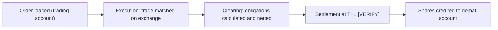

<!-- meta
id: T1.3
title: Demat accounts and settlement
page_type: Concept
prerequisites: [T1.2]
labs: []
estimated_minutes: 25
-->

# Demat accounts and settlement

## Hook

A hypothetical beginner buys 20 shares at Rs 250 in the morning, sees the order filled, and assumes the shares are already in the demat account and ready to sell the same afternoon. Between the fill and the holding there are clearing and settlement steps, and the cash and the shares do not move at the same moment.

## The idea

**Three accounts are involved.** Each holds something different.

- **Trading account:** where orders are placed and funds are tracked.
- **Demat account:** where shares are held in electronic form.
- **Linked bank account:** where money moves in and out of the trading account.

**A trade moves through three stages.**

1. **Execution:** the order matches at the exchange. This is when the trade happens.
2. **Clearing:** obligations are calculated, and many trades are netted together.
3. **Settlement:** the shares and the money actually change hands.

**Netting** means that many trades in one settlement cycle reduce to a single net obligation for each security and for each cash amount. Buys and sells offset each other before money or shares move.

**T+1** means settlement happens one working day after the trade date [VERIFY: current rule and effective date]. "T" is the trade day. "+1" is one working day later, not one calendar day.

**Shares must be in the demat account before they can be sold for delivery** [VERIFY: rule on selling shares not yet credited].

**Holding and position are different.** A delivery holding is settled shares sitting in your demat account. An intraday position is not a delivery holding. Intraday positions are covered in *Order book*.

**The timeline is not instant.** The execution, clearing and settlement stages happen at different times. The holding appears after settlement, not at the moment of the fill.

## See it

Follow the arrows from left to right. The gap between execution and settlement is the reason a holding does not appear the moment an order fills. This timeline is static; change nothing here.

<!-- OPEN: spec gives a static Mermaid timeline for this chapter and no interactive demo. The T+1 step is marked [VERIFY] as the spec requires. -->

## Worked example

**Netting illustration, concept only.** A broker has three buy trades of Rs 5,000 each and one sell trade of Rs 2,000 in the same settlement cycle.

| Step | Working | Result |
|---|---|---|
| 1. Gross buys | 3 x 5,000 | Rs 15,000 |
| 2. Sell proceeds | 1 x 2,000 | Rs 2,000 |
| 3. Net payable | 15,000 - 2,000 | Rs 13,000 |

**Check:** 13,000 + 2,000 = 15,000, which equals the gross buys. The netting rules, and who nets for which account, are [VERIFY: actual netting rules].

**Timeline example.** A buy executed on a hypothetical Monday settles on Tuesday, if Tuesday is a working day [VERIFY: holiday calendar]. If the next day is a holiday, the settlement moves to the next working day.

## Try it

### Guided exercise

**Task:** Fill in the blanks in the trace for a buy of 20 shares at Rs 250, a trade value of Rs 5,000.

| Stage | Which account or institution | Which day | Blank to fill |
|---|---|---|---|
| Order placed | ______ | Trade day | ______ |
| Trade matched | ______ | Trade day | ______ |
| Obligation recorded | ______ | Trade day | ______ |
| Settlement | ______ | Next working day, T+1 [VERIFY] | ______ |
| Shares arrive | ______ | After settlement | ______ |

**Hints:**

1. Which account holds the order and the funds? Which holds the shares?
2. Which institution matches the trade, and which records the obligation?
3. Which day is the trade day, and which is the settlement day?

**Answer:** Order placed: trading account, on the trade day. Trade matched: the exchange. Obligation recorded: the clearing corporation. Settlement: on the next working day, T+1 [VERIFY]; the Rs 5,000 leaves the linked bank account and the shares are credited to the demat account through the depository and the DP. Shares arrive in the demat account after settlement, not at the moment of the fill.

### Independent exercise

**Task:** A trade is executed on a Friday before a public holiday. List the sources you would need to find its settlement date. Do not compute the date without the calendar. Use no hints.

Check your answer

Sources needed:

- The current T+1 rule and its effective date. [VERIFY: SEBI circular; NSE clearing page]
- The exchange's holiday list for the year. [VERIFY: NSE holiday list]
- The trade date, and the weekend days between the trade and the candidate settlement date.

Only after you have these three can you count working days from the trade date. The date cannot be fixed from memory, because holidays are set each year.

## Quiz

<!-- component: quiz-block | src: quiz.json -->

Six questions check the holding timing, the meaning of T+1, the netting arithmetic, and what each account holds.

## Paper task

**Mode:** kite_demo. Find where holdings and funds appear in the Kite demo, and note the labels in your own words.

1. Open the Kite demo. Note the labels that show holdings and funds.
2. Write each label in your own words in the journal, or on paper until the journal app is ready.
3. Label the layout "check your own Kite for the current layout".
4. The Kite demo uses dummy data for interface practice. Zerodha does not provide a paper-trading account. [VERIFY: wording on support.zerodha.com before this is printed in the book].

## Limits and common mistakes

- Settlement risk is low for a learning exercise but real for live trades. Do not assume a sale is possible the same day without verifying the current rule.
- The dates and the netting rules here are a concept. The real rules are in the exchange and SEBI documents.
- A holding in your demat account is not the same as cash in your account. The money is in the bank and the trading account.
- The Kite demo's layout may change. Check your own Kite for the current layout.

## Remember

- Trading account holds orders and funds. Demat account holds shares. The bank account is linked.
- A trade is executed, then cleared, then settled. The holding appears after settlement.
- Netting reduces many trades to one net obligation per security and per cash amount. In the example, 15,000 of buys minus 2,000 of sells is a net Rs 13,000 payable.
- T+1 means one working day after the trade date [VERIFY: current rule].
- Shares must be credited before a delivery sale [VERIFY: rule].

## Sources and verification

**Sources (names only):**

- SEBI circulars on the settlement cycle.
- NSE clearing and settlement pages.
- NSDL and CDSL websites.
- Zerodha support pages on demat accounts.

**Facts to verify:**

- T+1 settlement rule and effective date. [VERIFY: SEBI circular; NSE clearing page]
- Holiday calendar for settlement days. [VERIFY: NSE holiday list]
- Rule on selling shares not yet credited. [VERIFY: SEBI or NSE rule]
- Demat account opening and annual charges, if mentioned later (cross-reference *Costs on a trade*). [VERIFY: Zerodha charges page; CDSL/NSDL tariff]
- Netting rules and who nets for which account. [VERIFY: clearing corporation rules]
- Kite demo as dummy data, and no paper-trading account. [VERIFY: wording on support.zerodha.com]

<!-- facts-needed: T+1 rule and effective date; NSE holiday list; rule on selling undelivered shares; netting rules; Zerodha charges page; CDSL/NSDL tariff; Kite demo wording on support.zerodha.com -->

<!-- standing-disclaimer -->
