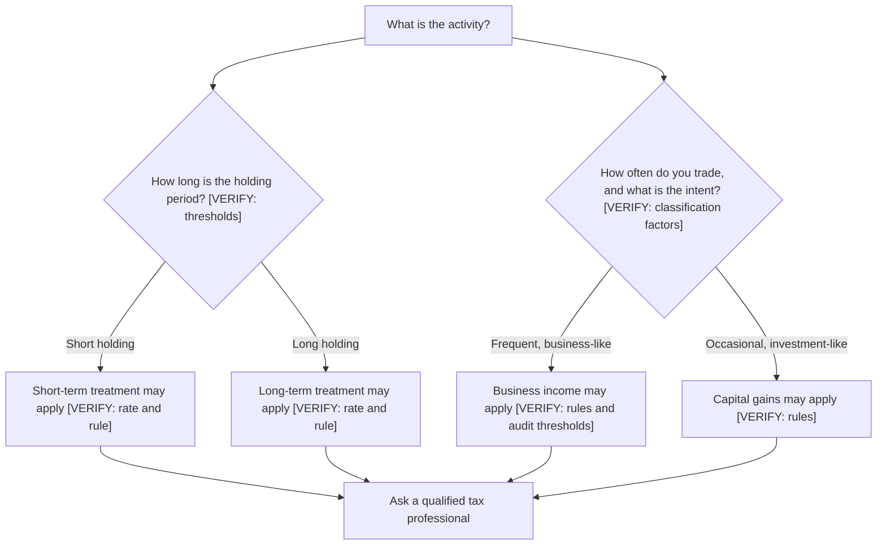

# Taxes on trading profits (concepts)

## Hook

A trader makes Rs 10,000 gross in a year, pays Rs 300 in trading costs, and assumes the remaining Rs 9,700 is the profit. Months later a tax notice arrives for an amount that is not in the trader's plan at all. The mistake was not the arithmetic. It was assuming that tax is simply a percentage of trading turnover, without checking how the activity is classified. This chapter gives the concepts, not the rates.

## The idea

Tax is a separate layer from trading costs. Costs (T2.2) are paid to brokers, exchanges and government on each trade. Tax is calculated on your net gains for the year, under rules that depend on what kind of activity it is.

Three ideas matter at the concept level:

- **Classification.** The same stock can be taxed differently depending on whether you hold it as an investment, trade it as a business, or do something else. The classification depends on facts such as how long you hold, how often you trade and your intent. [VERIFY: classification rules under the Income Tax Act and CBDT circulars]
- **Holding period.** For investments, how long you hold a share can decide whether a gain is treated as short-term or long-term. The thresholds and the rates differ. [VERIFY: holding-period thresholds and rates in the current Finance Act]
- **Loss set-off.** Some losses can offset some gains, and some can be carried forward to later years. Which losses, against which gains, and for how long, depends on the rules. [VERIFY: loss set-off and carry-forward rules]

Other points to know exist, and each one needs a check from an official source:

- Business income and speculative income are treated differently from capital gains. [VERIFY: business and speculative income treatment]
- Frequent trading can bring a tax audit obligation above a turnover threshold. [VERIFY: tax audit turnover thresholds]
- Dividends are taxed under their own rules, which connect to the corporate actions in T1.9. [VERIFY: dividend taxation]
- The tax regime you choose, and the changes to it over time, matter. [VERIFY: tax regime choice and recent changes]

**What the book does and does not do.** The book does not compute tax now. A tax calculator is deferred until the rates and rules are verified from the official source. Until then, the chapter stays conceptual.

**The formula, in words first.** Net result = gross gain - trading costs - tax. Tax = rate x taxable base. The taxable base depends on the classification, and whether costs can be deducted from it is itself a [VERIFY] point.

In symbols, with G the gross gain, C the trading costs, B the taxable base and t a tax rate you have not verified:

- If costs can be deducted, B = G - C.
- Tax = t x B.
- Net = G - C - t x B.

The symbol t is a placeholder. This chapter does not give a value for it.

**Classification questions.** Before a tax figure means anything, you need answers to questions such as: How long did I hold this? How many trades did I make in the year? Was I investing, or running trading as a business? These are questions for a qualified tax professional. Writing them down in your journal is useful, because the journal becomes the record you will need.

## See it

The decision tree below shows the kinds of questions that decide classification. It does not give a result. Each branch ends in a question for a professional, and each branch has a [VERIFY] note because the rules must be checked.

Read the tree from the top. The branches show which facts you would need to bring to a professional. No branch states a rate.

## Worked example

**Hypothetical, symbolic.** Gross gain Rs 10,000. Trading costs Rs 300. Assume costs are deductible from the taxable base (a working assumption to be verified).

| Step | Expression | Value |
|---|---|---|
| Gross gain | G | Rs 10,000 |
| Trading costs | C | Rs 300 |
| Taxable base | B = G - C | 10,000 - 300 = Rs 9,700 |
| Tax | t x B | t x 9,700 |
| Net result | G - C - t x B | 10,000 - 300 - t x 9,700 = 9,700 - 9,700t |

**DUMMY illustration, for algebra only.** If t were 20%, tax would be 0.20 x 9,700 = Rs 1,940, and the net would be 9,700 - 1,940 = Rs 7,760. The 20% is not a rate. It is a number to show that the algebra works. Do not use it as a tax figure.

## Try it

### Guided exercise

**Task.** A hypothetical year has a gross gain of Rs 4,000 and trading costs of Rs 200. Write the net expression using the placeholder rate t. Keep t as a symbol. Do not put a number in it.

Hints:

1. Find the taxable base first: gross gain minus costs.
2. Tax is t multiplied by the taxable base.
3. Net is gross gain minus costs minus tax.

**Answer:** Taxable base = 4,000 - 200 = 3,800. Tax = t x 3,800. Net = 4,000 - 200 - t x 3,800 = 3,800 - 3,800t, which is 3,800 x (1 - t).

<!-- OPEN: Lab 2 is listed as a deferred tax estimate (v1.1, after verification). No lab exists for this chapter yet, so the front matter has no lab. -->

### Independent exercise

**Task.** List five questions you would bring to a qualified tax professional before your first year of trading.

Check your answer

There is no single correct list. Examples of good questions:

1. How does my holding period change the treatment of my gains?
2. At what level of trading activity does my activity count as a business, and does that change my treatment?
3. Which of my losses can offset which of my gains, and can any be carried forward, and for how long?
4. Do my trading costs reduce my taxable base, and which costs?
5. Do I need to meet a tax audit requirement, and at what turnover?

## Quiz

<!-- component: quiz-block | src: quiz.json -->

The quiz checks the concepts: tax is not a flat percentage of turnover, holding period and classification matter, and loss set-off has rules.

## Paper task

Mode: **learning note**. Log it in your journal (or on paper until the journal app is ready).

1. For each trade you log, add a classification note column with three entries: holding period, intent, and how often you trade.
2. Do not calculate any tax figure. The column is a record for later, and a professional can use it.
3. Mark the entries as learning notes, not live records.

## What this does NOT tell you

- It does not tell you what tax you will pay. The rates and rules are not stated here and must be verified.
- It is not tax advice. The book does not give tax advice. Consult a qualified professional.
- It does not say that gains and losses are treated the same way across activities. They can differ, and the differences are the reason to get advice.
- It does not show that a tax bill is small or large for any plan. A tax bill can be larger than expected in a year with losses, depending on the rules.

## Remember

- Tax is separate from trading costs. It applies to net gains under rules that depend on the activity.
- Classification, holding period and loss set-off decide much of the treatment. Each needs an official check.
- The formula is net = gross gain - costs - tax, and tax = rate x taxable base.
- Keep a classification record for every trade from the start.
- Take the questions to a qualified tax professional.

## Sources and verification

- Income Tax Department website (incometaxindia.gov.in) and the Income Tax Act text.
- CBDT circulars.
- The current Finance Act.
- SEBI and NSE tax-information pages, where relevant.
- Zerodha Varsity tax section, as a reference only (link, no text copied).

<!-- facts-needed: classification rules for trading income; short-term and long-term capital gains rates and holding-period thresholds; business and speculative income treatment; loss set-off and carry-forward rules; tax audit turnover thresholds; tax regime choice and changes; dividend taxation. -->

[VERIFY: classification rules for trading income]
[VERIFY: short-term and long-term capital gains rates and holding-period thresholds]
[VERIFY: business and speculative income treatment]
[VERIFY: loss set-off and carry-forward rules]
[VERIFY: tax audit turnover thresholds]
[VERIFY: tax regime choice and recent changes]
[VERIFY: dividend taxation]

Last content review: not yet done

<!-- OPEN: The owner's own tax status (PLAN section 11, item 7) must be resolved before this chapter is final. The chapter stays conceptual until then. -->

<!-- standing-disclaimer -->
