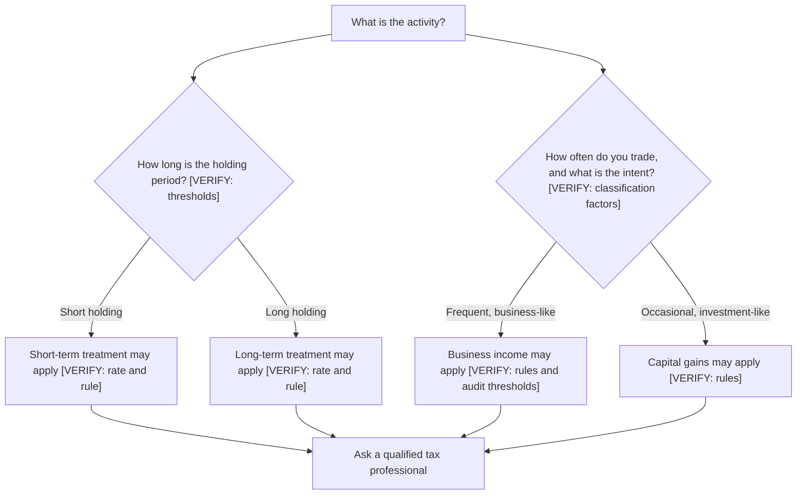

<!-- meta
id: T2.3
title: Taxes on trading profits
page_type: Concept
prerequisites: [T2.2, T1.9]
labs: []
estimated_minutes: 20
-->

# Taxes on trading profits

## Hook

A trader makes Rs 10,000 gross in a year. The trader pays Rs 300 in trading costs. The trader assumes the remaining Rs 9,700 is the profit. Months later, a tax notice arrives. It is for an amount that is not in the trader's plan at all. The mistake was not the arithmetic. The mistake was assuming that tax is simply a percentage of trading turnover. The trader did not check how the activity is classified. This chapter explains the ideas, not the rates.

## The idea

Tax is a separate layer from trading costs. Costs (*Costs on a trade*) are paid to brokers, exchanges and the government on each trade. Tax is worked out on your net gains for the year. The rules depend on what kind of activity it is.

Three ideas matter at the concept level:

- **Classification.** The same stock can be taxed in different ways. It depends on whether you hold it as an investment, trade it as a business, or do something else. The classification depends on facts. Those facts include how long you hold, how often you trade, and what you intend. [VERIFY: classification rules under the Income Tax Act and CBDT circulars]
- **Holding period.** For investments, how long you hold a share can decide whether a gain is short-term or long-term. The cut-off periods and the rates are different. [VERIFY: holding-period thresholds and rates in the current Finance Act]
- **Loss set-off.** Some losses can cancel out some gains. Some losses can be carried forward to later years. Which losses, against which gains, and for how long, depends on the rules. [VERIFY: loss set-off and carry-forward rules]

Other points exist too. Each one needs a check from an official source:

- Business income and speculative income are treated differently from capital gains. [VERIFY: business and speculative income treatment]
- Frequent trading can bring a tax audit duty, once turnover passes a set level. [VERIFY: tax audit turnover thresholds]
- Dividends are taxed under their own rules. These connect to the corporate actions in *Corporate actions*. [VERIFY: dividend taxation]
- The tax regime you choose matters. Changes to it over time also matter. [VERIFY: tax regime choice and recent changes]

**What the book does and does not do.** This book does not calculate tax yet. A tax calculator will come only after the rates and rules are checked against official sources. Until then, this chapter stays at the level of ideas.

**The formula, in words first.** Net result = gross gain - trading costs - tax. Tax = rate x taxable base. The taxable base depends on the classification. Whether costs can be deducted from it is a point that must still be checked. [VERIFY]

In symbols, G is the gross gain, C is the trading costs, B is the taxable base, and t is a tax rate that has not been verified.

- If costs can be deducted, B = G - C.
- Tax = t x B.
- Net = G - C - t x B.

The symbol t is a placeholder. This chapter does not give a value for it.

**Questions about classification.** Before a tax figure means anything, you need answers. For example: How long did I hold this? How many trades did I make in the year? Was I investing, or running trading as a business? A qualified tax professional should answer these questions with you. Writing your answers in your journal helps. The journal becomes the record you will need.

## See it

The decision tree below shows the kinds of questions that decide classification. It does not give a result. Each branch ends in a question for a professional. Each branch has a [VERIFY] note, because the rules must be checked.

Read the tree from the top. The branches show which facts you would need to bring to a professional. No branch states a rate.

## Worked example

**Hypothetical, symbolic.** The gross gain is Rs 10,000. Trading costs are Rs 300. Assume costs can be deducted from the taxable base. This is a working assumption that must still be verified.

| Step | Expression | Value |
|---|---|---|
| Gross gain | G | Rs 10,000 |
| Trading costs | C | Rs 300 |
| Taxable base | B = G - C | 10,000 - 300 = Rs 9,700 |
| Tax | t x B | t x 9,700 |
| Net result | G - C - t x B | 10,000 - 300 - t x 9,700 = 9,700 - 9,700t |

**DUMMY illustration, for algebra only.** If t were 20%, tax would be 0.20 x 9,700 = Rs 1,940. The net would be 9,700 - 1,940 = Rs 7,760. The 20% is not a rate. It only shows that the algebra works. Do not use it as a tax figure.

## Try it

### Guided exercise

**Task.** A made-up year has a gross gain of Rs 4,000 and trading costs of Rs 200. Write the net expression using the placeholder rate t. Keep t as a symbol. Do not put a number in it.

Hints:

1. Find the taxable base first. It is the gross gain minus the costs.
2. Tax is t multiplied by the taxable base.
3. Net is the gross gain minus the costs minus the tax.

**Answer:** Taxable base = 4,000 - 200 = 3,800. Tax = t x 3,800. Net = 4,000 - 200 - t x 3,800 = 3,800 - 3,800t, which is 3,800 x (1 - t).

<!-- OPEN: Lab 2 is listed as a deferred tax estimate (v1.1, after verification). No lab exists for this chapter yet, so the front matter has no lab. -->

### Independent exercise

**Task.** List five questions you would bring to a qualified tax professional before your first year of trading.

Check your answer

There is no single correct list. Here are examples of good questions:

1. How does my holding period change the treatment of my gains?
2. At what level of trading activity does my activity count as a business, and does that change my treatment?
3. Which of my losses can cancel which of my gains? Can any be carried forward, and for how long?
4. Do my trading costs reduce my taxable base, and which costs?
5. Do I need to meet a tax audit requirement, and at what turnover?

## Quiz

<!-- component: quiz-block | src: quiz.json -->

The quiz checks the main ideas. Tax is not a flat percentage of turnover. Holding period and classification matter. Loss set-off has rules.

## Paper task

Mode: **learning note**. Write it in your journal.

1. For each trade you log, add a classification note column with three entries: holding period, intent, and how often you trade.
2. Do not calculate any tax figure. The column is a record for later, and a professional can use it.
3. Mark the entries as learning notes, not live records.

## Limits and common mistakes

- It does not tell you what tax you will pay. The rates and rules are not stated here, and they must be verified.
- This is not tax advice. The book does not give tax advice. Talk to a qualified professional.
- Gains and losses are not always treated the same way across activities. The differences are the reason to get advice.
- It does not show that a tax bill is small or large for any plan. A tax bill can be larger than expected in a year with losses, depending on the rules.

## Remember

- Tax is separate from trading costs. It applies to net gains under rules that depend on the activity.
- Classification, holding period and loss set-off decide much of the treatment. Each needs an official check.
- The formula is net = gross gain - costs - tax, and tax = rate x taxable base.
- Keep a classification record for every trade from the start.
- Take the questions to a qualified tax professional.

## Sources and verification

- Income Tax Department website (incometaxindia.gov.in) and the Income Tax Act text.
- CBDT circulars.
- The current Finance Act.
- SEBI and NSE tax-information pages, where relevant.
- Zerodha Varsity tax section, for reference only (link only, no text copied).

<!-- facts-needed: classification rules for trading income; short-term and long-term capital gains rates and holding-period thresholds; business and speculative income treatment; loss set-off and carry-forward rules; tax audit turnover thresholds; tax regime choice and changes; dividend taxation. -->

[VERIFY: classification rules for trading income]
[VERIFY: short-term and long-term capital gains rates and holding-period thresholds]
[VERIFY: business and speculative income treatment]
[VERIFY: loss set-off and carry-forward rules]
[VERIFY: tax audit turnover thresholds]
[VERIFY: tax regime choice and recent changes]
[VERIFY: dividend taxation]

<!-- OPEN: The owner's own tax status (PLAN section 11, item 7) must be resolved before this chapter is final. The chapter stays conceptual until then. -->

<!-- standing-disclaimer -->
