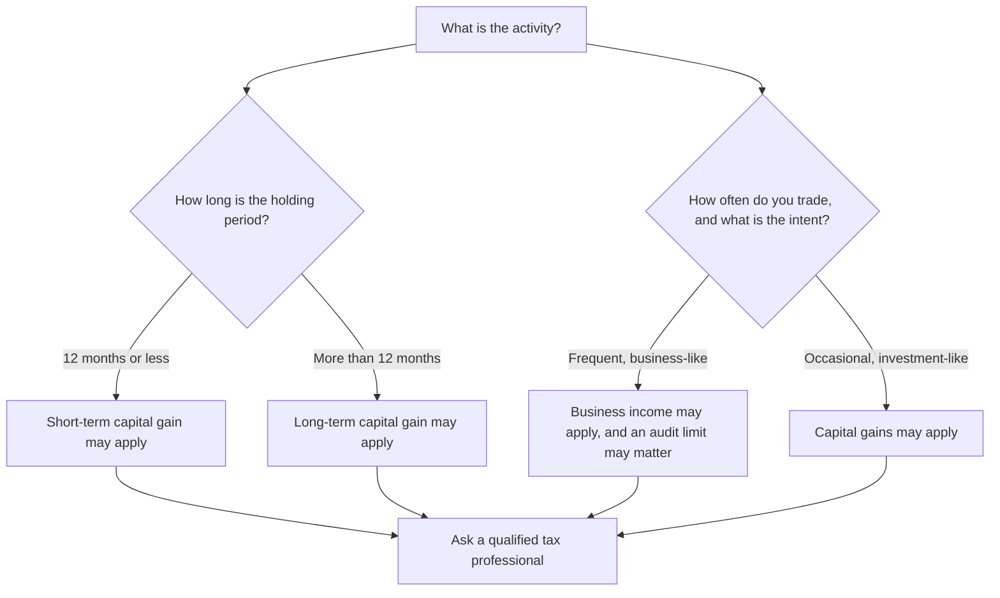

<!-- meta
id: T2.3
title: Taxes on trading profits
page_type: Concept
prerequisites: [T2.2, T1.9]
labs: []
estimated_minutes: 20
-->

# Taxes on trading profits

## Hook

A trader makes Rs 10,000 gross in a year. The trader pays Rs 300 in trading costs. The trader assumes the remaining Rs 9,700 is the profit. Months later, a tax notice arrives. It is for an amount that is not in the trader's plan at all. The mistake was not the arithmetic. The mistake was assuming that tax is simply a percentage of trading turnover. The trader did not check how the activity is classified. This chapter explains the ideas first. It then lists the main rules as the official sources state them.

## The idea

Tax is a separate layer from trading costs. Costs (*Costs on a trade*) are paid to brokers, exchanges and the government on each trade. Tax is worked out on your net gains for the year. The rules depend on what kind of activity it is.

Three ideas matter:

- **Classification.** The same stock can be taxed in different ways. It depends on whether you hold it as an investment, trade it as a business, or do something else. The classification depends on facts. Those facts include how long you hold, how often you trade, and what you intend. The law treats a trade that is not settled by taking delivery of the shares (for example, buying and selling the same day) as a speculative transaction. If such trading is done as a business, it is a separate "speculation business".
- **Holding period.** For listed shares, a gain is short-term if you held the shares for twelve months or less. It is long-term if you held them for more than twelve months. The rates are different for the two.
- **Loss set-off.** Some losses can cancel out some gains. Some losses can be carried forward to later years. The rules below show which losses, against which gains, and for how long.

### The main rules in one place

These are the rules for listed shares bought and sold on a stock exchange where STT is paid. They apply from the 2026-27 tax year, when the new Income-tax Act, 2025 came into force on 1 April 2026. Your own case may differ. A qualified tax professional should confirm what applies to you.

| Topic | What the official sources say |
|---|---|
| Short-term gain on listed shares (held 12 months or less) | Taxed at 20% |
| Long-term gain on listed shares (held more than 12 months) | The first Rs 1,25,000 of long-term gains in a year is not taxed. The part above that is taxed at 12.5%, with no indexation |
| STT condition | These special rates apply only where STT was paid. For long-term gains on shares, STT must have been paid when you bought and when you sold, with some exceptions |
| Capital loss set-off | A short-term loss can be set against any capital gain. A long-term loss can be set only against long-term gains |
| Capital loss carry-forward | An unused capital loss can be carried forward for up to 8 years. It can be used only against capital gains |
| Business income that is not speculative | A loss can be set against other heads of income in the same year (but not salary). An unused loss can be carried forward for up to 8 years and used only against business income |
| Speculation business (for example, intraday trades with no delivery) | A loss can be set only against profit from another speculation business. An unused loss can be carried forward for up to 4 years |
| Tax audit | A person with business income must have the accounts audited if turnover is over Rs 1 crore. The limit is Rs 10 crore if cash receipts and cash payments are each 5% or less of the total |
| ITR form (individual) | Capital gains with no business income are reported in ITR-2. Business income, including trading as a business, is reported in ITR-3 |
| Dividends | Dividend is added to your income and taxed under "income from other sources". The company may deduct tax before paying it. Only interest on money borrowed to earn it can be deducted, up to 20% of the dividend |
| Tax regime | The new tax regime is the default. A person with business income who wants the old regime must choose it by the return due date, and the choice can be changed back only once |

(As of 11 Nov 2026. Sources: the Income-tax Act, 2025 as published by the Income Tax Department, and the Income Tax Department e-filing help pages on loss set-off and on ITR forms. Rates and limits change with each Budget, so check incometax.gov.in each year.)

The same rules applied under the older Income-tax Act, 1961 for income up to 31 March 2026. Section numbers changed, but the rates above did not. Losses from earlier years carry forward under the new Act as they did under the old one.

Costs matter too. STT is not allowed as a deduction when you work out capital gains. For business income, STT paid on trades done in the course of the business can be claimed as a business expense. Other costs, such as brokerage, depend on the head of income. Ask a professional which costs apply to you.

**What the book does and does not do.** This book does not work out your tax. Your tax depends on your own facts, your other income and the year. The practice sum below uses a made-up rate to show the algebra only.

**The formula, in words first.** Net result = gross gain - trading costs - tax. Tax = rate x taxable base. The taxable base depends on the classification. Whether costs can be deducted from it depends on the head of income, as the notes above show.

In symbols, G is the gross gain, C is the trading costs, B is the taxable base, and t is a tax rate. In the practice sum, t is a made-up number.

- If costs can be deducted, B = G - C.
- Tax = t x B.
- Net = G - C - t x B.

The symbol t is a placeholder. The practice sum below gives it a made-up value only to show the algebra. The real rates are in the table above.

**Questions about classification.** Before a tax figure means anything, you need answers. For example: How long did I hold this? How many trades did I make in the year? Was I investing, or running trading as a business? A qualified tax professional should answer these questions with you. Writing your answers in your journal helps. The journal becomes the record you will need.

## See it

The decision tree below shows the kinds of questions that decide classification. It does not give a result. Each branch ends in a question for a professional.

Read the tree from the top. The branches show which facts you would need to bring to a professional. The rates are in the table above.

<!-- component: tax-calc | trades: 6000,3000,1000 | costs: 300 | rate: 20 | caption: A practice sum with a DUMMY tax rate. It is not a real rate. Check the official source or ask a tax professional. -->

## Worked example

**Hypothetical, symbolic.** The gross gain is Rs 10,000. Trading costs are Rs 300. For this practice sum, assume costs can be deducted from the taxable base. In real life this depends on the head of income, as noted above.

| Step | Expression | Value |
|---|---|---|
| Gross gain | G | Rs 10,000 |
| Trading costs | C | Rs 300 |
| Taxable base | B = G - C | 10,000 - 300 = Rs 9,700 |
| Tax | t x B | t x 9,700 |
| Net result | G - C - t x B | 10,000 - 300 - t x 9,700 = 9,700 - 9,700t |

**DUMMY illustration, for algebra only (a made-up round number, not your tax).** If t were 20%, tax would be 0.20 x 9,700 = Rs 1,940. The net would be 9,700 - 1,940 = Rs 7,760. The 20% here only shows that the algebra works. It is not a calculation of anyone's real tax. Do not use it as a tax figure.

## Try it

### Guided exercise

**Task.** A made-up year has a gross gain of Rs 4,000 and trading costs of Rs 200. Write the net expression using the placeholder rate t. Keep t as a symbol. Do not put a number in it.

Hints:

1. Find the taxable base first. It is the gross gain minus the costs.
2. Tax is t multiplied by the taxable base.
3. Net is the gross gain minus the costs minus the tax.

**Answer:** Taxable base = 4,000 - 200 = 3,800. Tax = t x 3,800. Net = 4,000 - 200 - t x 3,800 = 3,800 - 3,800t, which is 3,800 x (1 - t).

<!-- component: tax-calc | trades: 4000 | costs: 200 | rate: 20 | caption: Guided exercise: gross gain Rs 4,000 and costs Rs 200. Keep the rate as a symbol on paper. The slider uses a DUMMY rate only to show the idea. -->

### Independent exercise

**Task.** List five questions you would bring to a qualified tax professional before your first year of trading.

Check your answer

There is no single correct list. Here are examples of good questions:

1. How does my holding period change the treatment of my gains?
2. At what level of trading activity does my activity count as a business, and does that change my treatment?
3. Which of my losses can cancel which of my gains? Can any be carried forward, and for how long?
4. Do my trading costs reduce my taxable base, and which costs?
5. Do I need to meet a tax audit requirement, and at what turnover?

## Quiz

<!-- component: quiz-block | src: quiz.json -->

The quiz checks the main ideas. Tax is not a flat percentage of turnover. Holding period and classification matter. Loss set-off has rules.

## Paper task

Mode: **learning note**. Write it in your journal.

1. For each trade you log, add a classification note column with three entries: holding period, intent, and how often you trade.
2. Do not calculate any tax figure. The column is a record for later, and a professional can use it.
3. Mark the entries as learning notes, not live records.

## Limits and common mistakes

- It does not tell you what tax you will pay. It lists the main rules as the official sources state them. Your own case may differ.
- This is not tax advice. The book does not give tax advice. Talk to a qualified professional.
- Gains and losses are not always treated the same way across activities. The differences are the reason to get advice.
- It does not show that a tax bill is small or large for any plan. A tax bill can be larger than expected in a year with losses, depending on the rules.

## Remember

- Tax is separate from trading costs. It applies to net gains under rules that depend on the activity.
- Classification, holding period and loss set-off decide much of the treatment. For listed shares, the dividing line is 12 months. Short-term gains are taxed at 20%. Long-term gains above Rs 1,25,000 a year are taxed at 12.5%.
- The formula is net = gross gain - costs - tax, and tax = rate x taxable base.
- Keep a classification record for every trade from the start.
- Take the questions to a qualified tax professional.

## Sources and verification

- Income-tax Act, 2025 (Act 30 of 2025), published by the Income Tax Department (incometaxindia.gov.in). It covers the rates on listed shares, the Rs 1,25,000 exemption, loss set-off and carry-forward, speculation business, tax audit limits and the new tax regime. Read on 11 Nov 2026.
- Income Tax Department e-filing help pages (incometax.gov.in) on set-off and carry-forward of losses, and on the ITR form for business income. Read on 11 Nov 2026.
- The same rates and holding period applied under the older Income-tax Act, 1961 for transfers on or after 23 July 2024.
- Zerodha Varsity tax section, for reference only (link only, no text copied).

<!-- facts-needed: classification rules for trading income; short-term and long-term capital gains rates and holding-period thresholds; business and speculative income treatment; loss set-off and carry-forward rules; tax audit turnover thresholds; tax regime choice and changes; dividend taxation. -->

<!-- standing-disclaimer -->
