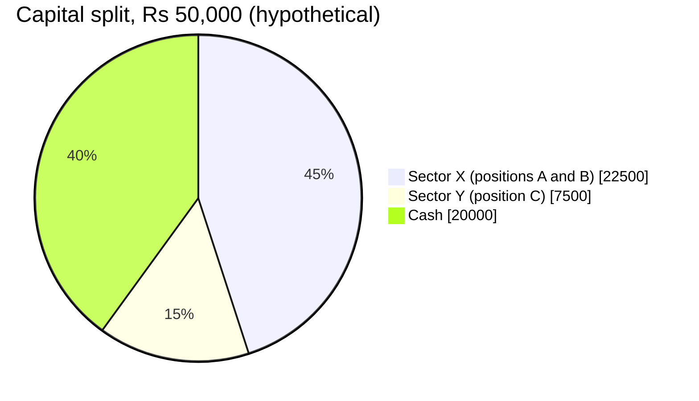

<!-- meta
id: T2.14
title: Portfolio exposure and concentration
page_type: Math/Calculator
prerequisites: [T2.5, T2.11, T1.8]
labs: [Lab 3, Lab 1]
estimated_minutes: 25
-->

# Portfolio exposure and concentration

## Hook

Hypothetical: a trader holds five stocks and says, "I am diversified." Three of the five are in the same sector. A bad week for that sector moves all three in the same direction, on the same day. The account feels like five separate bets. In practice, it behaved like one large bet.

## The idea

Four terms to know:

- **Exposure** is the rupee value of your positions. It is often written as a percentage of capital. Exposure is not risk. A position can be large and still carry a small planned loss.
- **Open risk** is the planned loss if every stop fills at its stop price.
  - Open risk = add up (entry - stop) x shares for each position.
  - This is the planned loss, not the maximum loss. Gaps and circuits (daily price limits set by the exchange) can make the real loss bigger (*Slippage, gaps and planned versus actual risk*).
- **Concentration** is how much of your capital sits in one stock, one sector or one theme.
- **Correlation** means positions that tend to move together. Stocks in the same sector often do. Five stocks that move together are closer to one bet than to five bets.

Other points:

- **Cash** = capital - deployed value. Deployed value is the total of the position values.
- **Diversification** reduces the risk from one company or one event. It does not remove risk that hits the whole market.
- **Limits.** You set a maximum per position, a maximum per sector and a maximum total open risk. Lab 1 uses a 25% per-position cap as a starting value. You choose the sector limits.
- **Adding to a losing position** to lower the average cost raises concentration in a failing idea. This is called averaging down. The book's capital-first rules ban it (*Position sizing step by step*). Check the limits before you add.
- **Sector labels** come from your data. Check their source against the NSE sectoral index definitions [VERIFY: sector classification source].

## See it

Pie chart of the worked example, with values in rupees (hypothetical):

The chart shows that Sector X is the largest slice of capital. Sector X is 45% of capital, and cash is 40%. The table in the worked example also shows the open risk and the sector limit. A pie chart cannot show those.

## Worked example

**Hypothetical.** Capital Rs 50,000. Holdings:

| Position | Sector | Value | % of capital | Planned loss at stop |
|---|---|---|---|---|
| A | X | 10,000 | 20% | 500 |
| B | X | 12,500 | 25% | 500 |
| C | Y | 7,500 | 15% | 300 |

1. **Deployed:** 10,000 + 12,500 + 7,500 = Rs 30,000. As a share of capital: 30,000 / 50,000 = 60%.
2. **Cash:** 50,000 - 30,000 = Rs 20,000, which is 40%.
3. **Open risk:** 500 + 500 + 300 = Rs 1,300. As a share of capital: 1,300 / 50,000 = 2.6%.
4. **Sector X:** 10,000 + 12,500 = Rs 22,500. As a share of capital: 22,500 / 50,000 = 45%.

**Adding a new position.** Position D is Rs 6,000 in Sector X, with a planned loss of Rs 300.

5. Sector X becomes 22,500 + 6,000 = Rs 28,500. As a share of capital: 28,500 / 50,000 = 57%.
6. Open risk becomes 1,300 + 300 = Rs 1,600. As a share of capital: 1,600 / 50,000 = 3.2%.
7. The illustrative 40% sector limit is breached (57% is above 40%). **The new position is rejected.** The sector limit is the rule that causes the rejection.

## Try it

This chapter has no interactive demo. Use the worked example and the guided exercise below.

<!-- OPEN: spec gives no interactive demo or component for *Portfolio exposure and concentration*; the See it content is a static pie chart and the worked example table. -->

### Guided exercise

**Task.** Using the holdings in the worked example, work out the deployed percentage, the open risk percentage and the Sector Y share.

Hints:

1. Add the position values first, then divide by capital.
2. Add the planned losses, then divide by capital.
3. Sector Y has one position only.

**Answer:** Deployed 30,000 / 50,000 = 60%. Open risk 1,300 / 50,000 = 2.6%. Sector Y 7,500 / 50,000 = 15%.

### Independent exercise

**Task.** Four positions, each at 25% of capital, and each with a planned loss of 1% of capital. Work out the total open risk and the deployed percentage. Then explain why this is a concentration problem if all four are in one sector.

Check your answer

Each position is 25% of capital, so deployed = 4 x 25% = 100%. Cash = 0.

Each planned loss is 1% of capital, so open risk = 4 x 1% = 4%.

If all four are in one sector, a single sector move can hit all four stops at once. The four positions are closer to one large bet on that sector than to four separate bets. So the sector share (100% of capital) is the concentration problem.

## Quiz

<!-- component: quiz-block | src: quiz.json -->

Six questions cover open risk, sector share, the difference between exposure and risk, correlation, and a spot-the-mistake on sector totals.

## Paper task

Mode: **learning note** (or paper). No orders are placed.

1. Write a weekly portfolio snapshot in your journal. Use made-up holdings only.
2. For each position, note the value, the sector, the percentage of capital and the planned loss at the stop.
3. Add up the totals: deployed, cash, open risk and each sector's share.
4. Compare each total with your own limits. Write one line on whether any limit is breached.

If the journal app is not ready, use paper.

## Limits and common mistakes

- Exposure and open risk are not forecasts. Open risk assumes every stop fills at its stop price. Gaps and circuits can break that assumption (*Slippage, gaps and planned versus actual risk*).
- Sector labels depend on the data source. Check the source before use [VERIFY: sector classification source].
- Diversification does not remove market-wide risk. A broad fall can hit every sector.
- The 40% sector limit is an example. You set every limit.
- Adding to a losing position to lower the average cost raises concentration. It is not a fix.

## Remember

- Exposure is value. Open risk is the planned loss. They are different numbers.
- Open risk = total of (entry - stop) x shares across positions.
- Positions in one sector often move together. Count them as one larger bet.
- Update sector totals every time you add a position.
- Check every limit before you add a position, not after.

## Sources and verification

Sources (names only):

- NSE sectoral index methodology documents.

Facts to verify before this chapter is final:

- [VERIFY: sector classification source for your data, against the NSE sectoral index definitions]

<!-- facts-needed: sector classification source for your data (NSE sectoral index definitions) -->

<!-- standing-disclaimer -->
