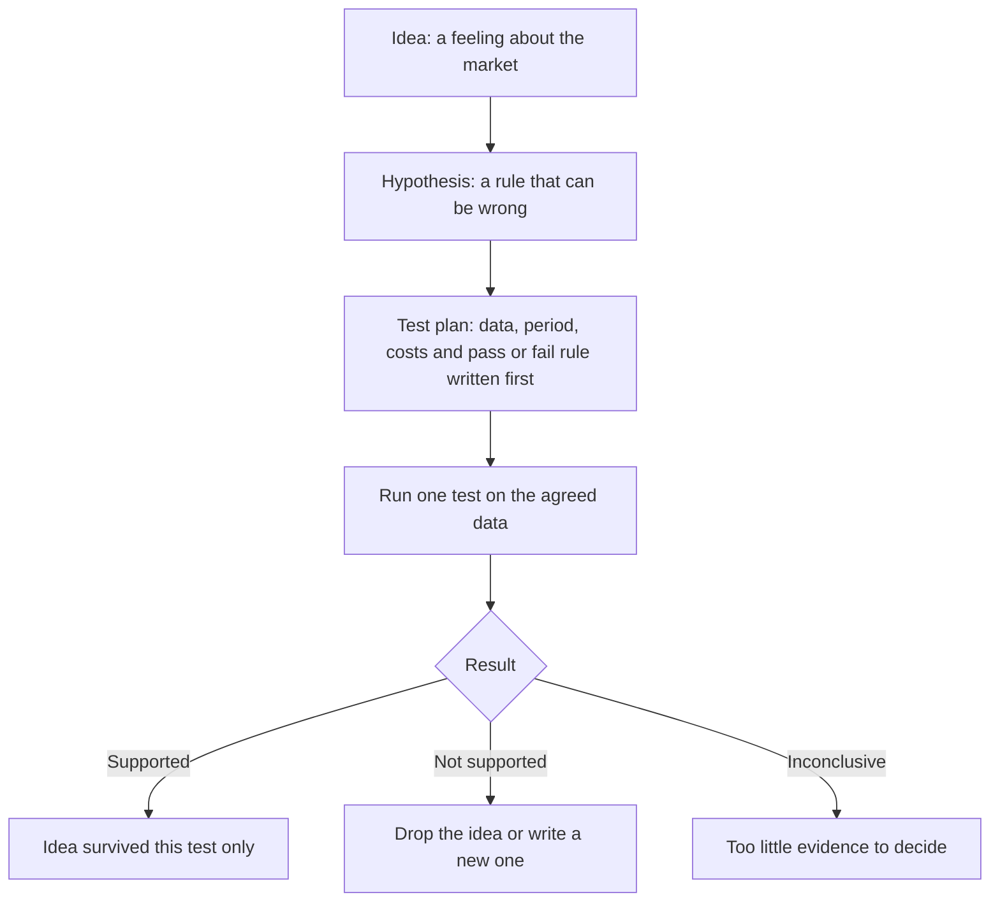

<!-- meta
id: T7.1
title: From idea to hypothesis to test plan
page_type: Concept
prerequisites: [T6.2, T6.4]
labs: []
estimated_minutes: 15
-->

# From idea to hypothesis to test plan

## Hook

Imagine you have this idea: stocks that make new highs keep going up. You test it on old prices. You try three stop levels and keep the one that shows the biggest gain. The gain looks good. But you picked the stop after you saw the results. That choice makes the test unfair. The result can tell you very little. This chapter shows how to write an idea so that a test can really check it.

## The idea

An **idea** is a feeling about the market. "Prices feel strong lately" is an idea. No one can test a feeling as it stands. No result would prove it wrong.

A **hypothesis** is a rule that can be wrong. It has a clear entry, a clear exit and a clear size. Each part is a number or a plain condition. Then a test can show that the rule failed. A trading edge is a rule with a real, repeatable advantage (*What a trading edge is*). A hypothesis is how you check whether an edge exists.

**Falsifiable** means you can say which result would make you drop the idea. A plan that says "I drop the idea if the average result after costs is not above zero" is falsifiable. If no result could prove you wrong, the idea is not ready to test.

**Fix the pass or fail rule before you look at the data.** Changing the rule after you see results is the most common way to fool yourself. The test then becomes a fit to the past. It stops being a check of the idea.

A **test plan** lists these fields before the run:

- **Universe:** the stocks you will test.
- **Data source:** where the prices come from. Read its terms.
- **Period:** the dates the test covers.
- **Split:** how the data is divided. One part is for building the rule. The other part is kept back for the final check (*Out-of-sample and walk-forward testing*).
- **Entry, stop and exit:** the rules that decide when you enter, when you cut a loss and when you leave.
- **Sizing:** how many shares each trade uses (*Position sizing step by step*).
- **Costs:** the charges and slippage the test adds (*Costs on a trade*).
- **Metrics:** the numbers you will read, such as expectancy (*Expectancy and profit factor*).
- **Pass or fail rule:** the result that decides the outcome.
- **Number of variants tried:** every version you test, including the ones you drop.

A test has three possible results:

- **Supported:** the idea passed this test under its rules.
- **Not supported:** the idea failed under its rules. Drop it or write a new idea. Do not move the rules to save it.
- **Inconclusive:** the test did not decide. For example, it had too few trades to say much.

A passed test is weak evidence. It means the idea survived one test. It does not prove the idea works.

## See it

Follow the arrows from top to bottom. The test plan must exist before the run. Each of the three results leads to a different next step. No box in this flow says trade.

<!-- component: hypothesis-builder | caption: Turn a loose idea into a rule that can be wrong, lock the pass rule first, then see what the result allows you to say. -->

## Worked example

**Hypothetical.** The idea is: stocks that make new highs keep going up. Here is one testable hypothesis written from that idea.

| Part | Rule |
|---|---|
| Entry | Buy at the next day's opening price, after a day closes above the highest price of the previous 55 days. |
| Stop | 2.5 times ATR(14) below the entry price. ATR is the average true range, a measure of how far a price usually moves in one day. The 14 is the number of days used. |
| Exit | Trail the stop at 3 times ATR. A trailing stop moves up as the price rises. It does not move down. |
| Size | Risk 1% of Rs 50,000 = Rs 500 per trade. |
| Costs | The costs from the cost settings in Lab 2. |
| Pass rule | Expectancy after costs must be above zero over the held-out period. Expectancy is the average result per trade. The held-out period is the part of the data kept back for the final check. |

Now change the pass rule after a result. Say the first run gives an expectancy of minus Rs 20 per trade. You change the pass rule to "above minus Rs 50 per trade". The idea now passes. But the new rule is a different, untested idea. The first test had already said not supported.

## Try it

### Guided exercise

**Task.** Turn each vague idea into a hypothesis. For each one, name the entry trigger, the exit, and the one number that defines "works".

1. Buy strong stocks.
2. Sell when the market feels weak.
3. Buy stocks that look cheap.

Hints:

1. Name the entry trigger in a measurable way. Words such as "strong" or "cheap" need a number.
2. Name the exit as a condition you can check on a price chart.
3. Pick one number that decides "works". For example, expectancy after costs above zero.

**Answer:**

1. Entry: buy at the next day's open, after a close above the highest close of the previous 20 days. Exit: sell at the next day's open, after a close below the lowest close of the previous 10 days. Works: expectancy after costs is above zero in the held-out period.
2. "Feels weak" is an exit idea for shares you already hold. Exit: sell at the next day's open when a chosen market index closes below its 50-day average close. Works: the average result per trade after costs is above zero in the held-out period.
3. Entry: buy at the next day's open, after a close at least 10% below the 60-day average close. Exit: sell at the next day's open when the close returns to the 60-day average, or after 20 trading days, whichever comes first. Works: expectancy after costs is above zero in the held-out period.

Add a stop and a size to each one, as in the worked example.

### Independent exercise

**Task.** Write a complete test plan for a breakout idea of your own choosing. Include every field listed in *The idea*.

Check your answer

A sample plan. All numbers are examples set for this exercise.

- **Universe:** 30 listed stocks, chosen by a written rule before the test starts.
- **Data source:** a named free source, whose terms you have read. Many free sources allow personal use only. See *Historical data*.
- **Period:** 2016 to 2022.
- **Split:** 2016 to 2019 for building the rule. 2020 to 2022 kept back for the final check. Nothing is chosen using 2020 to 2022.
- **Entry:** buy at the next day's open, after a close above the highest close of the previous 20 days.
- **Stop:** 2 times ATR(14) below the entry price.
- **Exit:** the stop, or the next day's open after a close below the lowest close of the previous 10 days, whichever comes first.
- **Sizing:** risk 1% of a test capital of Rs 50,000, which is Rs 500 per trade, with the caps from *Position sizing step by step*.
- **Costs:** the cost settings from Lab 2. Add slippage only if you set it.
- **Metrics:** expectancy after costs, profit factor, and the largest fall from a peak in the test account (*Drawdown and recovery math*).
- **Pass or fail rule:** expectancy after costs is above zero in the held-out period, with at least 30 trades. The 30 is an example number, set before the test.
- **Number of variants tried:** 1, this plan. Any other version you try is logged too.

All figures are hypothetical.

## Quiz

<!-- component: quiz-block | src: quiz.json -->

The quiz checks falsifiable rules, pass rules set after results, what a passed test shows, and how to answer a teammate's chart.

## Paper task

Mode: **learning note**. This is not a trade row.

1. Write one idea of your own in one sentence.
2. Turn it into a hypothesis with an entry, a stop, an exit and a size.
3. Fill in every field from *The idea* list.
4. Write the pass or fail rule and date it. Do not change it after any run.

Log it in your journal (or on paper until the journal app is ready).

## Limits and common mistakes

- A test plan does not show that the idea will work. It only shows how the idea was checked.
- A test plan is not a trading plan. Nothing in this chapter allows real money to be used.
- Writing a rule down does not make it a system. A system needs tested rules, costs, sizing and a record of results over time.
- Changing the pass rule after you see results is the most common error. Treat any change as a new idea that needs a new test (*Overfitting and the number of things you tried*).

## Remember

- A hypothesis is a rule that can be wrong.
- Write the pass or fail rule before you see any result.
- A passed test is weak evidence, not proof.
- A changed rule is a new, untested idea.
- A test plan is not a trading plan.

## Sources and verification

- Robert Pardo, *The Evaluation and Optimization of Trading Strategies*, 2nd edition (Wiley, 2008), on how to test a trading idea.

<!-- standing-disclaimer -->
