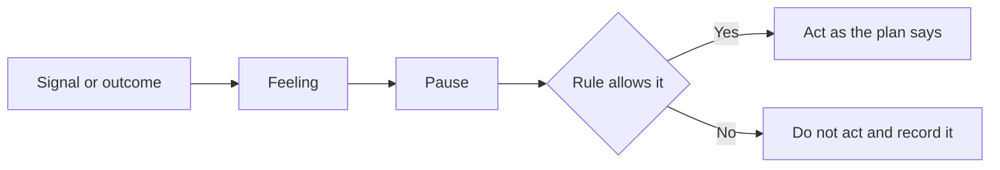

<!-- meta
id: T8.1
title: Fear, greed and the brain on losses
page_type: Concept
prerequisites: [T0.1, T2.1]
labs: [Lab 3]
estimated_minutes: 20
-->

# Fear, greed and the brain on losses

## Hook

A trader loses Rs 2,000 in one day. This is a hypothetical example. His plan says to stop after a loss, and he feels a strong urge to win the money back. He places one more trade, which the plan did not include. The loss that hurts most is the one he chose to take. This chapter explains why these feelings appear, and how to see them before they cost money.

## The idea

Fear and greed are useful in many parts of life. In markets they often push you the wrong way. Prices move for many reasons, and a single trader cannot see most of them. A feeling that is useful in one place can mislead you in another.

A loss sets off a stress response. The urge is to act, so the feeling stops. Acting to stop a feeling is a different thing from following the plan. Many people feel a loss more strongly than the same rupee amount gained. That is why the same Rs 500 can feel worse to lose.

Frame each loss in R. One R is your planned risk on one trade. A loss of 1R is the planned cost of one stopped trade. This turns a loss into a known cost of your method. It is not a personal failure.

Feelings show up at decision points. There are four:

- After a loss.
- After a win.
- When price moves without you.
- When your plan says "no trade".

At each point, a feeling can override a written rule. Naming the feeling helps you pause. The pause gives the rule a chance to decide.

This book does not diagnose anyone. If trading causes you real distress, see *When to stop trading altogether*.

## See it

Follow the arrows from a signal or an outcome. Notice the pause before any action. The rule check decides what happens next, not the feeling.

<!-- component: fear-greed-curve | capital: 50000 | caption: A made-up day with six moments. Name the feeling, choose what you do, and compare with the day that follows the rule. -->

## Worked example

**Hypothetical.** Capital Rs 50,000. One R is Rs 500, which is 1 percent of capital. The day ends with a loss of Rs 2,000.

| Measure | Calculation | Result |
|---|---|---|
| Loss in R | 2,000 / 500 | 4R |
| Loss as a share of capital | 2,000 / 50,000 | 4% |

The loss is the same size whether it came from four planned stops or from one unplanned trade. The second case is a rule break. Your journal records it as one.

## Try it

### Guided exercise

**Task.** Classify each of these five sentences as "feeling", "rule" or "outcome".

1. "Price fell to Rs 240 and my stop was hit."
2. "I want to get back the Rs 2,000 right now."
3. "The trade lost Rs 500, which is 1R."
4. "The plan says no new trade after two losses."
5. "I feel I must act now, or I will miss the move."

Hints:

1. A rule says what to do when a condition is met.
2. A feeling is about what you want to do next.
3. An outcome is something that has already happened.

**Answer:**

1. Outcome.
2. Feeling.
3. Outcome.
4. Rule.
5. Feeling.

### Independent exercise

**Task.** List five emotion tags you expect to use. Write one sentence for each, describing when it appears. Use the tag list in your journal if it has one.

Check your answer

A sample list:

- **Calm.** It appears when the plan is followed and no trade is needed.
- **Fear.** It appears when a stop is near and you feel like leaving early.
- **Greed.** It appears after a win, when you feel like adding size.
- **Frustration.** It appears after a loss, when you want to act at once.
- **Relief.** It appears when a trade ends as the plan said it would.

## Quiz

<!-- component: quiz-block | src: quiz.json -->

The quiz checks losses in R and the decision points. It also checks a loss followed by a wish to win it back, and why calm traders still need a check.

## Paper task

Mode: **learning note**.

1. Before each of five learning-note sessions, write one emotion tag. This is emotion_before.
2. After the session, write one emotion tag. This is emotion_after.
3. Note any moment when a feeling pushed you toward an action outside the rule.
4. After five sessions, write one sentence about the pattern you see.

Log it in your journal (or on paper until the journal app is ready). If the journal's emotion fields are not ready, use the five tags from the independent exercise.

## Limits and common mistakes

- This chapter does not tell you what your rule should be after a loss. Your written plan does (*The capital-first rules*).
- Naming a feeling does not stop it. The pause and the rule check protect your capital.
- This book does not diagnose anyone and does not offer therapy. If trading causes real distress, talk to a trusted person or a qualified professional. See *When to stop trading altogether*.
- An emotion tag is a record for learning. It is not a score of how good or bad you are as a trader.
- Feelings after a loss are normal. They are not a reason to trade.

## Remember

- Feelings are signals, not instructions.
- Record each loss in R and as a share of capital.
- Four decision points: after a loss, after a win, when price moves without you, and when the plan says no trade.
- Pause and check the rule before any action.
- Trading to win back a loss is a rule break. Record it.

## Sources and verification

- Daniel Kahneman, *Thinking, Fast and Slow* (Farrar, Straus and Giroux, 2011, first edition).
- The journal's emotion fields in Lab 3.

<!-- standing-disclaimer -->
