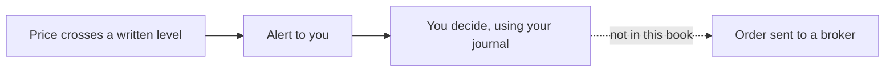

<!-- meta
id: T9.5
title: Algo trading and why this book does not automate
page_type: Concept
prerequisites: [T4.4, T7.10, T9.4]
labs: []
estimated_minutes: 25
-->

# Algo trading and why this book does not automate

## Hook

A reader thinks, "If a script can watch prices for me, it can place my orders while I sleep. Then I will never make a mistake." This chapter explains why that idea is risky. It also explains why this book does not automate orders.

## The idea

**Algo trading** means trading rules run by a program. A rule might say, "If the price crosses a level I wrote, do something." The something can be one of two very different things.

- An **alert** tells you that a level was crossed. It places nothing.
- An **order** sends an instruction to a broker to buy or sell. Sending an order is a separate step, and it is regulated.

A **trading API** is a way for software to talk to a broker. Plans differ. Some plans may not include the market data you need.

Zerodha's Kite Connect is one example. Its Personal plan is free. It covers orders, GTT orders, alerts, margin checks and portfolio tools, but it gives no live data and no historical data. The paid Connect plan costs Rs 500 per month for each app, and it adds live data and historical candles. Zerodha says historical data cannot be bought alone, and it offers no test sandbox for Kite Connect. (As of 11 Nov 2026, Zerodha support pages on Kite API charges and FAQs. Plans and prices change, so check support.zerodha.com.)

The **SEBI retail algo framework** sets rules for brokers and for retail use of algorithms. It includes a way to identify algorithms, called Algo-ID. Here is what the official papers say.

- SEBI's circular of 4 February 2025 on safer participation of retail investors in algorithmic trading makes the broker responsible. The broker is the principal, and the algo provider is its agent.
- Every order sent through an API carries an identifier given by the exchange. This is the Algo-ID.
- Brokers may not leave APIs open. A client needs an API key tied to that client and a fixed internet address that the broker has approved. Login must use OAuth and two-step checks.
- An exchange circular of 5 May 2025 sets a limit of 10 orders per second at first. Below that limit, a client's own algo needs no extra registration through the broker. A client who wants to go above it must register the algo and get an Algo-ID from the exchange. Orders above the limit are rejected.
- Algo providers must be listed with the exchanges. A provider who sells ready-made "black box" algos must also register as a research analyst.
- A later SEBI circular of 30 September 2025 set a phased start from 1 October 2025, with brokers' milestones up to 3 January 2026.
- Zerodha says a fixed (static) internet address is needed to place orders through its API from 1 April 2026. It can be changed once a week, and family members may share one.

(As of 11 Nov 2026, SEBI circulars of 4 Feb 2025 and 30 Sep 2025, NSE circular of 5 May 2025, and Zerodha support pages. Rules change, so check the SEBI and NSE sites.)

Automation does not remove risk. It can repeat one mistake many times, quickly. A bug can send orders you did not intend. Costs and data limits add up too.

This book is offline. It has no broker calls, no stored login details and no order placement.

## See it

Read the diagram from left to right. The first two steps are an alert and your own decision. The last step, sending an order, is not part of this book.

<!-- component: algo-pipeline | mode: alert | caption: Follow one idea from a written rule to an alert. A person checks. Sending an order is not part of this book. -->

## Worked example

**Hypothetical, no figures.** Two scripts watch the same written price level.

| | Script A | Script B |
|---|---|---|
| What it does when the level is crossed | Sends you a message | Sends an order to a broker |
| Places an order | No | Yes |
| Duties that apply | Your own checks | Broker and regulatory duties, as in the section above |

The code length is not the difference. The order step is the difference. That step brings compliance and risk duties that an alert does not.

## Try it

### Guided exercise

**Task.** Classify five described scripts. For each one, choose a label: alert only, places orders, or needs a compliance check first.

1. Sends you a message when a share's price crosses Rs 300. It places nothing.
2. Buys 10 shares through a broker when the price crosses Rs 300.
3. Sends a sell order to a broker at a set time each day.
4. A script you found online. You cannot tell whether it places orders.
5. Shows a chart and sends you a message when your rule is met. It has no link to any broker.

Hints:

1. Ask whether any order leaves your machine toward a broker.
2. A script that only sends a message is an alert.
3. If you are unsure, choose "needs a compliance check first."

**Answer:** 1 is alert only. 2 places orders. 3 places orders. 4 needs a compliance check first. 5 is alert only.

### Independent exercise

**Task.** Write three questions to answer from official sources before you consider any trading API. Do not include a date or a cost in your questions.

Check your answer

Examples of good questions:

- Which rules apply to a script that sends orders, and who must meet them?
- What does an Algo-ID require, and when is it needed? (The official circulars answer this. Read them, and do not rely on a summary.)
- Which broker plans include the data I need, and what does each plan contain?

A good question names the source to check. It does not assume an answer.

## Quiz

<!-- component: quiz-block | src: quiz.json -->

The quiz checks alerts against orders, free APIs, automation risk, one scenario and one spot-the-mistake.

## Paper task

Mode: **learning note**. This chapter has no practice. It asks for reflection only.

1. Write the three verification questions in your learning note.
2. Write one sentence on the difference between an alert and an order.
3. Write one sentence on why automation does not remove risk.
4. Save these in your journal, or on paper until the journal app is ready.

## Limits and common mistakes

- SEBI, NSE and BSE circulars and their dates change. Check them at the source before you act.
- Kite Connect plan contents and charges change. Check the Zerodha support pages.
- This chapter gives no code and no setup steps for any API.
- An alert script still needs your own checks. It can be wrong too.
- Automation does not replace the capital rules. See *Risk limits*.

## Remember

- An alert tells you something happened. An order sends an instruction to a broker.
- Sending orders is a separate, regulated step.
- A free API does not mean no rules apply.
- Automation can repeat a mistake faster.
- This book does not automate orders, and it has no broker calls.

## Sources and verification

- SEBI circular of 4 February 2025 on safer participation of retail investors in algorithmic trading
- SEBI circular of 30 September 2025 on the phased start (glide path)
- NSE circular of 5 May 2025 on implementation standards for retail algo trading
- Zerodha support pages on Kite API charges, static IP and Kite Connect FAQs

<!-- standing-disclaimer -->
