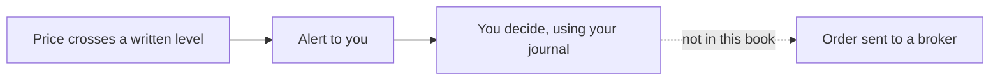

<!-- meta
id: T9.5
title: Algo trading and why this book does not automate
page_type: Concept
prerequisites: [T4.4, T7.10, T9.4]
labs: []
estimated_minutes: 25
-->

# Algo trading and why this book does not automate

## Hook

A reader thinks, "If a script can watch prices for me, it can place my orders while I sleep. Then I will never make a mistake." This chapter explains why that idea is risky. It also explains why this book does not automate orders.

## The idea

**Algo trading** means trading rules run by a program. A rule might say, "If the price crosses a level I wrote, do something." The something can be one of two very different things.

- An **alert** tells you that a level was crossed. It places nothing.
- An **order** sends an instruction to a broker to buy or sell. Sending an order is a separate step, and it is regulated.

A **trading API** is a way for software to talk to a broker. Plans differ. Some plans may not include the market data you need. [VERIFY: Kite Connect plan contents, including orders, alerts and market data]

The **SEBI retail algo framework** sets rules for brokers and for retail use of algorithms. It includes a way to identify algorithms, called Algo-ID. Current requirements and dates are not stated here. [VERIFY: SEBI and exchange circulars on retail algo trading and Algo-ID]

Automation does not remove risk. It can repeat one mistake many times, quickly. A bug can send orders you did not intend. Costs and data limits add up too.

This book is offline. It has no broker calls, no stored login details and no order placement.

## See it

Read the diagram from left to right. The first two steps are an alert and your own decision. The last step, sending an order, is not part of this book.

## Worked example

**Hypothetical, no figures.** Two scripts watch the same written price level.

| | Script A | Script B |
|---|---|---|
| What it does when the level is crossed | Sends you a message | Sends an order to a broker |
| Places an order | No | Yes |
| Duties that apply | Your own checks | Broker and regulatory duties [VERIFY: current duties] |

The code length is not the difference. The order step is the difference. That step brings compliance and risk duties that an alert does not.

## Try it

### Guided exercise

**Task.** Classify five described scripts. For each one, choose a label: alert only, places orders, or needs a compliance check first.

1. Sends you a message when a share's price crosses Rs 300. It places nothing.
2. Buys 10 shares through a broker when the price crosses Rs 300.
3. Sends a sell order to a broker at a set time each day.
4. A script you found online. You cannot tell whether it places orders.
5. Shows a chart and sends you a message when your rule is met. It has no link to any broker.

Hints:

1. Ask whether any order leaves your machine toward a broker.
2. A script that only sends a message is an alert.
3. If you are unsure, choose "needs a compliance check first."

**Answer:** 1 is alert only. 2 places orders. 3 places orders. 4 needs a compliance check first. 5 is alert only.

### Independent exercise

**Task.** Write three questions to answer from official sources before you consider any trading API. Do not include a date or a cost in your questions.

Check your answer

Examples of good questions:

- Which rules apply to a script that sends orders, and who must meet them?
- What does an Algo-ID require, and when is it needed? [VERIFY: current Algo-ID rules]
- Which broker plans include the data I need, and what does each plan contain?

A good question names the source to check. It does not assume an answer.

## Quiz

<!-- component: quiz-block | src: quiz.json -->

The quiz checks alerts against orders, free APIs, automation risk, one scenario and one spot-the-mistake.

## Paper task

Mode: **learning note**. This chapter has no practice. It asks for reflection only.

1. Write the three verification questions in your learning note.
2. Write one sentence on the difference between an alert and an order.
3. Write one sentence on why automation does not remove risk.
4. Save these in your journal, or on paper until the journal app is ready.

## Limits and common mistakes

- SEBI, NSE and BSE circulars and their dates change. Check them at the source before you act. [VERIFY: SEBI, NSE and BSE algo circulars]
- Kite Connect plan contents and charges change. [VERIFY: Zerodha Kite Connect plan pages]
- This chapter gives no code and no setup steps for any API.
- An alert script still needs your own checks. It can be wrong too.
- Automation does not replace the capital rules. See *Risk limits*.

## Remember

- An alert tells you something happened. An order sends an instruction to a broker.
- Sending orders is a separate, regulated step.
- A free API does not mean no rules apply.
- Automation can repeat a mistake faster.
- This book does not automate orders, and it has no broker calls.

## Sources and verification

- SEBI circulars on retail algo trading [VERIFY: name the exact circular and its date]
- NSE and BSE algo circular pages
- Zerodha Kite Connect developer pages

Items to verify:

- [VERIFY: SEBI retail algo framework, circular references and effective dates]
- [VERIFY: Algo-ID requirements]
- [VERIFY: Kite Connect plan contents]

<!-- facts-needed: circular references and effective dates of the SEBI retail algo framework; broker obligations; Algo-ID requirements; Kite Connect plan contents and whether market data is included on each plan. -->

<!-- OPEN: The spec asks for five described scripts in the guided exercise but does not give them. The five scripts were written here. The spec's quiz focus has no numeric item, so the 360-order question was added. Confirm both. -->

<!-- standing-disclaimer -->
